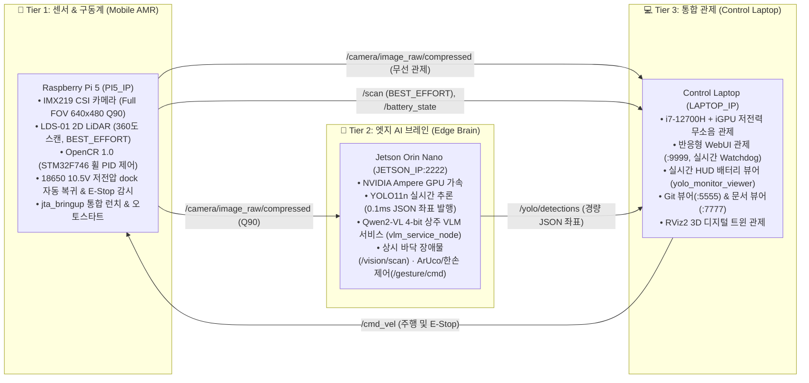

# 🤖 ros2_JTA: 3-Tier 분산 자율주행 & 엣지 AI 로봇 시스템

> **버전**: `v1.4.10` | **점검일**: 2026-11-24  
> **Raspberry Pi 5 + OpenCR 1.0**(하드웨어 센서 I/O & 모터 폐쇄 루프) ↔ **Jetson Orin Nano**(엣지 AI YOLO11 / Qwen2-VL VLM 브레인) ↔ **Control Laptop Host PC**(반응형 WebUI 관제 & iGPU 3D 디지털 트윈 관제)로 구성된 ROS 2 Humble 기반 3-Tier 분산 자율주행 및 물리 AI(Physical AI) 로봇 시스템입니다.

---

## 🏗️ 3-Tier 시스템 아키텍처 (v2.0)



---

## 📊 기기별 핵심 스펙 & 최신 역할 요약표

| Tier | 기기명 | IP&nbsp;/&nbsp;계정 | 주요 역할 | 하드웨어 & 실행 환경 | 핵심 소프트웨어 / 패키지 |
| :---: | :--- | :--- | :--- | :--- | :--- |
| **Tier&nbsp;1** | **Raspberry Pi 5**<br>(+ OpenCR 1.0) | `<PI5_IP>`<br>(`<PI_USER>`) | • 물리 센서 I/O & 모터 제어<br>• `10.5V` 저전압 자동 복귀(`dock`) & E-Stop 감시<br>• 부팅 시 모터 폭주 방지 (토크 잠금)<br>• 무인 자동 기동 (Linger) | • Cortex-A76 8GB RAM<br>• 5.2V 5A DC-DC 벅 컨버터 직결<br>• 언더볼티지 박멸 (`vcgencmd: 0x0`)<br>• Distrobox `humble` (ROS 2 / OpenCR / LiDAR / Nav2) | `jta_bringup` (`robot.launch.py`, `nav2.launch.py`, `patrol_node`)<br>`jta_camera` (CSI 카메라 노드)<br>`hlds_laser_publisher` (LiDAR)<br>`turtlebot3_node` (OpenCR `/dev/ttyACM0`)<br>`nav2_bringup` / `slam_toolbox` |
| **Tier&nbsp;2** | **Jetson Orin Nano** | `<JETSON_IP>:2222`<br>(`<JETSON_USER>`) | • Ampere GPU `yolo11n` 실시간 객체인식<br>• VLM 4-bit NF4 상주 서비스 (`VRAM 1.42GB`)<br>• 상시 바닥 장애물(`/vision/scan`) & ArUco·한손 제어(`/gesture/cmd`) | • 6-Core A78AE + 1024 CUDA Ampere GPU<br>• 8GB RAM + 16GB NVMe Swap<br>• TUI 모드 (OS 400MB) + Docker (`my_ros2_robot`) | `yolo11n` (`yolo11n.launch.py`)<br>`vlm_service_node.py` (`Qwen2-VL` 4-bit 상주)<br>`floor_obstacle_node.py` (OpenCV `/vision/scan`)<br>`gesture_node.py` (`ArUco` + `MediaPipe` ✋/👍) |
| **Tier&nbsp;3** | **Control Laptop**<br>(Host PC) | `<LAPTOP_IP>`<br>(`<LAPTOP_USER>`) | • 반응형 관제 (`/` 기본 맵, `/dashboard` 대시보드)<br>• WebUI 토크·WP·`dock` 지정·위험구간·제스처 Nav2/순찰 제어 & VLM 채팅<br>• iGPU 저전력 HUD 배터리 모니터링<br>• 상주 웹·Foxglove 데몬 | • Intel i7-12700H + 48GB DDR5<br>• MUX OFF 내장 그래픽(iGPU) 무소음 구동<br>• systemd user 상주 데몬 (`:9999`, `:8765`, `:5555`, `:7777`, `:9418`) | `web_monitor_server.py` (:9999, `/`, `/dashboard`)<br>`foxglove-bridge.service` (:8765 + Lichtblick)<br>`yolo_monitor_viewer.py` (HUD 뷰어)<br>RViz2 3D 디지털 트윈 & Nav2 런처 세트 |

* **공통 ROS 2 환경**: ROS 2 Humble Hawksbill (`ROS_DOMAIN_ID=30`)
* **DDS 네트워크 설정**: Wi-Fi 멀티캐스트 드롭 방지 및 단일 장애점(SPOF) 제거를 위한 **CycloneDDS Unicast Peer** (`RMW_IMPLEMENTATION=rmw_cyclonedds_cpp`, `config/cyclonedds.xml`) 3-Tier 통합 적용
* **네트워크 대역폭 최적화**: 단일 영상 스트림 원칙으로 **전체 시스템 트래픽 4~5 Mbps 이내 유지** (100Mbps 공유기 완벽 대응)

---

## 🌐 상주 웹 서비스 및 관제 포트 (Pi 5 `:9999` + 노트북)

Pi 5 시스템 데몬(`/etc/systemd/system/jta-web-monitor.service`)과 노트북 호스트 `systemd --user` 데몬(`Linger=yes`)에 의해 부팅 시 자동 기동되는 핵심 서비스 목록입니다:

| 포트 | 서비스명 | systemd 유닛 / 실행 파일 | 역할 및 접속 주소 |
| :---: | :---: | :--- | :--- |
| **`:9999`** | **JTA&nbsp;WebUI** | Pi 5 [`src/pi5/scripts/jta-web-monitor.service`](src/pi5/scripts/jta-web-monitor.service) (`User=<PI_USER>`, `Restart=always`, `RestartSec=5`, `ExecStartPre`/`ExecStopPost` ➔ [`src/pi5/scripts/inner_webui_launch.sh`](src/pi5/scripts/inner_webui_launch.sh) Distrobox `humble` + CycloneDDS ➔ `~/jta_web/web_monitor_server.py`)<br>[`src/laptop/web/web_monitor_server.py`](src/laptop/web/web_monitor_server.py) | • **데스크톱 / 모바일 반응형 관제 (`/` 기본 맵, `/dashboard` 대시보드)**<br>• **원본 JPEG 패스스루(`/video_feed`) + 브라우저 `<canvas>` YOLO·바닥장애물·ArUco/제스처 배지 오버레이(`/api/yolo`)** + VLM 채팅(TTS)<br>• **`WP 이동`/`위험구간` 2-Tab**, 지정순찰(`custom_order`), **`🔌 충전소 지정`(`set_dock`)**, 👍/✋ 비동기 Nav2·자동순찰 제어, PIN 인증 인터락<br>• 3.0초 단절 감시(Watchdog) 및 OpenCR 단절 시 즉시 **`🔴 OpenCR OFF`** 전환<br>• `http://<PI5_IP>:9999` (Pi 5) / `http://<LAPTOP_IP>:9999` (노트북) |
| **`:5555`** | **Git&nbsp;Web&nbsp;Viewer** | `git-web-viewer.service`<br>`~/.local/bin/git_web_viewer.py` | • Git 커밋 히스토리, 브랜치 트리, 코드 Diff 브라우저 열람<br>• `http://<LAPTOP_IP>:5555` |
| **`:7777`** | **Markdown&nbsp;Docs&nbsp;Viewer** | `md-viewer.service`<br>`~/.local/bin/md_viewer.py` | • `docs/1_master/`, `docs/2_tiers/`, `docs/3_daily_review/` 마크다운 문서 웹 렌더링<br>• `http://<LAPTOP_IP>:7777` |
| **`:9418`** | **Git&nbsp;Network&nbsp;Daemon** | `git-daemon.service`<br>`/usr/lib/git-core/git-daemon` | • Pi 5 및 Jetson에서 비밀번호 없이 초고속 `git clone/pull` 지원 |

---

## 🚀 기기별 원터치 실행 가이드

### 1. 라즈베리파이 5 (`<PI5_IP>`)
> **💡 무인 자동 기동 (`@reboot`)**: Pi 5는 전원 인가 시 `@reboot` [`run_robot_autostart.sh`](src/pi5/scripts/run_robot_autostart.sh) ➔ [`inner_robot_launch.sh`](src/pi5/scripts/inner_robot_launch.sh)(Fail-Safe 토크 잠금) + [`pi5_power_daemon.py`](src/pi5/utils/pi5_power_daemon.py)에 의해 자동 기동됩니다.

* **수동 단축 실행 (필요 시)**:
  ```bash
  # OpenCR 모터 + LDS-01 라이다 + CSI 카메라 원터치 실행
  tb3
  # 또는
  rosgo
  ```
* **수동 프로세스 정지 / E-Stop**:
  ```bash
  bash ~/ros2_JTA/src/pi5/utils/stop.sh
  ```

---

### 2. 젯슨 오린 나노 (`<JETSON_IP>:2222`)
* **1) 도커 컨테이너 진입**:
  ```bash
  cd ~/jetson_ros2_humble && ./run.sh
  ```
* **2) YOLO11n 실시간 추론 노드 실행** (컨테이너 내부):
  ```bash
  ros2 launch yolo11n yolo11n.launch.py
  # ➔ 0.1ms JSON 바운딩박스 토픽(/yolo/detections) 초고속 발행
  ```
* **3) Qwen2-VL 상주 VLM 추론 서비스 실행** (필요 시):
  ```bash
  python3 /root/ros2_ws/src/jetson/vlm_service_node.py
  # ➔ VRAM 1회 상주(Zero-Wait), 640×480 순수 시각 질의응답·TTS 브리핑 및 CLI(/vlm/chat_query) 지원
  ```

---

### 3. 관제 노트북 (`<LAPTOP_IP>`)
* **1) 2D SLAM 지도 작성 & 키보드 주행 (Pi 5 로컬 연산 및 관제)**:
  ```bash
  # Pi 5 로컬 SLAM Toolbox 실행 (SSH 원격 호출)
  bash scripts/run_pi5_slam.sh

  # 키보드 원격 조종 텔레옵 (모터 토크 자동 인가)
  bash scripts/run_teleop.sh

  # 매핑 완료 후 지도 저장 (maps/my_map.*)
  bash scripts/save_map.sh
  ```
* **2) Nav2 자율주행 실행 (Pi 5 로컬 폐쇄 루프)**:
  ```bash
  # Pi 5 로컬 Nav2 자율주행 기동
  bash scripts/run_pi5_nav2.sh

  # 관제 노트북 3D RViz2 디지털 트윈 모니터링
  bash scripts/run_rviz.sh
  ```
* **3) 오프라인 2D 맵 3D RViz2 뷰어 (로봇 미연결 시 단독 열람)**:
  ```bash
  # 로봇 없이 저장된 지도를 RViz2 그리드 정중앙에 즉시 렌더링
  bash scripts/view_map_rviz.sh
  ```
* **4) 모터 긴급 토크 제어**:
  ```bash
  # 모터 토크 강제 해제 (바퀴 굴림 가능)
  bash scripts/motor_disable.sh

  # 모터 토크 재인가 (주행 대기)
  bash scripts/motor_enable.sh
  ```
* **5) 실시간 HUD 뷰어 실행 (바탕화면 바로가기 또는 터미널)**:
  ```bash
  python3 src/laptop/yolo_monitor_viewer.py
  # ➔ YOLO 비전 + 18650 배터리 전압/게이지 + 라이다 실시간 HUD 오버레이
  ```
* **6) iGPU 저전력 관제 도커 진입 (외장 GPU 발열/소음 0%)**:
  ```bash
  cd ~/ros2_humble_docker && ./ros2basic_nonNV.sh
  ```
* **7) RViz2 3D 디지털 트윈 관제** (컨테이너 내부):
  ```bash
  rviz2
  # ➔ /camera/image_raw/compressed (실시간 비전 피드)
  # ➔ /scan (2D LiDAR 점군, BEST_EFFORT)
  # ➔ /tf & /robot_description (로봇 3D 트윈)
  ```

---

## 🛡️ 엔지니어링 헌법 & 하네스 검증

본 프로젝트는 에이전트 및 인간 엔지니어의 안전하고 일관된 협업을 위해 엄격한 **하네스 엔지니어링 헌법([`AGENTS.md`](AGENTS.md))**을 준수합니다.

* **Laziness Protocol**: 불필요한 보일러플레이트를 배제하고 목적에 필요한 가장 정밀한 최소 변경(Minimal Diff)만 적용.
* **Root-Cause Debugging**: `sleep()`이나 임의 버퍼 증설 등 표면 땜질을 금지하고 [DDS ➔ OS/포트 ➔ QoS ➔ 앱 로직] 순으로 근본 원인을 규명.
* **Pre-Clean & Safe E-Stop**: 코드 배포 전 잔류 프로세스 선제 격리 및 모터 비상정지 0.0 속도 5회 발행 보장.
* **로컬 하네스 전체 무결성 검증**:
  ```bash
  python3 scripts/validate_ros2_harness.py
  ```

---

## 📚 기술 문서 포털 및 상세 명세서 목록 (`docs/`)
* 🌟 **[중앙 문서 포털 (Documentation Hub)](docs/INDEX.md)**: 전체 문서 체계 및 바로가기 색인
* 📖 **[3-Tier 통합 마스터 명세서](docs/1_master/master_specification.md)**: 3-Tier 전체 스펙, 통신 구조, 코드 분석, 트러블슈팅 총망라 (PDF 인쇄 지원)
* 🗺️ **[v2.0 고도화 로드맵](docs/1_master/architecture_roadmap_v2.md)**: 전원 분리, Nav2 로컬 폐쇄 루프, 3cm 의자 다리 회피 계획
* 🍓 **[Raspberry Pi 5 & OpenCR 상세 문서](docs/2_tiers/tier1_raspberry_pi5/)**: 하드웨어/전원, OpenCR 모터 제어, jta_bringup 패키지
* ⚡ **[Jetson Orin Nano 상세 문서](docs/2_tiers/tier2_jetson_orin_nano/)**: 하드웨어/TUI, YOLO11n ROS 2 패키지, Qwen2-VL VLM 상주 서비스
* 💻 **[Control Laptop 상세 문서](docs/2_tiers/tier3_control_laptop/)**: iGPU 저전력 관제, WebUI(:9999), HUD 뷰어
* 📝 **[일일 개발 일지 모음](docs/3_daily_review/)**: 날짜별 마일스톤 및 트러블슈팅 상세 내역
