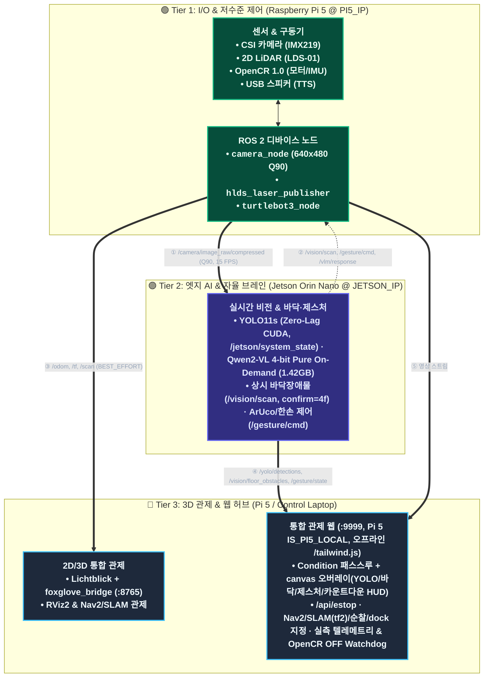
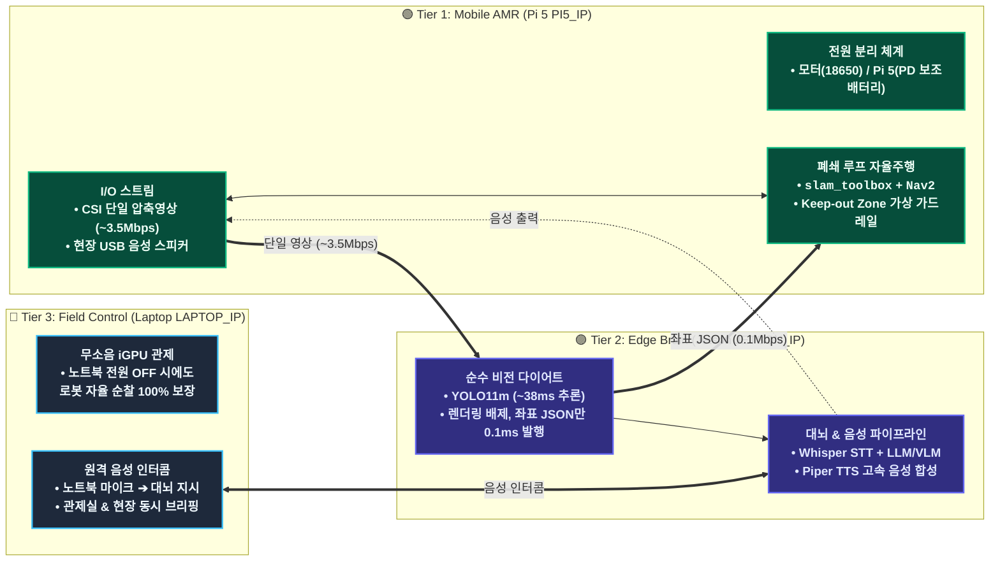

# 🚀 3-Tier 분산 로봇 시스템 종합 스펙 및 기술 아키텍처 마스터 가이드
### (Integrated Master Specification & Technical Architecture Guide)

- **문서 위치**: `docs/1_master/master_specification.md`
- **통합 대상**: Jetson Orin Nano, Raspberry Pi 5 & OpenCR, 관제 노트북(Host PC) 3개 기기의 스펙 및 기능별 분석서 6종 완벽 통합
- **점검일**: 2026-11-24

### 📋 문서 버전 관리 (Document Version Control)
| 문서&nbsp;버전 | 개정&nbsp;일자 | 작성자 | 문서&nbsp;상태 | 변경 및 개정 내역 |
| :---: | :---: | :---: | :---: | :--- |
| `v1.1.0` | 26.10.29 | ROS2_JW | Approved | • CSI Full FOV(640x480) 복원, YOLOv8s 추론 및 압축 스트림/양방향 싱크 구축 |
| `v1.2.0` | 26.11.04 | ROS2_JW | Approved | • 640x480 Q90 카메라, YOLO11s(`conf=0.60`), Qwen2-VL-2B TTS 브리핑 및 Pi 5 Linger 자동 기동 |
| `v1.3.0` | 26.11.09 | ROS2_JW | Approved | • Pi 5 5.2V 5A 전원 검증(`0x0`), 모터 부팅 락, 2D SLAM 지도 및 로컬 Nav2 스택 구축 |
| `v1.3.0` | 26.11.10 | ROS2_JW | Approved | • Qwen2-VL 4-bit NF4 경량화(`VRAM 1.42GB`, `10.80s`) 및 YOLO11n 동시 상주 실증 |
| `v1.4.0~1.4.1` | 26.11.16 | ROS2_JW | Approved | • CycloneDDS Unicast 전환, `jta_bringup` Nav2/AMCL 튜닝, Lichtblick(`:8765`) 및 WebUI(`:9999`) 제어 고도화 |
| `v1.4.2` | 26.11.17 | ROS2_JW | Approved | • `patrol_node` 순찰, WebUI `/map` 3열 가두리·전압바, `foxglove-bridge.service`, AMCL 복구 및 `dmix` 적용 |
| `v1.4.3` | 26.11.17 | ROS2_JW | Approved | • VLM Option A(`448x336`, `32 tokens`, `25s` 쿨다운, `"즉시"` 프레임 추론) 및 전체 문서 정합성 동기화 |
| `v1.4.4` | 26.11.17 | ROS2_JW | Approved | • Nav2 로컬 컨트롤러 `MPPIController` 전환 (`batch_size: 600`, `time_steps: 25`, `vx_min: -0.10`) |
| `v1.4.5` | 26.11.18 | ROS2_JW | Approved | • MPPI 실주행 검증, Costmap 좁은 틈 완화, Keepout/Speed 필터 스캐폴딩, WebUI `/map` 단일 WP·브레이크·모터 ON 복구 |
| `v1.4.6` | 26.11.18 | ROS2_JW | Approved | • WebUI `/` 기본 맵·2-Tab·대시보드 3단 VLM 채팅(TTS), Jetson VLM `640×480` 순수 시각 우선 및 CLI(`/vlm/chat_query`) 분리 |
| `v1.4.7` | 26.11.19 | ROS2_JW | Approved | • Nav2 `behavior_server` 정정·좁은공간 탈출 튜닝(`robot_radius 0.145`), `my_map_261113.pgm` 정리·확장<br>• 최단거리/선택 WP/3초확정 음성·20초 추종(40초 쿨다운, IDLE 포함), WebUI `LOCALIZING`·배지 교정 |
| `v1.4.8` | 26.11.20 | ROS2_JW | Approved | • WebUI 원본 JPEG 패스스루 + `<canvas>` YOLO 오버레이, `IS_PI5_LOCAL` Pi 5(`:9999`) 이전<br>• 지정순찰(`custom_order`)·부팅 볼륨(`80%→95%`)·`1.7m` 통일 |
| `v1.4.9` | 26.11.23 | ROS2_JW | Approved | • 상시 바닥장애물(`/vision/scan`), ArUco 카드(`0~10`)+한손(✋/👍) Nav2·자동순찰 제어, `10.5V` 저전압 `dock` 복귀<br>• `OpenCR OFF` UI 교정 및 `1.2m/30s/50s` 통일 |
| `v1.4.10` | 26.11.24 | ROS2_JW | Approved | • Pi 5·Jetson 실기 스크립트/설정/마스크 1:1 백업 & `launch_yolo11n.sh` 동기화 배포<br>• `speaker_node.py` `~/music/song` 랜덤 부팅곡+인트로 TTS 및 `dobingda.mp3` Edge-TTS 안내 음성 대체 |
| `v1.4.11` | 26.11.24 | ROS2_JW | Approved | • Nav2 `local_costmap` `vision_obstacle_layer` 분리, `MPPI` `CostCritic: 4.0`/`PathAlign: 9.0`<br>• `floor_obstacle_node` `beam_hold_sec=0.0`·`lateral_padding_m=0.03` 및 `process_specification.md` 신설 |
| **`v1.4.12`** | 26.11.24 | **ROS2_JW** | **Approved** | • 3-Tier 안전 핫픽스(`stop.sh` CycloneDDS·`patrol_node` 우측 라이다/`goal_seq`/저전압·WebUI `/api/estop`·`run_robot_autostart.sh`)<br>• VLM Pure On-Demand·오프라인 `/tailwind.js`·실측 텔레메트리(`/pi5/system_state`·`/jetson/system_state`)·Nav2 `20Hz`/`base_footprint`·바닥감도(`confirm=4f`, `raytrace 0.0`)·사람 카운트다운 HUD·`dobingda0.mp3 ➔ dobingda.mp3` 순차재생 반영 |
| `v2.0.0` | (예정) | ROS2_JW | 계획&nbsp;(Planned) | • 3cm 의자 다리 Sim2Real 회피 및 침입자 2.0m 추적 주행 |

---

# 📑 목차 (Table of Contents)
1. [시스템 총괄 개요 및 3-Tier 분산 아키텍처](#1-시스템-총괄-개요-및-3-tier-분산-아키텍처)
2. [분산 통신 네트워크 인프라 (CycloneDDS Unicast Peer)](#2-분산-통신-네트워크-인프라-cyclonedds-unicast-peer)
3. [[Tier 1] 센서 I/O 및 실시간 액추에이터 제어 허브 (Raspberry Pi 5 & OpenCR)](#3-tier-1-센서-io-및-실시간-액추에이터-제어-허브-raspberry-pi-5--opencr)
4. [[Tier 2] 엣지 AI 연산 및 자율 판단 브레인 (Jetson Orin Nano)](#4-tier-2-엣지-ai-연산-및-자율-판단-브레인-jetson-orin-nano)
5. [[Tier 3] 3D 디지털 트윈 관제 & HMI 허브 (관제 노트북 Host PC)](#5-tier-3-3d-디지털-트윈-관제--hmi-허브-관제-노트북-host-pc)
6. [원터치 기기별 기동 명령어 치트시트 (Cheatsheet)](#6-원터치-기기별-기동-명령어-치트시트-cheatsheet)
7. [차세대 자율 순찰 & 멀티모달 음성·비전 로드맵 (v2.0 Target Architecture)](#7-차세대-자율-순찰--멀티모달-음성비전-로드맵-v20-target-architecture)

---

# 1. 시스템 총괄 개요 및 3-Tier 분산 아키텍처

본 로봇 시스템은 단일 기기가 겪는 **전력 한계, 발열 스로틀링, CPU/GPU 병목**을 극복하기 위해 물리적·기능적으로 특화된 **3단계 분산 노드 토폴로지**로 구축되었습니다.



### 📊 3개 기기 한눈에 보는 비교 총괄표

| 비교 항목 | Tier 1: Raspberry Pi 5 & OpenCR | Tier 2: Jetson Orin Nano | Tier 3: 관제 노트북 (Host PC) |
| :--- | :--- | :--- | :--- |
| **IP / SSH 포트** | `<PI5_IP>:22` (`<PI_USER>`) | `<JETSON_IP>:2222` (`<JETSON_USER>`) | `<LAPTOP_IP>` (`<LAPTOP_USER>`, Local) |
| **핵심 역할** | 센서 I/O, 모터 구동, 오도메트리 | 실시간 비전 AI(YOLO), 자율 회피 판단 | 3D 디지털 트윈 관제, HMI, LLM 확장 |
| **메인 프로세서** | Broadcom BCM2712 (Cortex-A76) | 6-Core ARM Cortex-A78AE (1.72 GHz) | Intel Core i7-12700H (14C/20T, 4.7GHz) |
| **가속기 (GPU)** | VideoCore VII (딥러닝 부재) | **NVIDIA Ampere (1024 CUDA 코어)** | **NVIDIA RTX 4070 Laptop (8GB GDDR6)** |
| **RAM (메모리)** | **8GB LPDDR4X** (가용 7.4 GiB) | **8GB LPDDR5** (가용 6.3 GiB, 통합 메모리) | **48GB DDR5** (가용 43 GiB, 초대용량) |
| **스토리지** | 16GB MicroSD (여유 5.1GB) | Micron 512GB NVMe SSD (여유 370GB) | 512GB PCIe NVMe SSD (여유 233GB) |
| **호스트 OS** | Ubuntu 24.04.5 LTS | Ubuntu 24.04.5 LTS (L4T R39.2.1) | Linux Mint 22.3 (Ubuntu 24.04 Noble) |
| **ROS 가상화** | **Distrobox** (`humble`) | **Docker** (`my_ros2_robot:humble`) | **Docker** (`ros2-humble-gazebo:latest`) |
| **통신 미들웨어** | CycloneDDS Unicast (`DOMAIN_ID=30`) | CycloneDDS Unicast (`DOMAIN_ID=30`) | CycloneDDS Unicast (`DOMAIN_ID=30`) |

---

# 2. 분산 통신 네트워크 인프라 (CycloneDDS Unicast Peer)

### 🚨 Wi-Fi 공유기 환경의 고질적 문제와 해결책
기본 ROS 2(DDS)는 멀티캐스트(`239.255.0.1`)를 통해 노드를 자동 탐색합니다. 그러나 **상용 Wi-Fi 공유기는 무선 트래픽 폭주를 막기 위해 멀티캐스트 패킷을 강제로 드랍하거나 필터링**합니다. 또한 기존 FastDDS Discovery Server 방식은 단일 장애점(SPOF) 및 비정상 인터페이스(APIPA) 바인딩 문제를 유발했습니다.

### 🛠️ CycloneDDS 유니캐스트(`config/cyclonedds.xml`) 피어링 구축
이를 해결하기 위해 `RMW_IMPLEMENTATION=rmw_cyclonedds_cpp`로 전환하고, `<LAN_SUBNET>` 서브넷 인터페이스 고정 및 멀티캐스트 전면 차단(`AllowMulticast=false`) 기반의 **1:1 유니캐스트 UDP 피어링 프로파일**을 구성했습니다.

```xml
<?xml version="1.0" encoding="UTF-8" ?>
<CycloneDDS xmlns="https://cdds.io/config">
    <Domain id="any">
        <General>
            <Interfaces>
                <NetworkInterface address="<LAN_SUBNET>"/>
            </Interfaces>
            <AllowMulticast>false</AllowMulticast>
            <MaxMessageSize>65500B</MaxMessageSize>
        </General>
        <Discovery>
            <ParticipantIndex>auto</ParticipantIndex>
            <MaxAutoParticipantIndex>100</MaxAutoParticipantIndex>
            <Peers>
                <Peer address="127.0.0.1"/>
                <Peer address="<LAPTOP_IP>"/>
                <Peer address="<JETSON_IP>"/>
                <Peer address="<PI5_IP>"/>
            </Peers>
        </Discovery>
    </Domain>
</CycloneDDS>
```

- **효과**: 중앙 Discovery Server SPOF 제거, Jetson APIPA 격리 해결, `ROS_DOMAIN_ID=30` 격리 및 3-Tier 15 FPS 비전/YOLO 안정 통신 달성.

---

# 3. [Tier 1] 센서 I/O 및 실시간 액추에이터 제어 허브 (Raspberry Pi 5 & OpenCR)

### 3.1 하드웨어 및 OpenCR 1.0 보드 스펙
- **Raspberry Pi 5**: Broadcom BCM2712, 8GB LPDDR4X, 16GB MicroSD, 54.3°C 안정 동작.
- **OpenCR 1.0 (ROBOTIS Open-source Control Module for ROS)**:
  - **메인 MCU**: **STMicroelectronics STM32F746ZGT6** (32-bit ARM Cortex-M7 with FPU, **216 MHz**, 1MB Flash, 320KB SRAM).
  - **인터페이스**: USB CDC ACM 가상 시리얼 (`/dev/ttyACM0`, **1,000,000 bps**).
  - **역할**: 마이크로초 단위의 엄격한 하드 실시간 모터 PID 속도 제어, IMU 6축 퓨전, 엔코더 오도메트리 연산, 배터리 ADC 감지.
- **LDS-01 2D LiDAR**: Silicon Labs CP2102 USB-to-UART 브릿지 (`/dev/ttyUSB0`, 115200 bps).
- **Sony IMX219 CSI 카메라**: Raspberry Pi RP1 I/O 칩셋 직결 10-bit Raw Bayer 센서.

### 3.2 OpenCR Waffle Core 펌웨어 메커니즘
1. **기동 시 자이로 바이어스 영점 캘리브레이션 (5초 정지 측정)**으로 누적 회전 오차 최소화.
2. `DynamixelSDKWrapper`를 통한 다이나믹셀 모터 패킷 교환 및 차동 구동 역기구학 연산:
   $$v_{left} = v - \frac{\omega \cdot W}{2}, \quad v_{right} = v + \frac{\omega \cdot W}{2}$$
3. 실시간 토픽 발행: `/odom`(오도메트리), `/imu`(6축 관성), `/battery_state`(11.1V 배터리 전압), `/joint_states`(바퀴 엔코더).

### 3.3 전원부 업그레이드 및 언더볼티지 박멸 (5.2V 5A DC-DC 벅 컨버터)
- **과거 문제**: 초기 5V 3A 어댑터/보조배터리 구동 시 RPi5(Cortex-A76 4코어 2.4GHz 풀로드 시 2.5A+) + 라이다 모터 + 카메라 + USB 오디오가 동시 가동될 때 순간 전압 강하로 언더볼티지 경고(`0x50000`) 및 USB 포트 600mA 락 현상 발생.
- **최종 전원 솔루션 실측 및 검증 (2026-11-09)**:
  1. **배터리 직결 5.2V 5A DC-DC 벅 컨버터 전원 투입**: 고방전 18650 팩에서 강압하여 Pi 5 전원 포트에 직접 공급.
  2. `vcgencmd get_throttled`: **`0x0` (완벽한 정상 상태 확인, 언더볼티지/스로틀링 이력 0건)**.
  3. `/boot/firmware/config.txt`에 **`usb_max_current_enable=1`** 적용: USB 전류 공급 한도를 1.6A(1,600mA) 풀 파워로 개방하여 LiDAR, OpenCR, USB 오디오 동시 구동 시 전압 강하 원천 차단.

### 3.4 모터 부팅 폭주 방지 Fail-Safe 가드레일 (2026-11-09 신설)
- **현상**: OpenCR 1.0 부팅 직후 자이로 센서 캘리브레이션이 완료되면서 모터 토크가 켜질 때 잔류 목표 속도 버퍼 및 시리얼 노이즈로 인해 실물 바퀴가 급격히 자체 회전하는 위험 포착.
- **Fail-Safe 조치**:
  1. 부팅 런처(`inner_robot_launch.sh`): OpenCR 기동 직후 속도 `0.0` 정지 패킷을 5회 연속 주입하고 `/motor_power` 서비스(`data=false`)를 호출하여 기본 모터 토크를 잠금(Torque OFF).
  2. 비상 제어 스크립트: `scripts/motor_enable.sh` (토크 ON), `scripts/motor_disable.sh` (토크 OFF) 구축.
  3. 관제 WebUI(:9999) 연동: OpenCR 모터 토크 상태 실시간 구독 및 웹 원터치 락/언락 API (`POST /api/motor/torque`) 제공.

### 3.5 CSI 카메라 초저지연(Zero-Lag) 파이프라인 (`jta_camera`)
- **RP1-CFE 직접 제어 및 동적 탐색**: `libcamera` 대신 `media-ctl` + `v4l2-ctl`로 `SBGGR8_1X8` / `BA81` 파이프라인을 직접 구성하며, 재부팅 시 변경되는 `/dev/media*`, `/dev/v4l-subdev*` 및 IMX219 엔티티명(`get_imx219_info()`)을 동적 탐색합니다.
- **하드웨어 가속 및 안정화 (`v1.4.12`)**: 상하좌우 반전은 V4L2 레지스터(`horizontal_flip`, `vertical_flip`, CPU 부하 0%)로 처리하고 `cv2.LUT` 화이트밸런스를 적용합니다. `time.monotonic()` 프레임 페이싱, `rclpy.spin_once(self, timeout_sec=0.0)` 논블로킹 스핀, 종료 시 `proc.wait(timeout=2.0)` + `kill()`로 NTP 시간 점프 및 좀비 프로세스를 차단했습니다.
- **표준 스트림 계약**: `640x480` 해상도, `15 FPS`, JPEG Quality `90`(`/camera/image_raw/compressed`)으로 송출하며, 비압축 `/camera/image_raw`는 구독자 존재 시에만 On-Demand 발행하여 CPU/열 부하를 억제합니다.

### 3.6 Nav2 자율주행 · 순찰 · 안전 가드레일 & 실측 전원 감시 (`jta_bringup`, `v1.4.7~v1.4.12`)
- **Nav2 정밀 튜닝 (`nav2_params.yaml`)**: `MPPIController` (`vx_max: 0.16`, `vx_min: -0.10`, Critics 8종, `CostCritic: 4.0`, `PathAlignCritic: 9.0`), `local_costmap` Dual Layer 분리(`obstacle_layer` `/scan` + `vision_obstacle_layer` `/vision/scan` `combination_method: 1`, `obstacle 0.20~1.50m`, `raytrace 0.0~1.8m`, `inflation_radius: 0.25`, `cost_scaling_factor: 7.0`), `waypoint_follower.loop_rate: 20` 및 전 모듈 `robot_base_frame: base_footprint` 통일(Galactic 레거시 키 제거).
- **자율 순찰·추종 & 안전 상태 머신 (`patrol_node.py`)**:
  - 다중/선택/지정순찰(`custom_order`) 및 `/gesture/cmd` 수신 시 ArUco `ESTOP`(Goal 취소·정지·TTS) 및 `GOTO_WP`(등록 WP 1~10 단일 이동·도착 TTS) 실행.
  - `_scan_cb()`에 `math.atan2(math.sin(angle), math.cos(angle))` 정규화를 적용해 LDS-01 우측 전방(`335~359°`) 사각지대를 해소하고, `goal_seq`/`kind` 추적으로 `DOCK_RETURN`/`GOTO_WP` 경합 및 저전압·단일이동 중 사람 추종 오진입을 차단했습니다.
  - 사람 근접 `1.2m (bh >= 250px)` `3.0초` 연속 감지 확정 시 `30초` 비주얼 서보잉 추종(종료 시 `"추적을 종료합니다."` TTS + `/play/sound "stop"` 발행, 확정 시점 기준 `50초` 쿨다운).
  - `/battery_state`가 `9.0V < V <= 10.5V` 구간에서 `5.0초` 연속 지속 시 1회 래치(`low_volt_returning`) 후 `patrol.dock` 좌표로 자율 복귀(`DOCK_RETURN` / `DOCKED` + TTS, `11.5V` 회복 시 래치 해제). `SignalHandlerOptions.NO` + `SIGTERM`/`SIGINT` 핸들러로 종료 시 `stop_robot()` 5회 발행을 보장합니다.
- **오디오·세레머니 (`speaker_node.py`)**: `amixer -c UACDemoV10`(폴백 `-c 0`) + `plug:dmix` + Edge-TTS(`ko-KR-SunHiNeural`, `8.0s` 타임아웃, 원자적 오디오 프로세스 교체). 부팅 시 `~/music/song` 무작위 선곡 ➔ `80%` *"노래 한 곡 듣고 가시죠."* 인트로 TTS + `1.0s` ➔ 완곡 재생 ➔ `95%` *"시스템을 동작합니다."* 발화. 사람 근접 `dobingda` 요청 시 `dobingda0.mp3`(Edge-TTS 4단 안내) 완곡 후 `dobingda.mp3`를 순차 재생하며 `"stop"` 신호 시 즉시 취소합니다.
- **실측 전원 감시 & 비상정지 (`pi5_power_node.py`, `stop.sh`, `run_robot_autostart.sh`)**: `pi5_power_node.py`가 `/pi5/system_state`(1Hz JSON)로 `vcgencmd get_throttled` 실측 비트마스크와 한국어 상태를 발행하며(실기 검증에서 `5.18V` 정상 전압 하 `84.0°C` 열 쓰로틀링 `0xe0006` 즉시 포착), `stop.sh`는 CycloneDDS 환경·0.35s 매칭 대기 후 `/motor_power false`·`/patrol/set_enabled false`·Action 취소·`/cmd_vel 0.0` ×5×2를 실행합니다. `run_robot_autostart.sh`는 중복 실행 체크(`pgrep`)를 플래그 삭제·`fuser -k` 이전 최상단으로 배치해 기동 중 충돌을 차단했습니다.

---

# 4. [Tier 2] 엣지 AI 연산 및 자율 판단 브레인 (Jetson Orin Nano)

### 4.1 하드웨어 및 Docker 스펙
- **SoC / 보드**: **NVIDIA Jetson Orin Nano Developer Kit Super (8GB)**.
- **CPU**: **6-Core ARM Cortex-A78AE** (Automotive Enhanced 고신뢰성 코어, 최대 1.72 GHz).
- **GPU**: **NVIDIA Ampere 아키텍처 (1024 CUDA 코어 + 32 Tensor 코어)**.
- **RAM**: **8GB LPDDR5** (가용 6.3 GiB, CPU-GPU Zero-Copy Unified Memory).
- **스토리지**: Micron 2400 512GB PCIe Gen4 NVMe (여유 370GB).
- **전력 모드**: **`MAXN_SUPER (Mode 2)`** (45W 정품 단독 어댑터 분리 필수).
- **Docker 컨테이너 (`my_ros2_robot:humble`, `ros2_humble_dev`)**:
  - `--runtime nvidia`: 호스트 Ampere GPU 직접 제어.
  - `--net=host`: DDS 브리지 오버헤드 제로화.
  - `-v <JETSON_HOME>/ros2_ws:/root/ros2_ws`: 실시간 워크스페이스 마운트.

### 4.2 정식 YOLO11 패키지 (`yolo11n`) & 시스템 텔레메트리
- **Zero-Lag 프레임 스킵 & 실기 표준 (`src/jetson/yolo11n/yolo11n/detector_node.py`, `yolo11n.launch.py`)**: 이전 프레임 추론 중 신규 프레임 수신 시 `self.processing` 가드로 즉시 드롭(`depth=1`, CUDA:0). 실기 표준 기본값은 **`/root/ros2_ws/yolo11s.pt`, `imgsz=640`, `conf=0.60`**으로 통일했으며, 런치 인자로 경량 `yolo11n.pt`/`480` 전환이 가능합니다.
- **경량 JSON & 2초 주기 `/jetson/system_state`**: 기본 `publish_annotated=False`로 `/yolo/detections`(0.1ms JSON)만 발행하며, `/proc/meminfo` + thermal zone을 읽어 RAM/Swap/온도를 `/jetson/system_state` JSON으로 발행합니다(실측 `4.6/7.3 GB`, Swap `25 MB/16.0 GB`, `67.9°C`).

### 4.3 온디바이스 VLM Pure On-Demand 서비스 (`vlm_service_node.py`, `v1.4.12`)
- **`Qwen2-VL-2B-Instruct` 4-bit NF4 Pure On-Demand 상주**: VRAM **`1.42GB`** 상주 상태를 유지하되 `background_loop_enabled=False`로 25초 주기 GPU 공회전을 제거해 대기 발열과 GPU 경합을 없앴습니다.
- **Lazy JPEG 디코딩 & 비차단 락**: `camera_callback`은 원시 JPEG 바이트만 저장하고 실제 추론 시에만 `frame_lock` 밖에서 1회 디코딩하며, 비차단 `inference_lock`으로 중복 요청을 즉시 드롭합니다.
- **이원화 아키텍처**: YOLO `person` (`conf >= 0.50`, `h >= 250px`, `time.monotonic()`) 3초 확정 시 `dobingda`(`dobingda0.mp3 ➔ dobingda.mp3`) 재생(50초 쿨다운), 수동 `/vlm/trigger` 시 `640×480`·`max_new_tokens=40`·`allow_person_alert=False` 순수 시각 우선 브리핑(`/vlm/response`), CLI 전용 `/vlm/chat_query` ↔ `/vlm/chat_response` 분리.

### 4.4 상시 바닥 장애물 · 제스처 & 네트워크 페일오버 (`floor_obstacle_node.py`, `gesture_node.py`, `network_failover.py`, `v1.4.12`)
- **전 구간 상시 바닥 장애물 (`floor_obstacle_node.py`)**: `/yolo/zone_enable`과 무관하게 OpenCV LAB 색차(`chroma_thresh=18.0`) + 명도·에지(`luma_thresh=38.0`, `min_area_px=650`, `roi_top_ratio=0.58`, 밝은 바닥 반사광 억제 `dL_signed > luma_thresh * 1.7`) + YOLO 하단 좌표 보너스를 결합해 4프레임 연속 확정(`confirm_frames=4`)·`beam_hold_sec=0.0`·`lateral_padding_m=0.03`으로 전방 `±33°` 67빔 `LaserScan`(`/vision/scan`, `BEST_EFFORT`) 및 `/vision/floor_obstacles` JSON을 발행합니다.
- **ArUco 숫자 카드 + 한 손 Nav2 제어 (`gesture_node.py`)**: `DICT_4X4_50` ArUco 카드(`ID 0=ESTOP 0.25s`, `ID 1~10=GOTO_WP 0.8s`, A4 11장 [`docs/aruco_wp_cards.pdf`](../aruco_wp_cards.pdf))와 `MediaPipe Hands`(`model_complexity=1`, `mp_frame_stride=2`, 손가락 굽힘 히스테리시스 `>1.15` 펼침 / `<=1.05` 굽힘) 한 손 펼침(`✋`, `1.5s` ➔ `NAV2_STOP`) / 엄지척(`👍`, `2.0s` ➔ `NAV2_START`)을 `/gesture/cmd`·`/gesture/state`로 발행합니다.
- **유무선 IP 자동 전환 (`network_failover.py`)**: Wi-Fi 페일오버 시 유선 인터페이스(`enP8p1s0`)의 잔류 `<JETSON_IP>/24` 주소를 삭제하고 `time.monotonic()` 디바운스·정확한 프리픽스 검사(`f"{ip}/"`)로 라우팅 충돌을 방지합니다.

---

# 5. [Tier 3] 3D 디지털 트윈 관제 & HMI 허브 (관제 노트북 Host PC)

### 5.1 하드웨어 물리 사양
- **CPU**: **12th Gen Intel Core i7-12700H** (14코어 20스레드, 6P+8E 하이브리드, 최대 4.70 GHz).
- **RAM**: **48 GB DDR5** (가용 43 GiB, SLM/LLM 모델 및 3D 렌더링을 수용하는 초대용량).
- **GPU**: **NVIDIA GeForce RTX 4070 Laptop (8GB GDDR6)**, Driver 595.99.02, CUDA 13.2.
- **스토리지**: Micron 512GB PCIe NVMe SSD (여유 233GB).
- **OS**: Linux Mint 22.3 (Zena) 64-bit (Ubuntu 24.04 Noble 기반).

### 5.2 Docker 관제 환경 및 GPU GUI 오프로딩 (`ros2basic.sh`)
- **외장 GPU 강제 지정**: `--gpus all` 및 `-e __NV_PRIME_RENDER_OFFLOAD=1 -e __GLX_VENDOR_LIBRARY_NAME=nvidia` 플래그로 인텔 내장 그래픽 대신 RTX 4070으로 RViz2 3D 렌더링을 60 FPS 이상으로 하드웨어 가속.
- **X11 소켓 포워딩**: `-v /tmp/.X11-unix:/tmp/.X11-unix`와 `QT_X11_NO_MITSHM=1`로 렌더링 충돌 없이 호스트 화면으로 디스플레이.

### 5.3 Gazebo 가상 시간(`/clock`) vs 실로봇 현실 시간(Wall-clock) 충돌 해결
- **문제**: 시뮬레이션용 스크립트(`rros2gaz.sh`)에서 Gazebo가 가상 시간(`/clock`)을 발행하고 있어, 실로봇(RPi5)의 현실 시간 타임스탬프와 충돌 발생 ➔ TF2 버퍼 오류(`Extrapolation into the future`) 및 **RViz2 화면 10초 주기 프리징**.
- **해결**: 실로봇 운용 전용 런처 **`ros2basic.sh`**를 작성하여 Gazebo 프로세스를 완전히 제거하고 현실 세계 시간(`use_sim_time:=false`)으로 고정하여 화면 깜빡임과 프리징을 100% 박멸.

### 5.4 향후 확장: 온디바이스 SLM / LLM 자연어 작업 계획
- 48GB 고용량 메모리와 RTX 4070 GPU를 활용하여 노트북에서 **Ollama (Llama-3, Mistral 7B)**를 직접 구동.
- Jetson의 `/yolo/detections` 토픽을 실시간 수신하여 자연어 명령(*"책상 위 컵 찾아가기"*)을 로봇 Nav2 주행 목표 좌표로 변환하는 상위 플래너 확장 준비 완료.

### 5.5 호스트 · Pi 5 상주 웹 서비스 및 관제 인프라
- **JTA WebUI (`:9999`, `jta-web-monitor.service`, `v1.4.12`)**: `/etc/systemd/system/jta-web-monitor.service` (레포 백업: `src/pi5/scripts/jta-web-monitor.service`, `User=<PI_USER>`, `Restart=always`, `RestartSec=5`, `ExecStartPre`/`ExecStopPost` 포트 정리 ➔ `src/pi5/scripts/inner_webui_launch.sh` Distrobox `humble` CycloneDDS·ROS 2 로드 ➔ `~/jta_web/web_monitor_server.py`) 기반 **Pi 5(`http://<PI5_IP>:9999`) 단독 상시 호스팅**(`IS_WEB_MASTER` 게이트로 노트북 WebUI와 제스처 중복 충돌 방지). 로컬 `/tailwind.js`(398KB) 100% 오프라인 동작, `threading.Condition` 이벤트 기반 원본 JPEG 패스스루(`/video_feed`) + 브라우저 `<canvas>`(`yolo_overlay.js`: YOLO + 바닥장애물 + 제스처 배지 + 사람 감지 카운트다운 HUD `3s/30s/50s`), `POST /api/estop` 원자적 비상정지, `mtime` 캐싱, SLAM `tf2_ros` 폴백, Keepout 선분 폭 `0.15m` 정합, `turn_seq` 경합 방지, `/` 실시간 2D 맵(`WP`/`위험구간` 2-Tab, `custom_order`, `🔌 충전소 지정`), `/dashboard` 3단 VLM 채팅(TTS), 👍/✋ 비동기 제어, `3.0초` 단절 감시(`🔴 OpenCR OFF`) 및 실측 `/pi5/system_state`·`/jetson/system_state` 텔레메트리 표출.
- **노트북 호스트 상주 인프라 (`systemd --user`, `Linger=yes`)**:
  1. **Lichtblick + `foxglove_bridge` (`:8765`, `foxglove-bridge.service`)**: 2D/3D Nav2·SLAM 전용 관제(`config/lichtblick_nav2_slam.json`).
  2. **Git Web Viewer (`:5555`)** & **Markdown Docs Viewer (`:7777`)** & **Git Network Daemon (`:9418`)**.

---

# 6. 원터치 기기별 기동 명령어 치트시트 (Cheatsheet)

### 1) 🍓 Raspberry Pi 5 (`<PI5_IP>`) - 센서·Nav2·WebUI 기동
```bash
# 1. 로봇 통합 브링업 (OpenCR + LDS-01 + jta_camera + speaker_node + pi5_power_node)
distrobox enter humble -- bash -c "source /opt/ros/humble/setup.bash && source ~/ros2_ws/install/setup.bash && export ROS_DOMAIN_ID=30 RMW_IMPLEMENTATION=rmw_cyclonedds_cpp CYCLONEDDS_URI=file://<PI_HOME>/cyclonedds.xml && ros2 launch jta_bringup robot.launch.py"

# 2. Nav2 + patrol_node 자율주행 (또는 :9999 WebUI / 👍 엄지척)
ros2 launch jta_bringup nav2.launch.py

# 3. WebUI 상시 서비스 상태 확인 & 비상 정지
systemctl status jta-web-monitor.service
<PI_HOME>/stop.sh
```

### 2) 🤖 Jetson Orin Nano (`<JETSON_IP>:2222`) - AI 브레인 기동
```bash
# 1. 통합 자동 기동 스크립트 (VLM 4-bit + floor_obstacle_node + gesture_node + yolo11n)
docker exec -d ros2_humble_dev bash -c '/root/ros2_ws/launch_yolo11n.sh > /root/ros2_ws/yolo11n_autostart.log 2>&1'
```

### 3) 💻 관제 노트북 (`<LAPTOP_IP>`) - 3D 관제 & 하네스 검증
```bash
# 1. 무소음 iGPU 관제 도커 진입 & Lichtblick(:8765) / RViz2
cd ~/ros2_humble_docker && ./ros2basic_nonNV.sh

# 2. 로컬 하네스 검증 & 3-Tier 원격 코드 동기화
python3 scripts/validate_ros2_harness.py
bash scripts/sync_to_robot.sh all
```

---

# 7. 차세대 자율 순찰 & 멀티모달 음성·비전 로드맵 (v2.0 Target Architecture)

> **📌 아키텍처 구분**: 1~6장은 현재 구현 완료되어 동작 중인 베이스라인(`v1.4.12`) 명세이며, 본 7장은 **차기 단계로 확정된 24시간 독립 자율 순찰·트래픽 다이어트·양방향 음성 AI 통합 미래 계획(To-Be Roadmap)**입니다.



### 1) 3-Tier 하드웨어 역할 재정의 및 트래픽·전력 다이어트 매트릭스

| 계층&nbsp;(Tier) | 전원&nbsp;구성 | 핵심 전환 내역 (To-Be) | 엔지니어링 기대 효과 |
| :--- | :---: | :--- | :--- |
| **Tier 1**<br>(Raspberry Pi 5 + OpenCR) | 모터(18650) +<br>**Pi 5(5.2V 5A 벅 컨버터 직결)** | • **`slam_toolbox` + `Nav2`** 자율주행 패키지 및 지도 획득 완료<br>• 모터 부팅 폭주 방지 가드레일 (토크 기본 OFF)<br>• 현장용 USB 미니 스피커 장착<br>• 압축 영상 1회 발행 (~3.5 Mbps) | • 언더볼티지 박멸(`vcgencmd 0x0`) 및 USB 1.6A 풀 공급<br>• **Wi-Fi가 끊겨도 로봇 혼자 안전 회피·정지하는 로컬 폐쇄 루프 AMR 완성** |
| **Tier 2**<br>(Jetson Orin Nano) | **220V 상시 전원**<br>(전력 제약 없음) | • **YOLO11m (~38ms)** 박스 렌더링(`plot`) 및 영상 재전송 전면 폐지 ➔ **좌표 JSON만 0.1ms 발행**<br>• **Whisper STT + LLM/VLM + Piper TTS** 탑재 | • CPU 부하 및 오버커런트 피크 완벽 제거<br>• 220V 상시 전원을 활용해 고연산 비전+음성+LLM 대뇌 역할 전담 |
| **Tier 3**<br>(Control Laptop) | 상시/배터리<br>**(내장 iGPU 전용)** | • 외장 GPU(RTX 4070) 배제 ➔ **무소음·저발열 iGPU 구동**<br>• WebUI(:9999) 모터 토크 실시간 원격 제어 탑재<br>• Nav2 자율주행 관제 런처 세트 가동 | • **의존도 제로(Zero-Dependency)**: 노트북을 덮거나 꺼도 Pi 5 + 젯슨 2대만으로 24시간 독립 순찰 유지 |

### 2) 실제 주행 지형 특성 및 경사로 낙상(음의 장애물) 방어 설계

1. **20평(약 66㎡, 약 8m × 8m) 컴퓨터실**:
   * 가림막 없는 개방형 구조로 LDS-01 라이다(반경 3.5m) 및 5GHz Wi-Fi 가시거리(LOS) 100% 확보 (음영 구역 0%).
   * 고정된 책상과 컴퓨터 본체가 견고한 2D SLAM 특징점(Landmark) 역할 수행.
2. **2m × 2m 인접 작업실**:
   * 관제 책상이 위치한 공간으로, 터틀봇3의 제자리 360도 회전 반경(15~20cm)을 활용해 여유로운 도킹 및 주차 수행.
3. **경사로(언덕) 및 단차 낙상 위험 구간 3중 방어**:
   * **문제점**: 컴퓨터실과 작업실 경계의 경사로 옆 단차(낭떠러지)는 2D 라이다가 허공을 조준하여 '뚫린 길'로 오인하는 **음의 장애물(Negative Obstacle)** 위험이 존재함.
   * **해결책**:
     1. 최초 매핑 시 조이스틱 수동 조종(Teleop)으로 안전거리를 유지하며 지도 생성.
     2. 1층에서 단차 옆면을 '벽'으로 스캔한 절대좌표를 기준으로, 완성된 맵 위에 **`Nav2 Keep-out Zone` (가상 가드레일, 두께 10cm)**을 그어 로봇이 경사로 정중앙으로만 통행하도록 강제.
     3. OpenCR 6축 IMU의 피치(기울기) 각도를 감지하여 경사로 진입 시 자동 감속(Slow-down) 제어.

### 3) 네트워크 트래픽 다이어트 (아이피타임 604 / 100M급 공유기 완벽 대응)

* **DDS 유니캐스트 고정**: `ROS_DOMAIN_ID=30`, `RMW_IMPLEMENTATION=rmw_cyclonedds_cpp`, `config/cyclonedds.xml` 기반 1:1 유니캐스트 피어링(`<LAPTOP_IP>, <JETSON_IP>, <PI5_IP>`)으로 멀티캐스트 패킷 폭주 차단.
* **총 대역폭 4~5 Mbps 유지 (100M 대역폭의 5% 미만)**:
  * Pi 5 ➔ 젯슨/노트북 단일 압축 영상 스트림: `~3.5 Mbps`
  * 젯슨 ➔ Pi 5/노트북 YOLO11m 정밀 좌표 JSON: `~0.1 Mbps`
  * 양방향 음성 오디오 및 텍스트 인터콤: `~0.1 Mbps`

### 4) 단계별 구축 마일스톤 (Milestones)

* **Phase 1 (`v1.1.0` - 완료)**: 카메라 풀 화각 복원, YOLO11m 업그레이드, 무선 압축 스트림 및 양방향 스마트 싱크 하네스 구축 완료.
* **Phase 2 (`v1.2.0` ~ `v1.3.0` - 완료)**:
  * 젯슨 YOLO 노드 다이어트 (`plot()`/재인코딩 제거 및 JSON 좌표 전용 고속 발행 전환).
  * Pi 5 벅 컨버터(5.2V 5A) 전원 업그레이드 및 언더볼티지 박멸 (`vcgencmd get_throttled: 0x0`).
  * OpenCR 모터 부팅 폭주 방지 가드레일 (토크 기본 OFF) 및 WebUI(:9999) 모터 토크 제어 연동.
  * 2D 점유 격자 지도 실측 획득 (`maps/my_map.yaml`, `my_map.pgm`) 및 Pi 5/노트북 Nav2 자율주행 패키지 구축.
* **Phase 3 (`v2.0.0` - 최종 목표 진행 중)**:
  * 20평 컴퓨터실 웨이포인트 4개 코스 무한 자율 순찰 + `person` 인체 감지 즉시 정지/경보 연동.
  * 젯슨 Whisper STT + LLM/VLM + Piper TTS 및 로봇 USB 스피커·작업실 노트북 멀티룸 양방향 음성 인터콤 완성.


