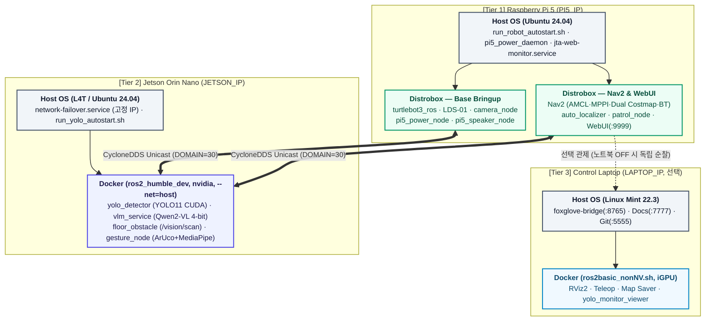
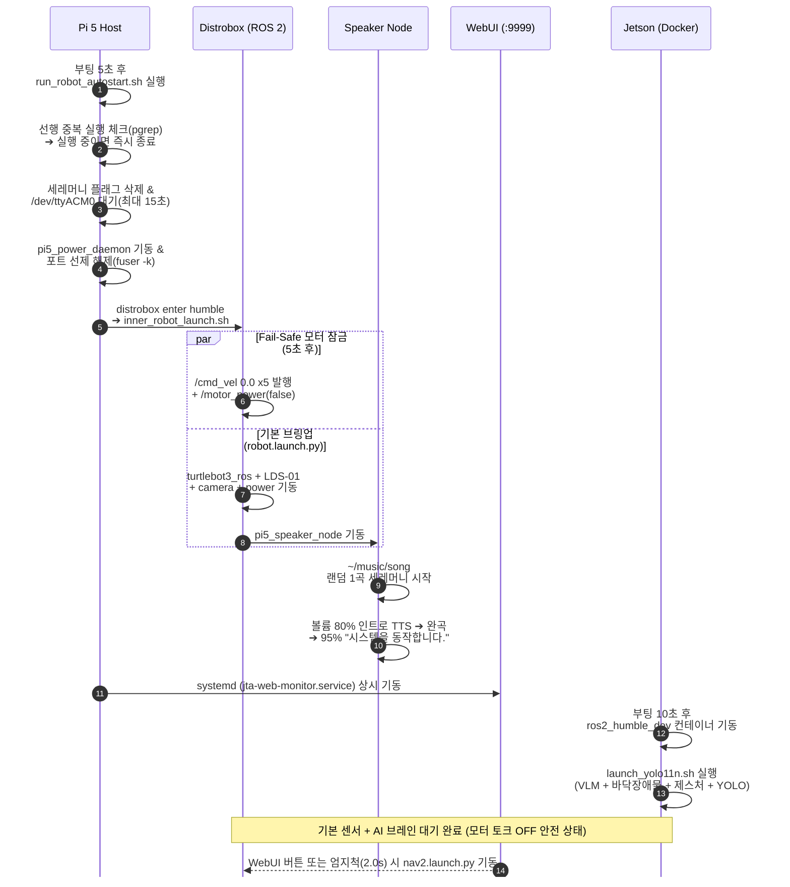
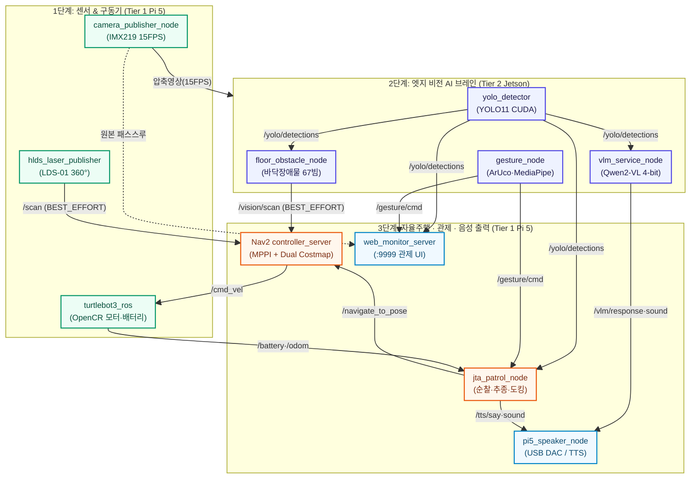
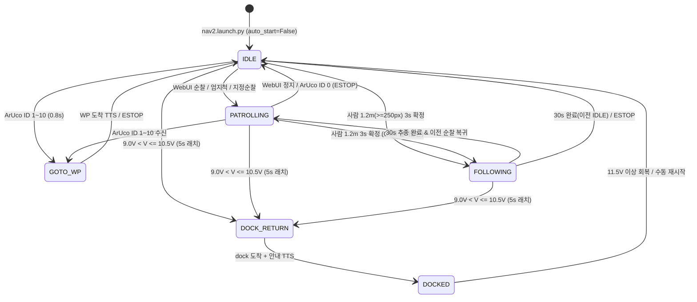

# 3-Tier 분산 로봇 실행 프로세스 명세서
### (3-Tier Distributed Robot Process & Dataflow Specification)

- **문서 위치**: `docs/1_master/process_specification.md`
- **대상 시스템**: `ros2_JTA` (Tier 1 Raspberry Pi 5 + Tier 2 Jetson Orin Nano + Tier 3 Control Laptop)
- **목적**: 부팅부터 자율주행·비전 AI·음성·관제·장애 복구까지 실제 동작하는 모든 OS 데몬, 컨테이너, ROS 2 패키지/노드, 설정 파라미터, 토픽/서비스 계약 및 상태 전이를 학습·실무 참조용으로 체계화
- **점검일**: 2026-11-24

<style>
@page {
  size: A4 portrait;
  margin: 12mm 11mm 12mm 11mm;
}
.page-break {
  page-break-before: always;
  break-before: page;
}
@media print {
  html, body, .md-body {
    font-size: 9.5pt !important;
    line-height: 1.4 !important;
    color: #111827 !important;
    background: #ffffff !important;
  }
  h1 { font-size: 13.5pt !important; margin: 6pt 0 4.5pt 0 !important; padding-bottom: 2.5pt !important; border-bottom: 0.8pt solid #94a3b8 !important; break-after: avoid !important; }
  h2 { font-size: 11.2pt !important; margin: 7pt 0 3.5pt 0 !important; break-after: avoid !important; }
  h3 { font-size: 10.2pt !important; margin: 6pt 0 2.5pt 0 !important; break-after: avoid !important; }
  p, ul, ol { margin: 2pt 0 4.5pt 0 !important; }
  li { margin-bottom: 1.5pt !important; }
  hr { margin: 6pt 0 !important; border-color: #cbd5e1 !important; }
  table, .md-body table {
    display: table !important;
    width: 100% !important;
    max-width: 100% !important;
    table-layout: fixed !important;
    border-collapse: collapse !important;
    font-size: 8.4pt !important;
    line-height: 1.32 !important;
    margin: 3.5pt 0 7pt 0 !important;
    overflow: visible !important;
  }
  table:has(thead tr th:nth-child(2):last-child) th:nth-child(1),
  table:has(thead tr th:nth-child(2):last-child) td:nth-child(1) { width: 24% !important; }
  table:has(thead tr th:nth-child(2):last-child) th:nth-child(2),
  table:has(thead tr th:nth-child(2):last-child) td:nth-child(2) { width: 76% !important; }
  table:has(thead tr th:nth-child(3):last-child) th:nth-child(1),
  table:has(thead tr th:nth-child(3):last-child) td:nth-child(1) { width: 27% !important; }
  table:has(thead tr th:nth-child(3):last-child) th:nth-child(2),
  table:has(thead tr th:nth-child(3):last-child) td:nth-child(2) { width: 27% !important; }
  table:has(thead tr th:nth-child(3):last-child) th:nth-child(3),
  table:has(thead tr th:nth-child(3):last-child) td:nth-child(3) { width: 46% !important; }
  table:has(thead tr th:nth-child(4):last-child) th:nth-child(1),
  table:has(thead tr th:nth-child(4):last-child) td:nth-child(1) { width: 15% !important; }
  table:has(thead tr th:nth-child(4):last-child) th:nth-child(2),
  table:has(thead tr th:nth-child(4):last-child) td:nth-child(2) { width: 11% !important; }
  table:has(thead tr th:nth-child(4):last-child) th:nth-child(3),
  table:has(thead tr th:nth-child(4):last-child) td:nth-child(3) { width: 12% !important; }
  table:has(thead tr th:nth-child(4):last-child) th:nth-child(4),
  table:has(thead tr th:nth-child(4):last-child) td:nth-child(4) { width: 62% !important; }
  thead { display: table-header-group !important; }
  tr { break-inside: avoid !important; page-break-inside: avoid !important; }
  th, td { padding: 3pt 4pt !important; vertical-align: top !important; white-space: normal !important; word-break: break-word !important; overflow-wrap: anywhere !important; border: 0.5pt solid #cbd5e1 !important; }
  th { background: #f1f5f9 !important; font-weight: 700 !important; color: #0f172a !important; }
  code { font-size: 8.1pt !important; white-space: pre-wrap !important; word-break: break-word !important; overflow-wrap: anywhere !important; padding: 0.4pt 2pt !important; background: #f1f5f9 !important; color: #0f172a !important; }
  pre { font-size: 8pt !important; line-height: 1.34 !important; padding: 5pt 7pt !important; margin: 3.5pt 0 6pt 0 !important; white-space: pre-wrap !important; word-break: break-word !important; overflow-wrap: anywhere !important; max-width: 100% !important; background: #f8fafc !important; border: 0.5pt solid #cbd5e1 !important; break-inside: avoid !important; }
  pre code { font-size: 8pt !important; padding: 0 !important; background: transparent !important; }
  blockquote { margin: 4pt 0 6pt 0 !important; padding: 4pt 8pt !important; font-size: 8.8pt !important; border-left: 2.5pt solid #64748b !important; background: #f8fafc !important; break-inside: avoid !important; }
  .mermaid, .mermaid svg, svg { max-width: 100% !important; max-height: 138mm !important; width: auto !important; height: auto !important; display: block !important; margin: 0 auto !important; break-inside: avoid !important; }
}
</style>

### 문서 버전 관리 (Document Version Control)
| 버전 (상태) | 개정 일자 | 작성자 | 변경 및 개정 내역 |
| :---: | :---: | :---: | :--- |
| `v1.4.11`<br>(Approved) | 26-11-24 | ROS2_JW | • 3-Tier 실행 프로세스 명세서 최초 작성, 패키지 3종 구조·노드별 파라미터·`nav2_params.yaml` 상세 설정 정리 및 A4 인쇄/PDF 페이지 맞춤 최적화 |
| **`v1.4.12`**<br>(Approved) | 26-11-24 | **ROS2_JW** | • 3-Tier 안전 핫픽스(`stop.sh` CycloneDDS·`patrol_node` `atan2`/`goal_seq`/`SIGTERM`·WebUI `/api/estop`·`run_robot_autostart.sh` 선행 중복검사), VLM Pure On-Demand·오프라인 `/tailwind.js`·실측 텔레메트리(`/pi5/system_state`·`/jetson/system_state`)·`raytrace_min_range: 0.0`·`base_footprint`·`20Hz`·바닥감도(`confirm=4f`)·사람 카운트다운 HUD·`dobingda0.mp3 ➔ dobingda.mp3` 순차재생 반영 |

---

# 목차 (Table of Contents)
1. [3-Tier 프로세스 계층 구조 (OS · 컨테이너 · ROS 2 경계)](#1-3-tier-프로세스-계층-구조-os--컨테이너--ros-2-경계)
2. [부팅 시퀀스 및 프로세스 생명주기 (Boot-to-Operation)](#2-부팅-시퀀스-및-프로세스-생명주기-boot-to-operation)
3. [Tier별 전체 실행 프로세스 카탈로그 (Process Inventory)](#3-tier별-전체-실행-프로세스-카탈로그-process-inventory)
4. [정식 ROS 2 패키지 3종 구조 및 빌드·엔트리포인트 매핑](#4-정식-ros-2-패키지-3종-구조-및-빌드엔트리포인트-매핑)
5. [핵심 설정 파일(Config) 및 노드별 파라미터 마스터 표](#5-핵심-설정-파일config-및-노드별-파라미터-마스터-표)
6. [핵심 데이터 파이프라인 및 토픽·QoS 계약](#6-핵심-데이터-파이프라인-및-토픽qos-계약)
7. [자율 순찰(`patrol_node`) 상태 머신 (State Machine)](#7-자율-순찰patrol_node-상태-머신-state-machine)
8. [안전 가드레일 · 장애 복구 · 프로세스 디버깅 치트시트](#8-안전-가드레일--장애-복구--프로세스-디버깅-치트시트)
9. [학습 점검용 핵심 체크포인트 (Self-Check Q&A)](#9-학습-점검용-핵심-체크포인트-self-check-qa)

---

### 학습 가이드: 본 명세서 구성 요약
| 구분 | 포함 내용 | 핵심 확인 포인트 |
| :--- | :--- | :--- |
| **1~2절 (구조·생명주기)** | 3-Tier OS/컨테이너 경계, 부팅 시퀀스 | Host vs Distrobox/Docker 분리 이유, Pre-Clean·5초 모터 잠금 |
| **3~4절 (프로세스·패키지)** | Tier 1/2/3 전체 노드 목록, `ament_python` 3종 | `setup.py` 엔트리포인트 매핑, `src/` vs `install/` 동기화 |
| **5절 (설정·파라미터)** | `nav2_params.yaml`, 순찰/구역 설정, 노드 인자 | Dual Costmap 분리(`vision_obstacle_layer`), MPPI Critics, `beam_hold_sec` |
| **6~7절 (파이프라인·상태)** | 5대 데이터 흐름, 토픽/QoS 20종, 순찰 상태 머신 | `/scan`·`/vision/scan` `BEST_EFFORT`, 사람 3초 확정, `10.5V` 도킹 |
| **8~9절 (안전·점검)** | 5대 가드레일, SSH 디버깅 명령, 자가 점검 Q&A 7선 | `finally` 5회 정지 패킷, Zero-Lag 드롭, 독립 순찰 근거 |

<div class="page-break"></div>

# 1. 3-Tier 프로세스 계층 구조 (OS · 컨테이너 · ROS 2 경계)

`ros2_JTA`의 모든 실행 프로세스는 **호스트 OS 영역**과 **ROS 2 Humble 컨테이너 영역(Distrobox / Docker)**으로 역할이 분리되어 있습니다. 모든 ROS 2 노드는 공통으로 `ROS_DOMAIN_ID=30`, `RMW_IMPLEMENTATION=rmw_cyclonedds_cpp`, `config/cyclonedds.xml` (Unicast Peer: `<LAPTOP_IP>`, `<JETSON_IP>`, `<PI5_IP>`, `127.0.0.1`) 위에서 통신합니다.



### 학습 핵심 포인트: 왜 컨테이너와 호스트를 나누었나?
1. **OS 버전 불일치 해결**: 호스트는 Ubuntu 24.04(Noble)이지만 ROS 2 표준 배포판은 Ubuntu 22.04 기반 **Humble**이므로, Pi 5는 **Distrobox**, Jetson/Laptop은 **Docker(`--net=host`)**로 격리 실행합니다.
2. **하드웨어 직결 권한**: Pi 5의 `vcgencmd`(전압/스로틀링 조회)는 호스트 커널 인터페이스가 필요하므로 `pi5_power_daemon.py`가 호스트에서 값을 읽어 공유 메모리로 전달하고, 컨테이너 내부 `pi5_power_node`가 이를 ROS 2 토픽으로 발행합니다.
3. **노트북 의존성 제로(Zero-Dependency)**: WebUI(`:9999`), Nav2, 순찰 로직을 모두 Pi 5에 배치해 관제 노트북을 꺼도 **Pi 5 + Jetson 2대만으로 24시간 독립 운용**이 가능합니다.

<div class="page-break"></div>

# 2. 부팅 시퀀스 및 프로세스 생명주기 (Boot-to-Operation)

전원 인가 후 로봇이 안전하게 기동·대기·주행 준비 상태에 도달하기까지의 시간축 실행 흐름입니다.



### 부팅 단계에서 꼭 알아야 할 안전 장치 3가지
1. **선행 중복 검사 & Pre-Clean 포트 해제 (`pgrep` ➔ `fuser -k`)**: `run_robot_autostart.sh`는 세레머니 플래그 삭제 및 포트 해제 이전에 최상단에서 `pgrep` 중복 실행 검사를 수행해 이미 구동 중인 로봇 노드를 실수로 강제 종료하는 사고를 차단한 뒤, 미구동 시에만 `/dev/ttyACM0`·`/dev/ttyUSB0`·`/dev/video0` 점유를 정리합니다.
2. **모터 부팅 폭주 차단 (Fail-Safe)**: OpenCR 기동 직후 자이로 캘리브레이션 종료 시 잔류 버퍼로 바퀴가 돌 수 있어, `inner_robot_launch.sh`가 5초 뒤 `/cmd_vel = 0.0`을 5회 연속 전송하고 `/motor_power`를 `false`(Torque OFF)로 잠급니다.
3. **Nav2 지연/선택 기동**: `robot.launch.py`의 `enable_nav2` 기본값은 `False`입니다. SLAM 매핑 모드와의 충돌을 막기 위해 평소에는 기본 센서만 띄워 두고, WebUI(`:9999`) 버튼이나 한 손 엄지척(2.0s) 제스처로 `nav2.launch.py`를 전환 기동합니다.

<div class="page-break"></div>

# 3. Tier별 전체 실행 프로세스 카탈로그 (Process Inventory)

## 3.1 Tier 1: Raspberry Pi 5 (`<PI5_IP>`)

### A. 호스트 OS 데몬 & 시스템 서비스
| 프로세스 / 서비스 | 기동 방식 | 핵심 역할 |
| :--- | :--- | :--- |
| `run_robot_autostart.sh` | 부팅 자동 기동 (Host OS) | OpenCR 대기, 포트 Pre-Clean, `pi5_power_daemon` 및 Distrobox `inner_robot_launch.sh` 호출 |
| `pi5_power_daemon.py` | 백그라운드 데몬 (Host OS) | `vcgencmd`로 Pi 5 코어 전압·온도·스로틀링 비트(`0x0`) 수집 후 컨테이너에 공유 |
| `jta-web-monitor.service` | `systemd` (`Restart=always`, 5s) | `ExecStartPre`/`Post`로 기존 프로세스 정리 후 Distrobox 내부 `web_monitor_server.py 9999` 상시 구동 |

### B. 기본 로봇 브링업 (`jta_bringup/launch/robot.launch.py`)
| 노드명 (패키지 · 재기동) | 담당 장치 / 출력 | 핵심 역할 |
| :--- | :--- | :--- |
| `turtlebot3_ros`<br>(`turtlebot3_bringup`, respawn: No) | OpenCR 1.0<br>`/dev/ttyACM0` (1Mbps) | `/cmd_vel` 수신 ➔ 바퀴 구동, `/odom`·`/imu`·`/battery_state`·`/joint_states` 발행 |
| `robot_state_publisher`<br>(`turtlebot3_bringup`, respawn: No) | URDF 기구 모델 | 정적/동적 TF 트리(`base_footprint` ➔ `base_link` ➔ `base_scan` 등) 방송 |
| `hlds_laser_publisher`<br>(`turtlebot3_bringup`, respawn: No) | LDS-01 2D LiDAR<br>`/dev/ttyUSB0` (115200bps) | 360° 스캔 데이터 `/scan` (`BEST_EFFORT`) 발행 |
| `camera_publisher_node`<br>(`jta_camera/camera_node`, **respawn: 2.0s**) | IMX219 CSI 카메라<br>(RP1-CFE 동적 탐색) | `640×480`, `15 FPS`, JPEG Q90(`/camera/image_raw/compressed`) 송출, V4L2 HW 플립, `monotonic()` 페이싱·`spin_once(0.0)` |
| `pi5_power_node`<br>(`jta_bringup/pi5_power_node`, **respawn: 3.0s**) | 호스트 전원 데몬 중계 | `/pi5/battery_state` 및 `/pi5/system_state`(1Hz JSON: 실측 `vcgencmd get_throttled` hex·한국어 상태) 발행 |
| `pi5_speaker_node`<br>(`jta_bringup/speaker_node`, **respawn: 2.0s**) | USB DAC (`UACDemoV10`, `plug:dmix`)<br>Edge-TTS (`SunHiNeural`, `8s` 타임아웃) | 음성 출력, 원자적 오디오 교체, 부팅 랜덤곡 세레머니(`80%➔95%`), `dobingda0.mp3 ➔ dobingda.mp3` 순차 재생(`"stop"` 즉시 취소) |

<div class="page-break"></div>

### C. 자율주행 및 순찰 스택 (`jta_bringup/launch/nav2.launch.py`)
| ROS 2 노드명 | 패키지 | 핵심 역할 |
| :--- | :--- | :--- |
| `map_server` | `nav2_map_server` | 정적 2D 점유 격자 지도(`~/maps/my_map_261113.yaml`)를 `/map`으로 발행 |
| `amcl` | `nav2_amcl` | 파티클 필터 기반 2D 위치 추정(`map` ➔ `odom` TF 발행, `/amcl_pose` 발행) |
| `controller_server` | `nav2_controller` | **`MPPIController`**(`batch_size: 600`, `time_steps: 25`, `vx_max: 0.16`, `vx_min: -0.10`) 로컬 궤적 최적화 + **`local_costmap`**(`obstacle_layer` + `vision_obstacle_layer` + `inflation_layer`) 관리 |
| `planner_server` | `nav2_planner` | 전역 경로 계획(`NavfnPlanner` A*) + `global_costmap` 관리 |
| `behavior_server` | `nav2_behaviors` | 좁은 공간 탈출·후진·제자리 회전(`Spin`, `BackUp`, `Wait`) 복구 행동 수행 |
| `bt_navigator` | `nav2_bt_navigator` | Behavior Tree 실행기. `/navigate_to_pose` 액션 수신 후 Planner/Controller/Recovery 조율 |
| `velocity_smoother` | `nav2_velocity_smoother` | 급가속/급감속을 완화해 OpenCR에 부드러운 `/cmd_vel` 전달 |
| `keepout_filter_mask_server` 외 3종 | `nav2_map_server` | 가상벽(`KeepoutFilter`) 및 서행 구간(`SpeedFilter`) 마스크 발행 (미존재 시 `blank_filter_mask.yaml` 폴백) |
| `lifecycle_manager_*` | `nav2_lifecycle_manager` | Nav2 및 Costmap Filter 노드들의 `Unconfigured` ➔ `Inactive` ➔ `Active` 생명주기 일괄 관리 |
| `jta_auto_localizer` | `jta_bringup`<br>(`auto_localizer`) | Nav2 기동 시 AMCL 전역 초기화(`/reinitialize_global_localization`), 정지 스캔 3회 갱신, `monotonic()` 제자리 회전 공분산(`cov <= 0.02`) 수렴 및 `SIGTERM` 포함 `/cmd_vel 0.0` x5 정지 |
| `jta_patrol_node` | `jta_bringup`<br>(`patrol_node`) | 다중/지정(`custom_order`) 순찰, `atan2` 전방 대칭 라이다, `goal_seq` 경합 차단, 사람 근접(`1.2m/3s`) 30초 추종(종료 시 `/play/sound "stop"`), ArUco `ESTOP`/`GOTO_WP`, `10.5V` `dock` 복귀, `SIGTERM` 안전 정지 |

### D. 상시 관제 웹 서버 (`src/laptop/web/web_monitor_server.py`, Pi 5 로컬 실행)
- **실행 경로**: `~/jta_web/web_monitor_server.py 9999` (`IS_PI5_LOCAL`·`IS_WEB_MASTER` 모드)
- **핵심 역할**: 로컬 `/tailwind.js`(398KB) 100% 오프라인 관제, `threading.Condition` 이벤트 기반 MJPEG 패스스루(`/video_feed`) + 브라우저 `<canvas>`(`yolo_overlay.js`: YOLO·바닥장애물·제스처·사람 카운트다운 HUD `3s/30s/50s`), `POST /api/estop` 원자적 비상정지, `mtime` 캐싱, SLAM `tf2_ros` 폴백, `/` 실시간 2D 맵(`WP`/`위험구간` 2-Tab, Keepout `0.15m`, `dock` 지정), `/dashboard` 3단 VLM 채팅, PIN 인증 Nav2/SLAM 인터락, `3.0초` OpenCR 단절 감시(`[OFF] OpenCR OFF`), 실측 `/pi5/system_state`·`/jetson/system_state` 텔레메트리, 한 손 제스처(엄지척/손펼침) Nav2 제어.

<div class="page-break"></div>

## 3.2 Tier 2: Jetson Orin Nano (`<JETSON_IP>:2222`)
| 프로세스 (실행 위치) | 기동 방식 | 핵심 역할 및 리소스 특성 |
| :--- | :--- | :--- |
| `network-failover.service`<br>(`network_failover.py`, Host OS) | `systemd`<br>(`Restart=always`, 3s) | 유선(`enP8p1s0`) ↔ 무선(`wlP1p1s0`) 링크 감시, 고정 IP `<JETSON_IP>/24` 전환 시 유선 잔류 IP 삭제 및 `monotonic()` 디바운스 |
| `run_yolo_autostart.sh`<br>(Host OS) | 부팅 10초 후 자동 기동 | `ros2_humble_dev` Docker 컨테이너 기동 후 내부 `launch_yolo11n.sh` 실행 |
| `yolo_detector`<br>(`detector_node.py`, Docker) | `ros2 launch yolo11n`<br>(포그라운드) | GPU CUDA 실시간 객체 탐지(기본 `yolo11s.pt/640/0.60`, `self.processing` 프레임 드롭). 경량 JSON(`/yolo/detections`, 0.1ms) 및 2초 주기 `/jetson/system_state`(RAM/Swap/온도) 발행 |
| `vlm_service_node.py`<br>(Docker) | `launch_yolo11n.sh`<br>(백그라운드) | **`Qwen2-VL-2B-Instruct` 4-bit NF4 Pure On-Demand** 상주(VRAM `1.42GB`, `background_loop_enabled=False`, Lazy JPEG 디코딩, 비차단 락). YOLO `1.2m(conf>=0.50, h>=250px)` 3초 확정 시 `/play/sound`(`dobingda`), `/vlm/trigger` 시 `640×480` 브리핑, CLI 전용 `/vlm/chat_query` 분리 |
| `floor_obstacle_node.py`<br>(Docker) | `launch_yolo11n.sh`<br>(백그라운드) | **전 구간 상시 바닥 장애물 감지**. OpenCV LAB 색차(`18.0`) + 명도·에지(`38.0`, `650px`, 반사광 억제) + YOLO 하단 보너스 ➔ 4프레임 확정(`confirm=4`), `beam_hold_sec=0.0`, `lateral_padding_m=0.03`으로 67빔 가상 라이다(`/vision/scan`, `BEST_EFFORT`) 및 `/vision/floor_obstacles` JSON 발행 |
| `gesture_node.py`<br>(Docker) | `launch_yolo11n.sh`<br>(백그라운드) | `DICT_4X4_50` ArUco 카드(`ID 0=ESTOP 0.25s`, `ID 1~10=GOTO_WP 0.8s`) + `MediaPipe Hands`(굽힘 `<=1.05` 히스테리시스) 한 손 펼침(`1.5s ➔ NAV2_STOP`) / 엄지척(`2.0s ➔ NAV2_START`) ➔ `/gesture/cmd`, `/gesture/state` 발행 |

## 3.3 Tier 3: Control Laptop (`<LAPTOP_IP>`, 선택 구동)
| 프로세스명 | 실행 위치 | 핵심 역할 |
| :--- | :--- | :--- |
| `foxglove-bridge.service` (`:8765`) | Host OS (`systemd --user`) | ROS 2 토픽을 WebSocket으로 브릿징해 **Lichtblick** 2D/3D Nav2·SLAM 실시간 시각화 지원 |
| `ros2basic_nonNV.sh` (RViz2 / Teleop) | Docker (무소음 iGPU) | 필요 시 RViz2, 키보드 Teleop(`run_teleop.sh`), 지도 저장(`save_map.sh`) 수행 (`use_sim_time:=false` 고정) |
| `yolo_monitor_viewer.py` | Host OS / Docker | 초경량 OpenCV 네이티브 HUD 뷰어 (배터리 전압·라이다·YOLO 오버레이) |
| Docs Viewer (`:7777`) / Git Web (`:5555`) | Host OS (`systemd --user`) | `docs/` 마크다운 문서 실시간 열람 및 Git 히스토리 웹 조회 |

<div class="page-break"></div>

# 4. 정식 ROS 2 패키지 3종 구조 및 빌드·엔트리포인트 매핑

`ros2_JTA`는 모두 **`ament_python`** 빌드 타입의 정식 ROS 2 패키지 3종(`jta_bringup`, `jta_camera`, `yolo11n`)과 단독 실행 스크립트 노드(`floor_obstacle_node.py`, `gesture_node.py`, `vlm_service_node.py`, `web_monitor_server.py`)의 하이브리드 구조로 운영됩니다.

## 4.1 `jta_bringup` (Tier 1 Pi 5 — 브링업 · Nav2 · 순찰 · 전원 · 음성)
| 항목 | 상세 구성 |
| :--- | :--- |
| **빌드 타입 / 의존성** | `ament_python` (`package.xml`: `turtlebot3_bringup`, `turtlebot3_node`, `jta_camera`) |
| **`console_scripts`** | • `pi5_power_node` ➔ `jta_bringup.pi5_power_node:main`<br>• `speaker_node` ➔ `jta_bringup.speaker_node:main`<br>• `auto_localizer` ➔ `jta_bringup.auto_localizer:main`<br>• `patrol_node` ➔ `jta_bringup.patrol_node:main` |
| **`data_files` 설치 자산** | `launch/*.launch.py`, `config/*.yaml`, `config/*.pgm` |

## 4.2 `jta_camera` (Tier 1 Pi 5 — CSI 카메라 하드웨어 스트리밍)
| 항목 | 상세 구성 |
| :--- | :--- |
| **빌드 타입 / 의존성** | `ament_python` (`package.xml`: `rclpy`, `sensor_msgs`) |
| **`console_scripts`** | • `camera_node` ➔ `jta_camera.camera_node:main` |
| **`data_files` 설치 자산** | `launch/*.launch.py` |

## 4.3 `yolo11n` (Tier 2 Jetson — CUDA 실시간 객체 탐지)
| 항목 | 상세 구성 |
| :--- | :--- |
| **빌드 타입 / 의존성** | `ament_python` (`package.xml`: `rclpy`, `sensor_msgs`, `std_msgs`) |
| **`console_scripts`** | • `yolo_detector` ➔ `yolo11n.detector_node:main` |
| **`data_files` 설치 자산** | `launch/*.launch.py`, `config/*.yaml` |

## 4.4 패키지 디렉터리 구조 및 `colcon build` 주의사항
```text
src/
├── pi5/
│   ├── jta_bringup/
│   │   ├── config/
│   │   │   ├── nav2_params.yaml           # Nav2 마스터 설정 (AMCL/MPPI/Costmap)
│   │   │   ├── patrol_waypoints.yaml      # 순찰 WP(1~7), dwell, custom_order, dock
│   │   │   ├── detection_zones.json       # 선택 감지 구역 사각형 및 서행 속도(%)
│   │   │   ├── hazard_zones.json          # 가상벽/위험구역 목록 (WebUI 연동)
│   │   │   └── blank_filter_mask.{yaml,pgm} # 마스크 미존재 시 폴백 빈 지도
│   │   ├── launch/
│   │   │   ├── robot.launch.py            # 기본 센서+카메라+전원+스피커 브링업
│   │   │   └── nav2.launch.py             # Nav2 + Filter + localizer + patrol
│   │   ├── jta_bringup/                   # Python 노드 모듈 4종
│   │   └── package.xml / setup.py
│   └── jta_camera/
│       ├── launch/camera.launch.py        # 640x480, Q90, 15 FPS, HW Flip 런처
│       ├── jta_camera/camera_node.py      # RP1-CFE 동적 탐색 CSI 카메라 노드
│       └── package.xml / setup.py
└── jetson/
    ├── yolo11n/
    │   ├── launch/yolo11n.launch.py       # YOLO11 가중치·imgsz·conf·JSON 런처
    │   ├── yolo11n/detector_node.py       # Zero-Lag CUDA 추론 노드
    │   └── package.xml / setup.py
    ├── floor_obstacle_node.py             # 상시 바닥 장애물 가상 라이다 (단독)
    ├── gesture_node.py                    # ArUco + MediaPipe Hands 제어 (단독)
    └── vlm_service_node.py                # Qwen2-VL 4-bit 상주 노드 (단독)
```

> **공부 핵심 — `src/` 수정 후 왜 `install/`까지 신경 써야 하는가?**
> `ros2 launch jta_bringup ...`는 소스 폴더(`src/`)가 아니라 빌드 산출물인 `~/ros2_ws/install/jta_bringup/share/jta_bringup/` 경로의 `launch/`·`config/` 파일을 읽습니다. 따라서 ① `colcon build --packages-select jta_bringup` (또는 `--symlink-install`)를 실행하거나, ② `scripts/sync_to_robot.sh`처럼 `src/`와 `install/` 양쪽을 동시에 동기화해야 실기에 즉시 반영됩니다.

<div class="page-break"></div>

# 5. 핵심 설정 파일(Config) 및 노드별 파라미터 마스터 표

## 5.1 Nav2 마스터 설정 (`src/pi5/jta_bringup/config/nav2_params.yaml`)

### 5.1.1 위치 추정 (`amcl`) 및 로컬 궤적 제어 (`controller_server` · `MPPIController`)
| 모듈 · 파라미터 | 설정값 (`v1.4.12`) | 엔지니어링 의도 (공부 포인트) |
| :--- | :--- | :--- |
| **`amcl`**<br>`robot_model_type` / `laser_model_type` | `DifferentialMotionModel`<br>`likelihood_field` | 차동 구동 로봇 + 2D LiDAR 표준 파티클 필터 |
| **`amcl`**<br>`min_particles` / `max_particles` | `500` / `5000` | 초기 전역 탐색 시 넓은 분포, 수렴 후 연산 경량화 |
| **`amcl`**<br>`update_min_d` / `update_min_a` | `0.08 m` / `0.05 rad` | 8cm 이동 또는 ~2.9° 회전마다 위치 보정 갱신 |
| **`controller_server`**<br>`controller_frequency` / `model_dt` | `10.0 Hz` / `0.1 s` | Pi 5 CPU 점유율(~37%)과 실시간 제어 균형 |
| **`MPPIController`**<br>`batch_size` / `time_steps` | `600` / `25` (예측 `2.5 s`) | 600개 후보 궤적을 2.5초 앞까지 샘플링 최적화 |
| **`MPPIController`**<br>`vx_max` / `vx_min` / `wz_max` | `0.16` / `-0.10` m/s<br>`0.9` rad/s | 실내 안전 속도 및 좁은 공간 후진 탈출(`-0.10`) 허용 |
| **`MPPIController`**<br>`xy_goal_tolerance` / `yaw_goal_tolerance` | `0.35 m` / `0.55 rad` | 순찰 웨이포인트 도착 판정 여유로 불필요한 제자리 진동 방지 |
| **`MPPIController`**<br>**Critics 가중치 8종** | `PathAlign: 9.0`, `PathFollow: 5.0`<br>`Goal: 5.0`, `PreferForward: 5.0`<br>**`CostCritic: 4.0`**, `Constraint: 4.0`<br>`GoalAngle: 3.0`, `PathAngle: 2.0` | `CostCritic`(1.5➔4.0) 강화 및 `PathAlign`(14.0➔9.0) 완화로 장애물 밀고 나가기 차단 |

### 5.1.2 비용 지도 (`local/global_costmap`) · 전역 계획 (`planner_server`) · 복구 (`behavior_server`)
| 모듈 · 파라미터 | 설정값 (`v1.4.12`) | 엔지니어링 의도 (공부 포인트) |
| :--- | :--- | :--- |
| **`local_costmap`**<br>`global_frame`, `rolling_window`, 크기·해상도 | `odom`, `true`<br>`3×3 m`, `0.025 m` | 로봇 중심 3×3m 고정밀(2.5cm 격자) 지역 장애물 지도 |
| **`local_costmap`**<br>`robot_radius` / `robot_base_frame` | `0.145 m` / **`base_footprint`** | 실물 반경 기반 좁은 틈 통과 + 전 모듈 기준 프레임 통일 |
| **`local_costmap`**<br>`plugins` | `["obstacle_layer",`<br>`"vision_obstacle_layer",`<br>`"inflation_layer"]` | **2D LiDAR와 카메라 가상 라이다 레이어 분리** |
| **`obstacle_layer`**<br>(`/scan` 전용) | `obstacle: 0.0~2.5 m`<br>`raytrace: 0.0~3.0 m`<br>`clearing: True` | 2D LiDAR 전용 마킹·클리어링 (비전 레이어 간섭 차단) |
| **`vision_obstacle_layer`**<br>(`/vision/scan` 전용) | `combination_method: 1`<br>`obstacle: 0.20~1.5 m`<br>**`raytrace: 0.0~1.8 m`**, `clearing: True` | LiDAR 간섭 차단 + `raytrace_min_range: 0.0`으로 정면 근접 고스트 셀 즉시 소거 (`v1.4.12`) |
| **`local_costmap`**<br>`inflation_layer` | **`inflation_radius: 0.25 m`**<br>**`cost_scaling_factor: 7.0`** | 완만한 비용 경사(10.5cm 여유 반경)로 조기·부드러운 우회 유도 |
| **`global_costmap`**<br>프레임 · 해상도 · 플러그인 · 필터 | `map`, `0.05 m`, `base_footprint`, `inflation: 0.19`<br>`plugins: [static, obstacle, inflation]`<br>`filters: [keepout_filter, speed_filter]` | 전역 정적 지도 + 가상벽(`Keepout`) + 서행 구역(`Speed`) 반영 |
| **`planner_server`**<br>`plugin`, `use_astar`, `tolerance`, `allow_unknown` | `NavfnPlanner`, `true`<br>`0.5 m`, `true` | A* 최단 경로 탐색 + 미탐색 영역 허용 |
| **`behavior_server` / `waypoint_follower`**<br>`robot_base_frame`, `simulate_ahead_time`, `loop_rate` | `["spin", "backup", "wait"]`<br>**`base_footprint`**, `0.5 s`, **`20 Hz`** | 0.5초 충돌 예측 기반 탈출 복구 + `waypoint_follower` `200➔20Hz` Pi 5 CPU 절감 |

<div class="page-break"></div>

## 5.2 순찰 · 구역 설정 파일 (`config/*.yaml`, `config/*.json`)
- **`patrol_waypoints.yaml`** (`patrol:` 루트 키): `dwell_sec: 2.0`(대기), `retry_limit: 1`(재시도), `custom_order: []`(지정순찰 순서), `waypoints:` `WP1`~`WP7`(`name, x, y, yaw, enabled`), `dock:`(`x: -0.293, y: -1.602, yaw: -0.345`, `10.5V` 저전압 자동 복귀 좌표).
- **`detection_zones.json`**: 사각형 감지/서행 구역 목록 (`type: "detect"`, `shape: "rect"`, `x1, y1, x2, y2`, `thickness: 0.15`, `speed_pct: 40`).
- **`hazard_zones.json`**: WebUI `/map` 위험구간 탭에서 편집하는 가상벽/위험구역 정의(저장 시 `keepout_mask` / `speed_mask` 재생성 연동).

## 5.3 주요 노드별 런치 인자 및 기본 파라미터 표

### Tier 1 (Pi 5) 런치 · 노드 파라미터
| 노드 / 파라미터 | 기본값 | 역할 및 튜닝 의미 |
| :--- | :--- | :--- |
| **`robot.launch.py`**<br>`enable_nav2` | `False` | 부팅 시 Nav2 5초 지연 자동 기동 여부 (SLAM 시 `False` 필수) |
| **`nav2.launch.py`**<br>`map` / `use_sim_time` | `~/maps/my_map_261113.yaml`<br>`False` | 실측 2D 지도 경로 및 현실 시간(`Wall-clock`) 고정 |
| **`nav2.launch.py`**<br>`auto_localize` / `auto_spin` | `True` / `True` | 기동 시 AMCL 전역 초기화 및 제자리 회전 수렴 실행 |
| **`nav2.launch.py`**<br>`enable_patrol` / `patrol_auto_start` | `True` / `False` | 순찰 노드 기동(기본 `IDLE` 대기, 명령 시 순찰 시작) |
| **`nav2.launch.py`**<br>`keepout_mask` / `speed_mask` | `~/maps/{keepout,speed}_mask.yaml` | 파일 미존재 시 `blank_filter_mask.yaml` 자동 폴백 |
| **`camera.launch.py` (`camera_node`)**<br>`width` / `height` / `jpeg_quality` / `target_fps` | `640` / `480` / `90` / `15` | 표준 15 FPS 압축 스트림 계약 (~3.5 Mbps) |
| **`camera.launch.py` (`camera_node`)**<br>`flip_h` / `flip_v` | `1` / `1` | V4L2 하드웨어 레지스터 상하좌우 반전 (CPU 부하 0%) |
| **`jta_auto_localizer`**<br>`enable_spin`, `angular_speed`, `max_spin_sec`, `cov_threshold` | `False`(런치 `True`), `0.5 rad/s`<br>`20.0 s`, `0.02` | 공분산 `cov(x)+cov(y) <= 0.02` 도달 시 즉시 회전 종료 및 정지 |

### Tier 2 (Jetson) 비전 · AI 노드 파라미터
| 노드 / 파라미터 | 기본값 | 역할 및 튜닝 의미 |
| :--- | :--- | :--- |
| **`yolo11n.launch.py` (`yolo_detector`)**<br>`model`, `imgsz`, `conf` | `/root/ros2_ws/yolo11s.pt`<br>`640`, `0.60` | 추론 가중치·해상도·신뢰도 임계값 (런치 인자로 `yolo11n.pt` 등 교체 가능) |
| **`yolo11n.launch.py` (`yolo_detector`)**<br>`use_compressed`, `publish_annotated` | `true`, `false` | 압축 영상 구독, 재인코딩 생략 후 경량 JSON(`/yolo/detections`)만 발행 |
| **`vlm_service_node.py`**<br>`background_loop_enabled`, `max_new_tokens`, `person_conf` | **`False`** (Pure On-Demand)<br>`40`, `>= 0.50` | 25초 주기 GPU 공회전 제거 + Lazy JPEG 디코딩 + 비차단 락 드롭 (`v1.4.12`) |
| **`floor_obstacle_node.py`**<br>`cam_height`, `cam_pitch_deg`, `cam_x_offset`, `hfov_deg`, `vfov_deg` | `0.145 m`, `0.0°`, `0.06 m`<br>`62.2°`, `48.8°` | IMX219 기하학 투영(지면 `z=0` ➔ `base_footprint` XY 변환) |
| **`floor_obstacle_node.py`**<br>`roi_top_ratio`, `chroma_thresh`, `luma_thresh`, `min_area_px` | `0.58`, **`18.0`**, **`38.0`**, **`650 px`** | 하단 42% 바닥 ROI 감도 완화 + 밝은 반사광 억제(`dL_signed > luma_thresh * 1.7`) (`v1.4.12`) |
| **`floor_obstacle_node.py`**<br>`min_detect_dist`, `max_detect_dist`, `confirm_frames` | `0.25 m`, `1.50 m`, **`4`** | 감지 유효 거리 및 4프레임 연속 확정으로 오탐·고스트 차단 |
| **`floor_obstacle_node.py`**<br>**`beam_hold_sec`**, **`lateral_padding_m`** | **`0.0 s`**, **`0.03 m`** | 회전 잔상 제거(Costmap 위임) + 좌우 3cm 측면 폭 보강 |
| **`gesture_node.py`**<br>`estop_hold_sec` / `wp_hold_sec` | `0.25 s` / `0.8 s` | ArUco `ID 0`(비상정지) 즉각 확정 / `ID 1~10` 오인식 방지 유지 |
| **`gesture_node.py`**<br>`nav2_stop_hold_sec` / `nav2_start_hold_sec` | `1.5 s` / `2.0 s` | 한 손 펼침(`NAV2_STOP`) / 엄지척(`NAV2_START`) 유지 시간 |
| **`gesture_node.py`**<br>`estop`/`wp`/`nav2_stop`/`nav2_start` `_cooldown_sec`, `mp_frame_stride` | `2s` / `4s` / `10s` / `15s`<br>`stride: 2` | 중복 명령 방지 쿨다운 및 MediaPipe 2프레임당 1회(~7.5Hz) 경량화 |

<div class="page-break"></div>

# 6. 핵심 데이터 파이프라인 및 토픽·QoS 계약

실제 로봇이 움직이고 판단할 때 데이터가 어떤 프로세스를 거쳐 흐르는지 **3단 계층(센서 ➔ 엣지 AI ➔ 제어·관제)**과 **5대 핵심 파이프라인**으로 정리했습니다.



### 5대 핵심 파이프라인 상세 해설
1. **파이프라인 A — 2D LiDAR + 비전 바닥 장애물 듀얼 레이어 회피 (`v1.4.11~v1.4.12`)**
   - `camera_publisher_node` ➔ `floor_obstacle_node`가 바닥 색차(`18.0`)/명도(`38.0`·반사광 억제)/에지 + YOLO 하단 보너스로 4프레임 확정(`confirm=4`) 후 67빔 가상 라이다(`/vision/scan`, `lateral_padding_m=0.03`, `beam_hold_sec=0.0`) 발행.
   - Nav2 `local_costmap`은 **`obstacle_layer`(`/scan` 전용)**과 **`vision_obstacle_layer`(`/vision/scan` 전용, `combination_method: 1`, `raytrace_min_range: 0.0`)**을 분리 유지.
   - 2D LiDAR가 낮은 장애물 위로 지나가도 `vision_obstacle_layer`를 지우지 못하며, 장애물 제거 시 정면 근접 고스트는 즉시 소거되고 **MPPI(`CostCritic: 4.0`, `PathAlign: 9.0`, `inflation: 0.25`)**가 부드럽게 우회합니다.
2. **파이프라인 B — 사람 근접 감지 & 30초 추종 + 순차 음성 안내**
   - `yolo_detector` ➔ `/yolo/detections` ➔ `vlm_service_node`·`patrol_node`가 `person`(`conf>=0.50`, `bh >= 250px`, 약 1.2m) `3.0초` 연속 감지 확정 시 `dobingda0.mp3`(Edge-TTS 4단 안내) 완곡 후 `dobingda.mp3` 순차 재생 + `30초` 비주얼 서보잉 추종(종료 시 `/play/sound "stop"` 발행 + 확정 기준 `50초` 쿨다운, WebUI `<canvas>` 카운트다운 HUD 표출).
3. **파이프라인 C — ArUco 카드 & 한 손 제스처 제어**
   - `gesture_node`: ArUco `ID 0`(0.25s) ➔ `ESTOP`, `ID 1~10`(0.8s) ➔ `GOTO_WP`(`patrol_node` 즉시 실행). 한 손 펼침(`1.5s ➔ NAV2_STOP`) / 엄지척(`2.0s ➔ NAV2_START`)은 `web_monitor_server`(`IS_WEB_MASTER`)가 Nav2 스택 전체를 비동기 제어.
4. **파이프라인 D — Pure On-Demand VLM 브리핑 vs CLI 채팅 이원화**
   - `background_loop_enabled=False`로 평시 GPU 공회전을 제거하고, WebUI(`/vlm/trigger`) 시에만 Lazy JPEG 디코딩 ➔ `640×480` 추론 ➔ `/vlm/response` ➔ `pi5_speaker_node` 발화. 반면 CLI(`qss`) ➔ `/vlm/chat_query` ↔ `/vlm/chat_response` 전용 경로는 스피커를 울리지 않습니다.
5. **파이프라인 E — `10.5V` 저전압 자율 복귀 & OpenCR·기기 실측 감시**
   - `/battery_state` `9.0V < V <= 10.5V` 5초 지속 시 `patrol.dock` 좌표로 자율 복귀(`11.5V` 회복 시 래치 해제, 복귀 중 사람 추종 차단). WebUI는 `/battery_state`·`/odom` 3초 단절 시 즉시 `[OFF] OpenCR OFF` 초기화 및 `/pi5/system_state`·`/jetson/system_state` 실측 텔레메트리를 표출합니다.

<div class="page-break"></div>

### 주요 ROS 2 토픽 · 서비스 · 액션 마스터 계약표
| 인터페이스 (종류 · 타입) | 흐름 (Pub/Client ➔ Sub/Server) | QoS 및 핵심 규약 |
| :--- | :--- | :--- |
| `/camera/image_raw/compressed`<br>Topic · `CompressedImage` | `camera_publisher_node`<br>➔ Jetson 4종 노드, `web_monitor_server` | `depth=1` (Zero-Lag) |
| `/scan`<br>Topic · `LaserScan` | `hlds_laser_publisher`<br>➔ Nav2, `patrol_node`, `vlm_service`, WebUI | **`BEST_EFFORT` 필수** |
| `/vision/scan`<br>Topic · `LaserScan` | `floor_obstacle_node`<br>➔ Nav2 (`vision_obstacle_layer`) | **`BEST_EFFORT` 필수** |
| `/vision/floor_obstacles`<br>Topic · `String` (JSON) | `floor_obstacle_node`<br>➔ `web_monitor_server` (`<canvas>`) | `depth=10` |
| `/yolo/detections`<br>Topic · `String` (JSON) | `yolo_detector`<br>➔ `floor_obstacle`, `vlm_service`, `patrol_node`, WebUI | `RELIABLE`, `depth=10` |
| `/gesture/cmd`<br>Topic · `String` (JSON) | `gesture_node`<br>➔ `patrol_node`, `web_monitor_server` | `RELIABLE` |
| `/gesture/state`<br>Topic · `String` (JSON) | `gesture_node`<br>➔ `web_monitor_server` | `RELIABLE` |
| `/vlm/trigger`<br>Topic · `String` | `web_monitor_server`<br>➔ `vlm_service_node` | `RELIABLE` |
| `/vlm/response`<br>Topic · `String` | `vlm_service_node`<br>➔ `pi5_speaker_node`, `web_monitor_server` | `RELIABLE` |
| `/vlm/chat_query` ↔ `response`<br>Topic · `String` | CLI(`qss`) ↔ `vlm_service_node` | `RELIABLE` (스피커 무음) |
| `/tts/say`, `/play/sound`<br>Topic · `String` | `patrol_node`, `vlm_service`, WebUI<br>➔ `pi5_speaker_node` | `RELIABLE` (`"stop"` 중단) |
| `/battery_state`, `/odom`<br>Topic · `BatteryState`, `Odometry` | `turtlebot3_ros`<br>➔ Nav2, `patrol_node`, `web_monitor_server` | Sensor Data |
| `/pi5/system_state`<br>Topic · `String` (JSON) | `pi5_power_node`<br>➔ `web_monitor_server` | `RELIABLE`, 1Hz (`throttled` 실측) |
| `/jetson/system_state`<br>Topic · `String` (JSON) | `yolo_detector`<br>➔ `web_monitor_server` | `RELIABLE`, 0.5Hz (RAM/Swap/온도) |
| `/yolo/zone_enable`<br>Topic · `Bool` | `patrol_node`<br>➔ `vlm_service_node`, `web_monitor_server` | `RELIABLE` (탐지구역 내 활성) |
| `/amcl_pose`<br>Topic · `PoseWithCovarianceStamped` | `amcl`<br>➔ `jta_auto_localizer`, `patrol_node`, WebUI | **`TRANSIENT_LOCAL`** |
| `/cmd_vel`<br>Topic · `Twist` | Nav2, `patrol_node`, `auto_localizer`, Teleop<br>➔ `turtlebot3_ros` | `RELIABLE` |
| `/motor_power`<br>Service · `std_srvs/SetBool` | `inner_robot_launch`, WebUI, `motor_*.sh`<br>➔ `turtlebot3_ros` | 동기 호출 |
| `/reinitialize_global_localization`<br>Service · `std_srvs/Empty` | `jta_auto_localizer`<br>➔ `amcl` | 전역 파티클 재분포 |
| `/navigate_to_pose`<br>Action · `nav2_msgs/NavigateToPose` | `patrol_node`, WebUI<br>➔ `bt_navigator` | 비동기 Goal/Cancel |

<div class="page-break"></div>

# 7. 자율 순찰(`patrol_node`) 상태 머신 (State Machine)

`jta_patrol_node`는 평소 `IDLE` 상태로 대기하며, 순찰 명령·사람 근접·ArUco 카드·저전압 이벤트에 따라 아래 상태 머신으로 동작합니다.



# 8. 안전 가드레일 · 장애 복구 · 프로세스 디버깅 치트시트

### 시스템 5대 핵심 안전 가드레일
1. **부팅 모터 잠금 & 원자적 비상정지**: `inner_robot_launch.sh`가 기동 5초 후 `/cmd_vel = 0.0` x5 + `/motor_power(false)` 강제 적용. 비상 시 `stop.sh`(CycloneDDS+`/motor_power false`+Action 취소) 및 WebUI `POST /api/estop`으로 전 계층 동시 정지.
2. **종료(`SIGTERM`/`SIGINT`) 시 5회 정지 패킷**: `/cmd_vel`을 발행하는 모든 커스텀 노드(`auto_localizer`, `obstacle_avoidance`, `patrol_node`)는 `SignalHandlerOptions.NO` + `finally` 블록에서 `0.0`을 5회 연속 발행.
3. **Zero-Lag 프레임 드롭**: Jetson 비전 노드(`yolo_detector`, `floor_obstacle_node`, `gesture_node`)는 `if self.processing: return` + `depth=1`로 지연 누적을 원천 차단.
4. **Pre-Clean 포트/프로세스 정리**: 재기동 전 `pgrep -fa` 확인 및 `pkill -f` / `fuser -k`로 좀비 프로세스 및 시리얼 포트 점유 제거.
5. **10.5V 저전압 보호**: 18650 3S 팩 과방전 방지를 위해 `10.5V` 5초 지속 시 즉시 `dock` 자율 복귀 수행.

### 실전 프로세스 점검 & 디버깅 명령어
```bash
# [Pi 5] 실행 중인 ROS 2 · WebUI 프로세스 조회 / 긴급 정지
ssh <PI_USER>@<PI5_IP> "pgrep -fa 'turtlebot3|hlds_laser|camera_node|speaker_node|patrol_node|nav2|web_monitor'"
ssh <PI_USER>@<PI5_IP> "~/stop.sh"

# [Pi 5] WebUI systemd 상태 및 최근 로그
ssh <PI_USER>@<PI5_IP> "systemctl status jta-web-monitor.service --no-pager && journalctl -u jta-web-monitor.service -n 30 --no-pager"

# [Jetson] Docker 내부 AI 4종 생존 확인 / 바닥 장애물 로그
ssh -p 2222 <JETSON_USER>@<JETSON_IP> "docker exec ros2_humble_dev pgrep -fa 'yolo_detector|vlm_service|floor_obstacle|gesture_node'"
ssh -p 2222 <JETSON_USER>@<JETSON_IP> "docker exec ros2_humble_dev tail -n 30 /root/ros2_ws/floor_obstacle.log"

# [공통 - 컨테이너 내부] 활성 노드·토픽·주파수 확인
ros2 node list && ros2 topic list && ros2 topic hz /scan /vision/scan /yolo/detections
```

<div class="page-break"></div>

# 9. 학습 점검용 핵심 체크포인트 (Self-Check Q&A)

공부하면서 아래 7가지 질문에 막힘없이 답할 수 있으면 `ros2_JTA`의 실행 프로세스 구조를 완벽히 이해한 것입니다.

1. **Q. 왜 Pi 5의 `pi5_power_daemon.py`는 Distrobox 밖(호스트 OS)에서 돌고, `pi5_power_node`는 Distrobox 안에서 도는가?**
   - **A.** `vcgencmd` 하드웨어 인터페이스는 호스트 OS에서만 직접 접근 가능하므로 호스트 데몬이 값을 수집하고, 컨테이너 내부 ROS 2 노드가 이를 구독 가능한 토픽으로 발행하는 브릿지 구조를 취하기 때문입니다.
2. **Q. `/scan`과 `/vision/scan`을 구독할 때 왜 `RELIABLE`이 아니라 `BEST_EFFORT` QoS를 써야 하는가?**
   - **A.** 센서 발행자(Publisher)가 `BEST_EFFORT`일 때 구독자(Subscriber)가 `RELIABLE`을 요구하면 DDS QoS 비호환으로 메시지가 아예 수신되지 않으며, 실시간 센서 데이터는 재전송 지연보다 최신 프레임 수신이 중요하기 때문입니다.
3. **Q. Jetson 비전 노드들에서 `if self.processing: return`과 `depth=1`을 빼면 어떤 문제가 생기는가?**
   - **A.** 추론 시간보다 카메라 프레임 유입이 빠를 때 큐에 과거 프레임이 쌓여 수 초 전 화면을 보고 장애물을 판단하는 치명적 지연(Lag)이 발생합니다.
4. **Q. `local_costmap`에서 `obstacle_layer`(`/scan`)와 `vision_obstacle_layer`(`/vision/scan`)를 분리한 이유는 무엇인가?**
   - **A.** 같은 레이어를 공유하면 2D LiDAR 광선이 낮은 바닥 장애물 위로 통과하면서 카메라가 찍어둔 장애물 셀을 매 주기 지워버리는(Clearing 간섭) 문제가 발생하기 때문입니다.
5. **Q. `floor_obstacle_node.py`의 `beam_hold_sec`을 `0.8`에서 `0.0`으로 내린 이유는 무엇인가?**
   - **A.** `base_footprint` 기준 잔상 유지는 로봇이 회전할 때 유령 빔이 같이 회전해 실제 장애물 위치를 비워버리므로, 잔상 유지는 `odom` 좌표계에 고정된 Nav2 `vision_obstacle_layer`에 위임하는 것이 정확하기 때문입니다.
6. **Q. `jta_auto_localizer`가 AMCL 초기화를 마친 뒤 왜 `/cmd_vel 0.0`을 1번이 아니라 5회 연속 발행하는가?**
   - **A.** UDP 기반 DDS 환경에서 단일 정지 패킷 유실로 인해 로봇이 계속 회전하는 사고를 막고, OpenCR 속도 버퍼를 확실히 0으로 덮어쓰기 위한 Fail-Safe 규약입니다.
7. **Q. 관제 노트북의 전원을 완전히 꺼도 로봇이 자율 순찰을 계속할 수 있는 구조적 이유는 무엇인가?**
   - **A.** 센서 I/O, Nav2 자율주행, 순찰 상태 머신(`patrol_node`), 관제 WebUI(`:9999`)가 모두 Pi 5에, 비전 AI가 Jetson에 배치되어 있어 노트북은 순수 선택적 모니터링 단말로만 동작하기 때문입니다.
