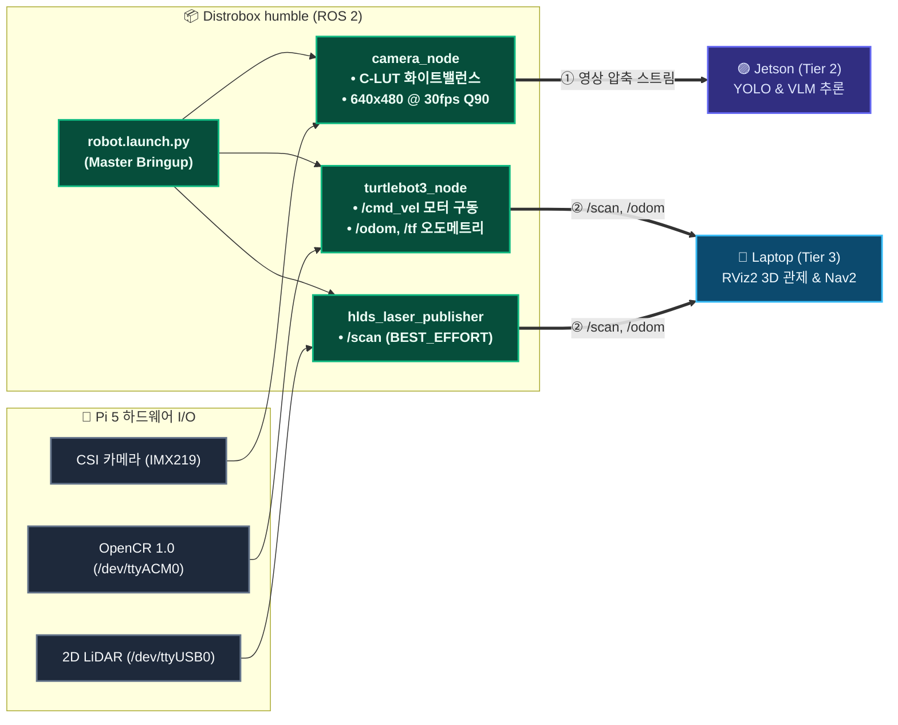
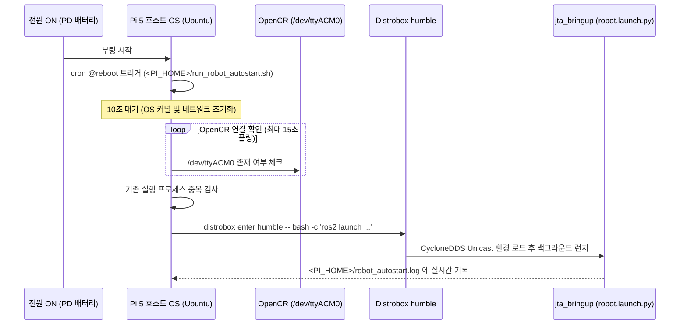

# 🤖 Raspberry Pi 5: `jta_camera` & `jta_bringup` 패키지화 및 부팅 자동 실행 기술 명세서

> **문서 버전**: v1.4.10  
> **점검일**: 2026-11-24  
> **대상 기기**: Raspberry Pi 5 (`<PI5_IP>:22`, 계정: `<PI_USER>`, 컨테이너: `distrobox humble`)  
> **작성자**: `ROS2_JW`

### 📋 문서 버전 관리 (Document Version Control)
| 문서&nbsp;버전 | 개정&nbsp;일자 | 작성자 | 문서&nbsp;상태 | 변경 및 개정 내역 |
| :---: | :---: | :---: | :---: | :--- |
| `v1.0.0` | 26.11.04 | ROS2_JW | Approved | • `jta_camera`, `jta_bringup` 패키지 모듈화 및 `systemd` Linger 무인 자동 기동 명세 제정 |
| `v1.4.1` | 26.11.16 | ROS2_JW | Approved | • `nav2.launch.py`, `nav2_params.yaml`, `auto_localizer.py` 통합 및 CycloneDDS·AMCL 실주행 튜닝 반영 |
| `v1.4.2` | 26.11.17 | ROS2_JW | Approved | • `patrol_node` 순찰 추가, AMCL 납치 복구(`recovery_alpha`) 및 `recoveries_server` 정정 |
| `v1.4.4` | 26.11.17 | ROS2_JW | Approved | • `nav2_params.yaml` `MPPIController` 전환 (`batch_size: 600`, `time_steps: 25`, `vx_min: -0.10`) |
| `v1.4.5` | 26.11.18 | ROS2_JW | Approved | • Pi 5 MPPI 실주행 검증, Costmap 좁은 틈 우회 완화(`robot_radius: 0.19`), `KeepoutFilter`/`SpeedFilter` 스캐폴딩 반영 |
| `v1.4.7` | 26.11.19 | ROS2_JW | Approved | • Nav2 `behavior_server` 정정(`simulate_ahead_time: 0.5`)·좁은공간 탈출 튜닝(`robot_radius: 0.145`, `inflation: 0.19`, `planner 2Hz`)<br>• `patrol_node` 최단거리·선택 WP(`enabled`)·Option B 내부취소 추적·3초확정 20초 추종(40초 쿨다운, IDLE 포함) 반영 |
| `v1.4.8` | 26.11.20 | ROS2_JW | Approved | • `speaker_node` 부팅 볼륨(`80%→95%`)<br>• `patrol_node` 지정순찰(`custom_order`)·추적 종료 `/tts/say` `"추적을 종료합니다."`·사람 감지 `1.7m(176px)` 통일 및 `FOLLOWING` 중 `/yolo/zone_enable=True` 유지 반영 |
| `v1.4.9` | 26.11.23 | ROS2_JW | Approved | • `nav2_params.yaml` `vision_scan`(`/vision/scan`) 바닥장애물 레이어 추가<br>• `patrol_node` `/gesture/cmd`(ArUco `ESTOP`/`GOTO_WP`)·`10.5V` 저전압 `dock` 복귀 및 사람 추종 `1.2m(250px)/30초/50초` 통일 반영 |
| **`v1.4.10`** | 26.11.24 | **ROS2_JW** | **Approved** | • Pi 5 실기 부팅/내부 런처(`inner_*_launch.sh`)·`pi5_power_daemon.py`·`patrol_waypoints.yaml`(`dock`)·`detection_zones.json`·마스크 1:1 백업<br>• `speaker_node` `~/music/song` 랜덤 선곡+인트로 TTS 및 `dobingda.mp3` Edge-TTS 안내 음성 대체 반영 |

---

## 1. 개요 및 설계 목적

본 문서는 Raspberry Pi 5(Tier 1 AMR 로봇 플랫폼)에서 단독 실행되던 IMX219 CSI 카메라 스트리밍과 TurtleBot3 로봇 브링업을 **ROS 2 표준 패키지(`jta_camera`, `jta_bringup`)로 완전 모듈화/패키징**하고, **전원 부팅 시 하드웨어 연결 감지 후 Distrobox 컨테이너 내부에서 100% 무인 자동 실행(Autostart)**되도록 구축한 전체 엔지니어링 명세서입니다.

---

## 2. 시스템 아키텍처 및 하드웨어 파이프라인



---

## 3. ROS 2 패키지 구조 및 상세 소스 코드 분석

### 3.1 패키지 디렉토리 구조
패키지 경로: `<PI_HOME>/ros2_ws/src/`

```text
ros2_ws/src/
├── jta_camera/                         # CSI 카메라 전용 초저지연 ROS 2 패키지
│   ├── package.xml
│   ├── setup.cfg
│   ├── setup.py                        # camera_node 엔트리포인트 등록
│   ├── resource/jta_camera
│   ├── jta_camera/
│   │   ├── __init__.py
│   │   └── camera_node.py              # V4L2 RAW + C-LUT 화이트밸런스 스트리머
│   └── launch/
│       └── camera.launch.py            # 파라미터 제어 및 respawn=True 탑재
│
└── jta_bringup/                        # 원터치 마스터 브링업 패키지
    ├── package.xml                     # 의존성: turtlebot3_bringup, jta_camera
    ├── setup.cfg
    ├── setup.py
    ├── resource/jta_bringup
    └── launch/
        └── robot.launch.py             # 모터 + 라이다 + 카메라 일체형 통합 런처
```

---

### 3.2 핵심 소스 코드 분석

#### (1) `jta_camera/camera_node.py` (초저지연 CSI 드라이버)
* **하드웨어 180도 플립**: OpenCV 소프트웨어 회전(`cv2.rotate`) 대신 `v4l2-ctl` subdev 하드웨어 레지스터를 직접 반전(`hflip=1, vflip=1`)하여 **CPU 연산 부하 0% 달성**.
* **초고속 C-LUT 화이트밸런스**: 라즈베리파이 5 RP1 칩의 RAW8(BA81) 비트맵을 직수신하고 고정 변환 룩업테이블(LUT)을 적용하여 ~3ms 이내 BGR 변환 완료.
* **JPEG Quality 90 압축 스트리밍**: 640×480 JPEG(Q90) · 15 FPS 단일 스트림으로 Wi-Fi 대역폭을 ~3.5Mbps 수준으로 유지해 100Mbps 공유기 환경에서도 안정 송출.

#### (2) `jta_camera/launch/camera.launch.py`
카메라 장치 일시 순단 시 자동 복구되도록 `respawn` 보호 장치 탑재:
```python
camera_node = Node(
    package='jta_camera',
    executable='camera_node',
    name='camera_publisher_node',
    output='screen',
    parameters=[{
        'width': LaunchConfiguration('width'),
        'height': LaunchConfiguration('height'),
        'jpeg_quality': LaunchConfiguration('jpeg_quality'),
        'flip_h': 1,
        'flip_v': 1,
    }],
    respawn=True,         # 카메라 프로세스 크래시 시 자동 부활
    respawn_delay=2.0
)
```

#### (3) `jta_bringup/launch/robot.launch.py` (원터치 마스터 런처)
기존 TurtleBot3 Waffle의 Bringup 런치와 방금 구축한 `jta_camera`를 하나의 런치 파일로 통합:
```python
def generate_launch_description():
    tb3_bringup_dir = get_package_share_directory('turtlebot3_bringup')
    jta_camera_dir = get_package_share_directory('jta_camera')

    env_tb3_model = SetEnvironmentVariable('TURTLEBOT3_MODEL', 'waffle')
    env_lds_model = SetEnvironmentVariable('LDS_MODEL', 'LDS-01')

    # 1. 터틀봇3 기본 브링업 (OpenCR 모터/오도메트리 + 라이다 + 로봇 TF)
    tb3_launch = IncludeLaunchDescription(
        PythonLaunchDescriptionSource(os.path.join(tb3_bringup_dir, 'launch', 'robot.launch.py'))
    )

    # 2. JTA 초저지연 CSI 카메라 브링업
    camera_launch = IncludeLaunchDescription(
        PythonLaunchDescriptionSource(os.path.join(jta_camera_dir, 'launch', 'camera.launch.py')),
        launch_arguments={'width': '640', 'height': '480', 'jpeg_quality': '90', 'target_fps': '15'}.items()
    )

    return LaunchDescription([env_tb3_model, env_lds_model, tb3_launch, camera_launch])
```

---

## 4. 부팅 시 자동 실행(Autostart) 매커니즘 및 안정성 보호

하드웨어 I/O가 물리적으로 연결되기도 전에 ROS 노드가 성급히 기동되어 크래시 나는 문제를 방지하기 위해 **선제적 하드웨어 폴링 및 3단계 안전 시퀀스**를 적용했습니다.



### 4.1 핵심 자동 실행 스크립트 (`<PI_HOME>/run_robot_autostart.sh` ➔ `inner_robot_launch.sh`)

* **레포 1:1 백업본**: [`src/pi5/scripts/run_robot_autostart.sh`](../../../src/pi5/scripts/run_robot_autostart.sh), [`src/pi5/scripts/inner_robot_launch.sh`](../../../src/pi5/scripts/inner_robot_launch.sh), [`src/pi5/scripts/inner_nav2_launch.sh`](../../../src/pi5/scripts/inner_nav2_launch.sh), [`src/pi5/scripts/inner_slam_launch.sh`](../../../src/pi5/scripts/inner_slam_launch.sh), [`src/pi5/utils/pi5_power_daemon.py`](../../../src/pi5/utils/pi5_power_daemon.py)

```bash
#!/bin/bash
# [Raspberry Pi 5] 부팅 시 Distrobox humble 및 robot.launch.py 자동 실행 스크립트
export USER="${USER:-<PI_USER>}"
export HOME="${HOME:-/home/${USER}}"
export XDG_RUNTIME_DIR="${XDG_RUNTIME_DIR:-/run/user/$(id -u)}"
export PATH=/usr/local/sbin:/usr/local/bin:/usr/sbin:/usr/bin:/sbin:/bin

sleep 5
rm -f /dev/shm/pi5_boot_ceremony_done /tmp/pi5_boot_ceremony_done > /dev/null 2>&1

# 1. OpenCR 디바이스 연결 확인 (최대 15초 대기)
COUNT=0
while [ ! -e /dev/ttyACM0 ] && [ $COUNT -lt 15 ]; do
    sleep 1
    COUNT=$((COUNT + 1))
done

# 2. 호스트 백그라운드 전원 감시 데몬 기동 (/dev/shm/pi5_power.json 1초 갱신)
if ! pgrep -f "pi5_power_daemon.py" > /dev/null; then
    nohup /usr/bin/python3 "$HOME/pi5_power_daemon.py" > /dev/null 2>&1 &
fi

# 3. 포트 Pre-Clean 및 중복 실행 방지 후 Distrobox 내부 런처 호출
fuser -k /dev/ttyACM0 /dev/ttyUSB0 /dev/video0 > /dev/null 2>&1
sleep 1
RUNNING=$(pgrep -f "robot.launch.py|turtlebot3_ros|hlds_laser_publisher" 2>/dev/null)
if [ -n "$RUNNING" ]; then
    echo "[autostart] Robot node is already running." >> "$HOME/robot_autostart.log"
    exit 0
fi

nohup distrobox enter humble -- "$HOME/inner_robot_launch.sh" > "$HOME/robot_autostart.log" 2>&1 &
echo "[autostart] Successfully initiated robot.launch.py at $(date)" >> "$HOME/robot_autostart.log"
```

### 4.2 Crontab 등록
```bash
@reboot <PI_HOME>/run_robot_autostart.sh
```

### 4.3 Pi 5 독립 WebUI (`:9999`) 시스템 데몬 (`jta-web-monitor.service`)
* **시스템 유닛**: `/etc/systemd/system/jta-web-monitor.service` (레포 백업: [`src/pi5/scripts/jta-web-monitor.service`](../../../src/pi5/scripts/jta-web-monitor.service), `WantedBy=multi-user.target`, `User=<PI_USER>`, `After=user@1000.service`, `Restart=always`, `RestartSec=5`)
  * `ExecStartPre` 및 `ExecStopPost`로 기존 `:9999` / `web_monitor_server.py` 잔류 프로세스를 선제·사후 정리하여 `systemctl restart` 시 포트 바인딩 충돌을 차단합니다.
* **컨테이너 내부 런처**: `<PI_HOME>/inner_webui_launch.sh` (레포 백업: [`src/pi5/scripts/inner_webui_launch.sh`](../../../src/pi5/scripts/inner_webui_launch.sh))
  * Distrobox `humble` 내부에서 ROS 2 Humble 및 CycloneDDS Unicast 환경(`config/cyclonedds.xml`)을 로드한 뒤 `~/jta_web/web_monitor_server.py`(`0.0.0.0:9999`)를 기동합니다.
* **운영 검증**: `enabled`/`active`, `0.0.0.0:9999 LISTEN`, `GET /api/health` ➔ `ALL_GREEN` 확인 (코드 수정 후에는 `scripts/sync_to_robot.sh pi5`로 `~/jta_web/` 동기화 및 서비스 재시작).

### 4.4 Pi 5 현장 설정 & Costmap 필터 마스크 1:1 백업
* **순찰/탐지 설정**: [`patrol_waypoints.yaml`](../../../src/pi5/jta_bringup/config/patrol_waypoints.yaml) (`dock` 충전소 좌표 포함, `WP1~WP7`), [`detection_zones.json`](../../../src/pi5/jta_bringup/config/detection_zones.json) (사람 탐지 구역 2개)
* **Costmap 필터 마스크**: [`maps/keepout_mask.{pgm,yaml}`](../../../maps/keepout_mask.yaml), [`maps/speed_mask.{pgm,yaml}`](../../../maps/speed_mask.yaml) (`nav2.launch.py` 기본 로드)

---

## 5. 실전 운영 및 유지보수 가이드

### 5.1 실시간 로그 모니터링
```bash
# Pi 5 터미널에서 실행 로그 확인
tail -f <PI_HOME>/robot_autostart.log
```

### 5.2 프로세스 상태 확인
```bash
ps aux | grep -E "turtlebot3|camera_node|laser"
```
* **정상 기동 시 동작 노드**:
  1. `turtlebot3_ros` (OpenCR 통신, `/dev/ttyACM0`)
  2. `hlds_laser_publisher` (LDS-01 2D 라이다)
  3. `camera_node` (IMX219 640x480 압축 영상 스트리밍)

### 5.3 수동 비상 정지 및 수동 기동
* **비상 정지 (모터 0 속도 강제 송신 및 프로세스 종료)**:
  ```bash
  <PI_HOME>/stop.sh
  pkill -f robot.launch.py
  ```
  * **수동 재시작**:
  ```bash
  <PI_HOME>/run_robot_autostart.sh
  # 또는 CLI 대화형 실행
  rosgo
  ```

---

## 6. Nav2 통합 런치 · `patrol_node` & `10.5V` 복귀 (`v1.4.7 ~ v1.4.9`)

* **분리 기동 정책**: `robot.launch.py`의 `enable_nav2` 기본값은 `False`로 유지하고, 필요 시 `:9999` WebUI(PIN 또는 👍 엄지척)나 `ros2 launch jta_bringup nav2.launch.py`로 독립 기동합니다.
* **전역 초기 위치 추정 (`jta_bringup/auto_localizer.py`)**:
  * 기동 시 `/reinitialize_global_localization` 호출 후 `/request_nomotion_update` 3회 선행 필터링을 수행합니다.
  * `auto_spin:=True`(기본값) 시 `0.5 rad/s`로 최대 `20.0s` 회전하며 `cov <= 0.02` 달성 시 즉시 정지(`/cmd_vel 0.0` × 5 + `rclpy.spin_once` 및 `0.25s` DDS 플러시 대기)합니다.
* **실주행 Costmap / MPPI / 바닥장애물 튜닝 (`config/nav2_params.yaml`)**:
  * **AMCL**: `max_particles: 5000`, `max_beams: 180`, `z_hit: 0.9`, `z_rand: 0.1`, `sigma_hit: 0.08`, `update_min_d: 0.08`, `update_min_a: 0.05`, `recovery_alpha_fast: 0.1`, `recovery_alpha_slow: 0.001`(주행 중 위치 이탈 시 자동 복구).
  * **로컬 컨트롤러 (`MPPIController`)**: `motion_model: "DiffDrive"`, `batch_size: 600`, `time_steps: 25`, `model_dt: 0.1`, `vx_max: 0.16`, `vx_min: -0.10`(후진 탈출), `wz_max: 1.2`, Critics 8종 적용.
  * **`local_costmap` / `global_costmap`**: `obstacle_layer` 단일화, `resolution: 0.025 / 0.05`, `robot_radius: 0.145`, `inflation_radius: 0.19`, `cost_scaling_factor: 15.0`, `KeepoutFilter`/`SpeedFilter` (`/keepout_filter_mask`, `/speed_filter_mask`) 및 `local_costmap` **`vision_scan` (`/vision/scan`, `0.20~1.50m`, `raytrace 1.8m`)** 바닥장애물 레이어 결합.
  * **`behavior_server`**: `nav2_behaviors/Spin|BackUp|Wait`, `robot_base_frame: base_link`, `simulate_ahead_time: 0.5`, `use_sim_time: False`.
* **다중·지정 순찰 / ArUco 제어 / `10.5V` 복귀 (`jta_bringup/patrol_node.py`, `config/patrol_waypoints.yaml`)**:
  * `nav2.launch.py`에서 `enable_patrol:=True`, `patrol_auto_start:=False`(IDLE 대기)로 기동되며, 최단거리/선택 WP/지정순찰(`custom_order`) 순환을 지원합니다.
  * **사람 근접 추종**: 탐지구역 내 `1.2m(bh >= 250px)` 사람 `3.0초` 연속 감지 확정 시 `30초` 비주얼 서보잉 추종(종료 시 `"추적을 종료합니다."` TTS, 확정 시점 기준 `50초` 쿨다운).
  * **ArUco 명령 연동 (`/gesture/cmd`)**: `ESTOP` 수신 시 Goal 취소·정지·TTS, `GOTO_WP` 수신 시 등록 WP 1~10 단일 이동·도착 TTS.
  * **저전압 자동 복귀 (`dock`)**: `/battery_state` `9.0V < V <= 10.5V` `5.0초` 연속 지속 시 1회 래치 후 `patrol.dock` 좌표로 자율 복귀(`DOCK_RETURN` / `DOCKED` + TTS, `11.5V` 회복 시 래치 해제).
* **부팅 세레머니 & 사람 감지 음원 (`speaker_node.py`, `v1.4.10`)**:
  * **랜덤 선곡 + 인트로 TTS**: `/dev/shm/pi5_boot_ceremony_done` 부재 시 `~/music/song` 내 `.mp3`/`.wav` 중 1곡을 무작위 선곡(폴백 없음) ➔ `80%` 볼륨 *"노래 한 곡 듣고 가시죠."* Edge-TTS ➔ `1.0초` 대기 ➔ 완곡 재생(`"stop"` 즉시 스킵) ➔ `95%` *"시스템을 동작합니다."* 발화.
  * **`dobingda.mp3` Edge-TTS 안내 음성 대체**: `ko-KR-SunHiNeural` 4단 멘트(*"사람이 감지되었습니다." × 2 ➔ "용건을 말씀해 주세요." ➔ 2.95s 무음 ➔ "앗! 죄송합니다. 제가 마이크가 없네요... 허허.."*, 원본 `dobingda.mp3.bak` 보존).
