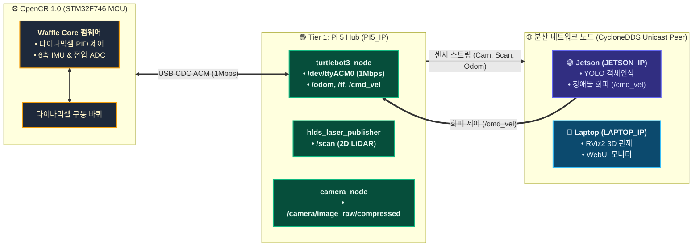

# 🧠 Raspberry Pi 5 & OpenCR 제어보드 기능별·역할별 기술 분석 보고서
### (OpenCR Board Specs, Firmware Architecture, Low-Power Tuning & Sensor Pipeline Deep-Dive)

- **점검일**: 2026-11-23
- **문서 위치**: `docs/2_tiers/tier1_raspberry_pi5/opencr_and_motor.md`
- **대상 기기**: Raspberry Pi 5 (`<PI5_IP>:22`) 및 직결 OpenCR 제어보드 (`/dev/ttyACM0`)
- **목적**: 엣지 하드웨어 허브로서의 라즈베리파이 5와 실시간 모터/센서 제어기인 OpenCR 보드의 하드웨어 스펙, 구동 펌웨어, 전력 관리 튜닝, 카메라 파이프라인의 엔지니어링 설계와 운용 명세를 체계화.

### 📋 문서 버전 관리 (Document Version Control)
| 문서&nbsp;버전 | 개정&nbsp;일자 | 작성자 | 문서&nbsp;상태 | 변경 및 개정 내역 |
| :---: | :---: | :---: | :---: | :--- |
| `v1.0.0` | 26.10.27 | ROS2_JW | Approved | • OpenCR 1.0 펌웨어 시퀀스, 전원 안정화 및 CSI 파이프라인 분석서 제정 |
| `v1.2.0` | 26.11.09 | ROS2_JW | Approved | • 부팅 0.0 폭주 방지 가드레일, WebUI 토크 제어 API 및 `motor_*.sh` 반영 |
| `v1.4.0~1.4.1` | 26.11.16 | ROS2_JW | Approved | • CycloneDDS 전환, `auto_localizer.py` 정지/플러시 보강 및 WebUI `full_reset` 연동 |
| **`v1.4.9`** | 26.11.23 | **ROS2_JW** | **Approved** | • `/battery_state` `10.5V` 5초 저전압 `dock` 자동 복귀 및 OpenCR `NO_CONNECT` 시 WebUI `🔴 OpenCR OFF` 단절 표출 교정 |
| `v2.0.0` | (예정) | ROS2_JW | 계획&nbsp;(Planned) | • 다이나믹셀 휠 엔코더 PID 튜닝 및 IMU 융합 필터 분석 추가 |

---

## 1. 🏗️ 시스템 내 위치 및 역할 분담 (Tier 1 Architecture)

전체 분산 로봇 시스템에서 **Raspberry Pi 5 + OpenCR**은 **Tier 1 (물리 하드웨어 I/O 및 실시간 액추에이터 제어 허브)**의 역할을 담당합니다.

---

## 2. 🎛️ OpenCR 1.0 제어보드 스펙 및 하드웨어 분석

> [!NOTE] 하드웨어 명칭 확인
> 사용자가 "openCV보드"로 언급한 장치는 **ROBOTIS 사의 OpenCR 1.0 (Open-source Control Module for ROS)** 보드입니다. 이는 영상 처리가 아닌 **로봇의 관절 제어, 오도메트리 연산, 실시간 센서 입출력을 전담하는 임베디드 제어 보드**입니다.

### 📋 OpenCR 1.0 하드웨어 규격표
| 구분 | 상세 규격 | 엔지니어링 특징 및 기능 |
| :--- | :--- | :--- |
| **메인&nbsp;MCU** | **STMicroelectronics STM32F746ZGT6** | • 32-bit ARM Cortex-M7 with FPU (최대 **216 MHz**) • 1MB Flash Memory, 320KB SRAM • 고성능 DSP 명령어셋 내장으로 실시간 모터 PID 및 필터링 고속 연산 |
| **USB&nbsp;인터페이스** | ST Virtual COM Port (`/dev/ttyACM0`) | • VID:PID = `0483:5740` • **1,000,000 bps (1 Mbps)** 초고속 CDC ACM 시리얼 통신으로 지연 없는 제어 패킷 전송 |
| **모터&nbsp;드라이버&nbsp;인터페이스** | 다이나믹셀 전용 통신 포트 | • TTL 포트 (3-Pin) 및 RS-485 포트 (4-Pin) • XM-430 등 다이나믹셀 스마트 액추에이터 데이지체인 제어 |
| **내장&nbsp;센서** | 6축 IMU (MPU9250 / ICM-20648) | • 3축 자이로(Gyroscope) + 3축 가속도계(Accelerometer) • 로봇의 각속도 및 기울기 실시간 측정 |
| **전원&nbsp;회로** | 외부 11.1V ~ 12V 입력부 | • 로봇 구동 모터 전원(11.1V Li-Po)을 직접 공급받아 스텝다운 DC-DC 컨버터를 통해 MCU 및 센서 구동 • 라즈베리파이 5V 라인과 물리적으로 모터 전원이 분리되어 모터 역기전력 및 전압 강하 영향 차단 |

---

## 3. ⚙️ OpenCR 구동 펌웨어 동작 메커니즘 분석

OpenCR 1.0에는 **TurtleBot3 Waffle Core 펌웨어**가 탑재되어 라즈베리파이 5의 `turtlebot3_node` (`turtlebot3_ros`)와 통신합니다.

### 🔄 펌웨어 부팅 및 실시간 제어 시퀀스
1. **포트 개방 및 보레이트 동기화**:
   - `DynamixelSDKWrapper`가 `/dev/ttyACM0` 포트를 열고 **1,000,000 bps**로 통신 링크를 확립합니다.
2. **자이로 센서 자동 보정 (Start Calibration of Gyro)**:
   - 노드 기동 직후 5초 동안 로봇이 정지한 상태에서 자이로스코프 바이어스(오프셋)를 측정하여 드리프트(Drift) 오차를 영점 보정합니다 (`Calibration End`).
3. **디바이스 및 모터 등록**:
   - 좌/우 다이나믹셀 휠 모터(`Add Motors`, `Add Wheels`)를 통신 버스에 등록하고 휠 간격(Wheel Separation: 0.287m) 및 바퀴 반경(0.033m) 파라미터를 초기화합니다.
4. **실시간 퍼블리셔 가동**:
   - `/battery_state`: ADC 전압 센서를 통해 배터리 잔량(전압) 실시간 모니터링
   - `/imu`: 보정된 각속도 및 선형 가속도 데이터 실시간 발행
   - `/joint_states`: 좌/우 휠 엔코더의 틱(Tick) 카운트 및 회전각 발행
   - `/odom`: 차동 구동(Differential Drive) 기구학 모델을 바탕으로 누적 데드레커닝 오도메트리 발행
5. **`/cmd_vel` 실시간 수신 및 모터 역기구학 변환**:
   - 수신된 선속도($v$, m/s)와 각속도($\omega$, rad/s)를 좌우 휠 속도로 변환:
     $$v_{left} = v - \frac{\omega \cdot W}{2}, \quad v_{right} = v + \frac{\omega \cdot W}{2}$$
   - 다이나믹셀 모터 패킷으로 변환하여 실시간 속도 제어를 수행합니다.

---

## 4. ⚡ 5V 3A 보조배터리 셧다운 트러블슈팅 및 전력 최적화

### 🚨 현상 및 원인 규명
- **초기 현상**: 단일 5V 3A 보조배터리로 라즈베리파이 5를 구동한 채 주행을 시작하면 약 2분 만에 전원이 꺼지고 Red LED가 켜진 채 벽돌(Hang) 상태가 됨.
- **원인 분석**:
  1. 라즈베리파이 5(Cortex-A76 4코어 2.4GHz)는 CPU 풀로드 시 단독으로 2.5A 이상을 소모합니다.
  2. 여기에 CSI 카메라, LDS-01 2D LiDAR(모터 회전 전류), OpenCR USB 인터페이스가 동시에 전류를 끌어 쓰면서 **순간 피크 전류가 보조배터리 출력 한계(3.0A)를 초과**.
  3. 보조배터리의 **OCP(과전류 보호회로)**가 작동하여 5V 출력을 차단함으로써 시스템이 셧다운되었습니다.

### 🛠️ 엔지니어링 해결 전략
1. **전원 라인 분리**: OpenCR 모터 구동 전원은 11.1V 3S Li-Po 배터리로 완전히 분리하여 모터 기동 전류가 라즈베리파이에 영향을 주지 않도록 격리.
2. **CPU 언더클럭 (`/boot/firmware/config.txt`)**:
   - `arm_freq=1400` 적용: 최대 동작 클럭을 2.4GHz에서 1.4GHz로 제한하여 피크 소비 전력을 40% 이상 감축.
3. **CPU 코어 수 제한 (2코어 오프라인)**:
   - Cortex-A76 4개 코어 중 Core 2, 3을 오프라인으로 전환하고, **Core 0, 1 (듀얼코어)만 가동**하여 센서 I/O와 통신 전용으로 특화.
4. **저전압 `dock` 복귀 & 단절 감지 (`v1.4.9`)**:
   - `patrol_node.py`가 `/battery_state`를 감시해 `9.0V < V <= 10.5V` 구간 `5.0초` 지속 시 지정 충전소(`patrol.dock`)로 자율 복귀합니다.
   - `turtlebot3_ros` 통신이 `3.0초` 이상 두절되면 WebUI 서버(`web_monitor_server.py`)가 `NO_CONNECT` 전환과 함께 잔여 전압 캐시를 `0.0V`로 초기화해 상단바에 즉시 `🔴 OpenCR OFF`를 표출합니다.
5. **USB 전력 공급 (`5.2V 5A 벅 컨버터` + `usb_max_current_enable=1`)**:
   - 5.2V 5A DC-DC 벅 컨버터 직결 이후 `usb_max_current_enable=1`(1.6A 개방)을 적용해 LiDAR·OpenCR·오디오 동시 구동 시에도 `vcgencmd get_throttled: 0x0` 안정 상태를 유지합니다.
- **결과**: **54.3°C의 안정적인 패시브 쿨링 상태를 유지하며 셧다운 없이 연속 주행 및 센서 스트리밍 완벽 성공.**

---

## 5. 📷 CSI 카메라 초저지연(Zero-Lag) 파이프라인 엔지니어링

라즈베리파이 5의 신규 I/O 칩셋인 **RP1(rp1-cfe)** 컨트롤러와 Sony IMX219 센서의 특수성을 고려하여 맞춤형 스트리머(`camera_ros2_stream.py`)를 개발했습니다.

### 🔍 직면 과제 및 기술적 해결
1. **V4L2 포맷 호환 에러 (`Invalid argument (22)`)**:
   - IMX219 센서는 일반 웹캠과 달리 YUV나 MJPEG 하드웨어 인코더를 지원하지 않고 **10-bit Raw Bayer (`pRAA`) 포맷만 출력**.
   - `media-ctl`을 통해 CSI 링크를 수동 연결하고, OpenCV를 통해 Bayer RAW ➔ BGR 색공간 디모자이크(Demosaic) 변환을 파이프라인에서 직접 처리.
2. **화이트밸런스 왜곡 (초록빛 화면) 보정**:
   - Bayer 패턴의 Green 픽셀 과다로 화면이 녹색으로 치우치는 현상을 방지하기 위해 채널별 화이트밸런스 게인 수동 보정 (Red: **1.55**, Blue: **1.25**) 적용.
3. **네트워크 대역폭 최적화 (`jta_camera`)**:
   - 비압축 640x480 Raw 프레임 상시 전송 시 Wi-Fi 패킷 드랍 발생 ➔ **640x480 JPEG(Quality 90), 15 FPS, Queue Size=1** 압축 스트림(`/camera/image_raw/compressed`)을 주력으로 송출하고, 비압축 `/camera/image_raw`는 구독자 존재 시에만 On-Demand 발행하여 **Zero-Lag 스트리밍** 달성.

---

## 6. 📦 Distrobox 기반 무오버헤드 컨테이너 가상화

라즈베리파이 5의 호스트 OS는 최신 **Ubuntu 24.04 LTS (Noble)**이지만, 로봇 생태계 패키지(TurtleBot3, LDS 드라이버)는 **Ubuntu 22.04 LTS 기반 ROS 2 Humble**에 최적화되어 있습니다.

### 💡 Distrobox 채택의 이점
- 일반 Docker 컨테이너와 달리 **호스트의 `/dev/ttyACM0`, `/dev/ttyUSB0`, CSI 카메라 장치 소켓, 사용자 파일 시스템을 100% 네이티브 성능으로 직접 공유**.
- 백그라운드 가상화 오버헤드가 전혀 없어 CPU 자원을 센서 패킷 수집에 온전히 투입할 수 있습니다.
