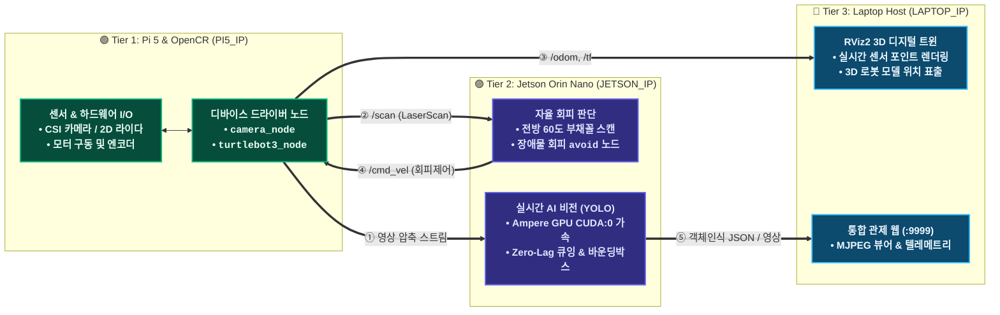

# 🧠 Jetson Orin Nano 상세 기능별·역할별 기술 분석 보고서
### (Hardware, Docker Architecture, ROS 2 Node Deep-Dive & System Rationale)

- **점검일**: 2026-11-24
- **문서 위치**: `docs/2_tiers/tier2_jetson_orin_nano/vlm_tts_service.md`
- **대상 기기**: NVIDIA Jetson Orin Nano Developer Kit Super (`<JETSON_IP>:2222`)
- **목적**: 엣지 AI 로봇 시스템 내 Jetson Orin Nano의 하드웨어, 컨테이너, 통신, VLM/YOLO 알고리즘별 기능과 엔지니어링 설계 명세를 체계적으로 정리.

### 📋 문서 버전 관리 (Document Version Control)
| 문서&nbsp;버전 | 개정&nbsp;일자 | 작성자 | 문서&nbsp;상태 | 변경 및 개정 내역 |
| :---: | :---: | :---: | :---: | :--- |
| `v1.0.0` | 26.10.27 | ROS2_JW | Approved | • Ampere GPU, avoid.py 회피 및 YOLO 실시간 큐잉 분석서 제정 |
| `v1.4.0~1.4.1` | 26.11.16 | ROS2_JW | Approved | • VLM 4-bit NF4 상주(`1.42GB`), YOLO 30ms 근접 트리거 및 CycloneDDS 전환 반영 |
| `v1.4.3` | 26.11.17 | ROS2_JW | Approved | • VLM Option A(`448x336`, `32 tokens`, `25s` 쿨다운, `"즉시"` 프레임 추론) 반영 |
| `v1.4.6` | 26.11.18 | ROS2_JW | Approved | • 수동 VLM 순수 시각 우선(`allow_person_alert=False`), 사람 감지 후처리 프리픽스, `640×480` 해상도 복구<br>• 영어 시각 지시 프롬프트(`40 tokens`) 및 CLI 전용 `/vlm/chat_query` ↔ `/vlm/chat_response` 분리 반영 |
| `v1.4.7` | 26.11.19 | ROS2_JW | Approved | • `vlm_service_node.py` 사람 근접 음성 트리거 거리 `2.0m`(`h >= 150px`) 확장<br>• `3초` 연속 감지 확정 시 즉시 `dobingda.mp3` 재생(추종 동시 시작) 및 확정 시점 기준 `40초` 쿨다운 반영 |
| `v1.4.8` | 26.11.20 | ROS2_JW | Approved | • `vlm_service_node.py` 사람 근접 음성 트리거 기준을 `1.7m`(`h >= 176px`)로 통일 반영 |
| `v1.4.9` | 26.11.23 | ROS2_JW | Approved | • `vlm_service_node.py` 사람 근접 트리거 `1.2m(h >= 250px)` · `50초` 쿨다운 통일<br>• 상시 바닥장애물(`floor_obstacle_node.py` `/vision/scan`) 및 ArUco+한손 제어(`gesture_node.py` `/gesture/cmd`) 추가 |
| `v1.4.10` | 26.11.24 | ROS2_JW | Approved | • `vlm_service_node.py` 코드 변경 없이 Pi 5 `dobingda.mp3` Edge-TTS 4단 안내 음성 대체 연동 반영 |
| `v1.4.11` | 26.11.24 | ROS2_JW | Approved | • `floor_obstacle_node.py` `beam_hold_sec=0.0`(회전 잔상 제거, Nav2 `vision_obstacle_layer` 위임) 및 `lateral_padding_m=0.03` 반영 |
| **`v1.4.12`** | 26.11.24 | **ROS2_JW** | **Approved** | • `vlm_service_node.py` Pure On-Demand(`background_loop_enabled=False`)·Lazy JPEG 디코딩·비차단 락·`conf>=0.50`·`monotonic()`·미사용 `/tts/say` 제거<br>• `floor_obstacle_node.py` 감도 완화(`18.0/38.0/650px/confirm=4`, 반사광 억제), `gesture_node.py` 손가락 굽힘 데드밴드 교정(`<=1.05`) 반영 |

---

## 1. 🏗️ 3-Tier 분산 시스템 아키텍처 및 역할 분담

본 로봇 시스템은 단일 기기의 자원 한계와 발열/전력 병목을 방지하기 위해 **기능별로 특화된 3단계 분산 노드 토폴로지**로 설계되었습니다.



### 💡 왜 젯슨을 AI/판단 전용 브레인으로 분리했는가?
1. **라즈베리파이 전력 피크 및 셧다운 방지**: 라즈베리파이 5는 모터와 라이다를 구동하는 상태에서 온보드 딥러닝 추론을 수행할 경우 피크 부하(5V 3A 초과)로 인해 보조배터리 OCP 보호회로가 동작하여 시스템이 강제 다운됩니다.
2. **GPU 가속 전담**: Jetson Orin Nano의 Ampere GPU(1024 CUDA 코어)를 전담 활용하여 비전 인식(YOLO)과 공간 인지(SLAM/Nav2)를 15~20 FPS 이상의 실시간 속도로 지연 없이 처리합니다.

---

## 2. 🖥️ 하드웨어 컴포넌트별 상세 기능 및 역할 분석

| 하드웨어&nbsp;항목 | 장착&nbsp;스펙 | 시스템 내 기능 및 엔지니어링 역할 (Functional Role) |
| :--- | :--- | :--- |
| **SoC** | Jetson Orin Nano Super | 전체 로봇의 고수준 판단(High-Level Decision Making)과 실시간 딥러닝 파이프라인 총괄 |
| **CPU** | 6-Core Cortex-A78AE (1.72 GHz) | • **A78AE (Automotive Enhanced)**: 오토모티브/산업용 기능 안전(Functional Safety)을 고려한 고신뢰성 코어<br>• 멀티스레드 기반으로 DDS 통신 I/O, LiDAR 거리 계산 알고리즘, ROS 2 콜백 큐를 병렬 처리하여 CPU 병목을 원천 방지 |
| **GPU** | NVIDIA Ampere Architecture | • **1024 CUDA 코어 + 32 Tensor 코어** 보유<br>• YOLOv8/v11 신경망의 Conv/Matrix 연산을 하드웨어 레벨에서 병렬 가속하여 단일 프레임 추론 속도를 20ms 내외로 단축 |
| **RAM** | 8GB LPDDR5 (가용 6.3 GiB) | • **Unified Memory Architecture (통합 메모리)** 구조로 CPU와 GPU 간의 물리적 메모리 복사 오버헤드(Zero-Copy)가 없어 고해상도 이미지 전송 시 버스 대역폭 절약<br>• 8GB의 넉넉한 용량으로 YOLO뿐만 아니라 향후 Ollama 기반 SLM(온디바이스 소형 언어 모델) 동시 적재 가능 |
| **스토리지** | Micron 2400 512GB NVMe SSD | • 읽기/쓰기 수천 MB/s의 PCIe Gen4 고속 스토리지<br>• 31GB 규모의 무거운 로보틱스 도커 이미지 및 딥러닝 가중치(`yolo11n.pt`)의 로딩 시간 최소화 및 로깅(ROS bag) 시 I/O 드랍 방지 (여유 공간 370GB 확보) |
| **전력&nbsp;모드** | `MAXN_SUPER (Mode 2)` | 모듈 전력 제한을 최대로 해제하여 순간적인 딥러닝 연산 급증 시에도 CPU/GPU 클럭 다운(Thermal/Power Throttling) 없이 최대 연산력 유지 |
| **Wi-Fi** | Realtek RTL8822CE (802.11ac) | 5GHz 대역 무선 링크를 통해 라즈베리파이(`<PI5_IP>`) ➔ 젯슨(`<JETSON_IP>`) ➔ 노트북(`<LAPTOP_IP>`) 간 대용량 이미지/라이다 패킷을 10ms 미만 지연으로 무선 중계 |

---

## 3. 🐳 Docker 가상화 아키텍처 및 컨테이너 설계 이유

젯슨 호스트는 **Ubuntu 24.04 LTS (JetPack 6 / L4T R39.2.1)** 기반입니다. 그러나 현재 로보틱스 산업 표준 프레임워크인 **ROS 2 Humble은 공식적으로 Ubuntu 22.04 LTS를 타깃**으로 합니다. 이 간극을 해결하고 안정적인 개발 환경을 보장하기 위해 Docker 컨테이너 가상화를 채택했습니다.

### ⚙️ 핵심 실행 옵션 및 기능별 설계 의도
```bash
docker run -it \
    --name ros2_humble_dev \
    --runtime nvidia \
    -e NVIDIA_VISIBLE_DEVICES=all \
    -e NVIDIA_DRIVER_CAPABILITIES=all \
    --net=host \
    --ipc=host \
    --privileged \
    -v /dev:/dev \
    -e DISPLAY=:1 \
    -v /tmp/.X11-unix:/tmp/.X11-unix:rw \
    -v <JETSON_HOME>/ros2_ws:/root/ros2_ws \
    my_ros2_robot:humble bash
```

1. **`--net=host` (호스트 네트워크 모드)**:
   - **기능**: Docker의 가상 브리지(`docker0`)와 NAT 포트 포워딩을 우회하고, 호스트 물리 인터페이스(`wlP1p1s0`)의 네트워크 스택을 컨테이너가 직접 공유.
   - **이유**: ROS 2의 DDS(CycloneDDS)는 노드 탐색 및 토픽 전송 시 동적 UDP 포트를 사용합니다. 브리지 모드를 사용할 경우 멀티캐스트·유니캐스트 피어링이 격리되어 타 기기와의 ROS 2 통신이 두절되므로 `host` 모드가 필수적입니다.
2. **`--runtime nvidia` & NVIDIA 환경변수**:
   - **기능**: 컨테이너 내부에 호스트의 Tegra GPU 드라이버 소켓 및 CUDA 라이브러리를 동적으로 패스스루(Pass-through).
   - **이유**: 컨테이너 내부의 PyTorch 및 OpenCV가 물리 Ampere GPU에 직접 접근하여 하드웨어 가속 추론을 수행할 수 있도록 지원합니다.
3. **`-v <JETSON_HOME>/ros2_ws:/root/ros2_ws` (볼륨 바인드 마운트)**:
   - **기능**: 호스트 SSD 디렉토리와 컨테이너 내부 워크스페이스를 1:1 실시간 동기화.
   - **이유**: 컨테이너가 삭제되거나 재생성되어도 개발한 소스 코드(`src/jetson_brain`)와 빌드 결과물, YOLO 모델 가중치(`yolo11n.pt`)가 영구 보존되며, VS Code 원격 개발 환경과의 연동성을 극대화합니다.
4. **`-v /tmp/.X11-unix:/tmp/.X11-unix` & DISPLAY**:
   - **기능**: X11 UNIX 도메인 소켓을 컨테이너로 전달하여 GUI 렌더링 파이프라인 연결.
   - **이유**: 젯슨에 연결된 모니터 또는 가상 데스크톱에 OpenCV 윈도우(`cv2.imshow`) 및 RViz2 화면을 직접 표출할 수 있도록 지원합니다.

---

## 4. 🌐 ROS 2 분산 통신 (CycloneDDS Unicast Peer)

- **단일 원본(SSOT)**: 전체 3-Tier DDS XML 프로파일과 피어 목록은 [`config/cyclonedds.xml`](../../../config/cyclonedds.xml) 및 [`master_specification.md` 2장](../../1_master/master_specification.md#2-분산-통신-네트워크-인프라-cyclonedds-unicast-peer)을 따릅니다.
- **Jetson 적용 핵심**: Wi-Fi 공유기 멀티캐스트 드롭 및 APIPA 인터페이스 격리를 차단하기 위해 `RMW_IMPLEMENTATION=rmw_cyclonedds_cpp`, `ROS_DOMAIN_ID=30`, `<LAN_SUBNET>` 서브넷 고정으로 동작합니다.

---

## 5. 💻 ROS 2 노드별 제어 & 인지 알고리즘 Deep-Dive

### 1) 🛡️ 자율 회피 제어 노드 (`avoid.py`)
- **패키지**: `jetson_brain`
- **구독(Sub)**: `/scan` (`sensor_msgs/msg/LaserScan`)
- **발행(Pub)**: `/cmd_vel` (`geometry_msgs/msg/Twist`)

#### 🔍 핵심 알고리즘 코드 및 메커니즘 분석
```python
def on_scan(self, msg):
    n = len(msg.ranges)
    # [기능 1] 전방 60도 부채꼴 영역 슬라이싱 (정면 기준 좌우 30도씩 추출)
    front = list(msg.ranges[0:30]) + list(msg.ranges[n - 30:n])
    
    # [기능 2] 결측치 및 무한대(inf) 노이즈 필터링
    valid = [r for r in front if math.isfinite(r)]
    d = min(valid) if valid else float('inf')
    
    cmd = Twist()
    # [기능 3] 회피 임계 거리 판별 및 조향 명령 생성
    if d < 0.6:  # 전방 0.6m 이내 장애물 감지 시
        cmd.angular.z = 0.6  # 제자리 회전 조향
        self.get_logger().info(f'obstacle {d:.2f}m -> turn', throttle_duration_sec=2.0)
    else:
        cmd.linear.x = 0.2   # 전방 안전 시 0.2m/s 전진
    self.pub.publish(cmd)
```
- **안전 정지 (Safety Latch)**:
  ```python
  finally:
      node.pub.publish(Twist()) # 종료 시 반드시 0 속도 발행
  ```
  노드가 예기치 않게 종료되거나 Ctrl+C 인터럽트가 발생할 때, OpenCR 모터 컨트롤러에 이전 속도 명령이 남아 로봇이 폭주하는 것을 방지하기 위해 반드시 영점 속도(Zero Twist)를 발행하고 종료합니다.

---

### 2) ⏱️ 오도메트리 기반 주행 테스트 노드 (`drive.py`)
- **패키지**: `jetson_brain`
- **구독(Sub)**: `/odom` (`nav_msgs/msg/Odometry`)
- **발행(Pub)**: `/cmd_vel` (`geometry_msgs/msg/Twist`)

#### 🔍 핵심 제어 루프 분석
```python
def __init__(self):
    self.pub = self.create_publisher(Twist, 'cmd_vel', 10)
    self.sub = self.create_subscription(Odometry, 'odom', self.on_odom, 10)
    self.t0 = self.get_clock().now()
    self.timer = self.create_timer(0.1, self.tick) # 10Hz 제어 루프

def tick(self):
    elapsed = (self.get_clock().now() - self.t0).nanoseconds / 1e9
    msg = Twist()
    if elapsed < 5.0:
        msg.linear.x = 0.2  # 최초 5초간 0.2m/s 전진
    else:
        self.pub.publish(Twist()) # 5초 경과 시 강제 정지 명령 래칭
        self.get_logger().info('done')
        raise SystemExit
    self.pub.publish(msg)
```
- **역할**: 분산 네트워크 연결 상태에서 젯슨의 명령(`/cmd_vel`)이 라즈베리파이의 OpenCR 모터까지 정확히 전달되고, 엔코더 오도메트리(`/odom`)가 젯슨으로 안정적으로 피드백되는지 검증하는 정밀 타이밍 테스트 노드입니다.

---

### 3) 👁️ 실시간 GPU 비전 객체 인식 노드 (`yolo_detector_node.py` & `jetson_yolo_node.py`)
- **구독(Sub)**: `/image_raw/compressed` 또는 `/camera/image_raw` (`sensor_msgs/msg/Image`)
- **발행(Pub)**:
  - `/yolo/image_annotated`: 바운딩 박스와 신뢰도(Confidence)가 렌더링된 실시간 BGR 영상 (노트북 RViz2 관제용)
  - `/yolo/detections`: 검출된 사물 리스트 문자열 (`std_msgs/msg/String`, 예: `"person(0.92), chair(0.85)"`, 온디바이스 LLM 의사결정 연동용)

#### 🔍 Zero-Lag 큐잉 및 GPU 고속 추론 파이프라인
```python
def image_callback(self, msg: Image):
    # [기능 1] Zero-Lag 프레임 드랍 메커니즘
    if self.processing:
        return # 이전 프레임 추론 중이면 현재 프레임은 과감히 스킵하여 지연 누적 방지
    self.processing = True

    try:
        # [기능 2] ROS 2 Raw 바이트 -> OpenCV BGR Mat 변환
        frame = np.frombuffer(msg.data, dtype=np.uint8).reshape((msg.height, msg.width, 3))

        # [기능 3] NVIDIA GPU 가속 추론 (imgsz=320, device=0)
        results = self.model(frame, device=self.device, imgsz=320, conf=0.4, verbose=False)
        annotated_frame = results[0].plot()

        # [기능 4] 텍스트 사물 리스트 추출 및 퍼블리시
        detected_items = [f"{self.model.names[int(b.cls[0])]}({float(b.conf[0]):.2f})" for b in results[0].boxes]
        if detected_items:
            self.pub_detections.publish(String(data=", ".join(detected_items)))

        # [기능 5] 어노테이션 영상 토픽 퍼블리시 (RViz2 관제용)
        out_msg = Image()
        out_msg.header = msg.header
        out_msg.height, out_msg.width, _ = annotated_frame.shape
        out_msg.encoding = 'bgr8'
        out_msg.step = out_msg.width * 3
        out_msg.data = annotated_frame.tobytes()
        self.pub_annotated.publish(out_msg)
    finally:
        self.processing = False
```

- **Zero-Lag 기술의 핵심**:
  - 기존 일반 ROS 2 노드는 큐에 수신된 이미지를 순차적으로 모두 처리하려다 추론 시간 동안 큐가 밀려 **수 초 뒤의 과거 영상이 출력되는 레이턴시 랙(Lag)**이 발생합니다.
  - `self.processing` 플래그와 `Queue Size=1` 설정을 결합하여 **언제나 "가장 최신의 프레임 1장"만 즉시 GPU로 넘김으로써 0.02초의 실시간성**을 유지합니다.

---

### 4) 🧠 온디바이스 VLM Pure On-Demand 추론 노드 (`vlm_service_node.py`, `v1.4.12`)
- **모델**: `Qwen2-VL-2B-Instruct` (`BitsAndBytes` 4-bit NF4 양자화, VRAM `1.42GB` 1회 상주)
- **구독(Sub)**: `/camera/image_raw/compressed`, `/yolo/detections`, `/scan` (`BEST_EFFORT`), `/vlm/trigger`, `/vlm/chat_query`, `/yolo/zone_enable` (미사용 `/tts/say` 구독 제거)
- **발행(Pub)**: `/vlm/response` (TTS 브리핑), `/vlm/chat_response` (CLI 조용한 응답), `/vlm/latest_summary`, `/play/sound`
- **Pure On-Demand & Lazy JPEG 디코딩 아키텍처 (`v1.4.6 ~ v1.4.12`)**:
  - **Pure On-Demand 모드**: `background_loop_enabled=False`로 25초 주기 배경 GPU 공회전을 제거해 대기 발열과 YOLO GPU 경합을 없애면서도, 모델 가중치는 VRAM(`1.42GB`)에 상주시켜 수동 질의 시 즉시 추론합니다.
  - **Lazy JPEG 디코딩 & 비차단 락**: `camera_callback`은 매 프레임 JPEG 디코딩을 수행하지 않고 원시 바이트만 저장하며, 실제 추론 요청 시에만 `frame_lock` 밖에서 1회 디코딩합니다. 비차단 `inference_lock`으로 추론 중 중복 요청을 즉시 드롭합니다.
  - **입력/토큰 규격**: `_execute_vlm_inference()`에서 `640×480` 원본 해상도와 `max_new_tokens=40`을 사용하며, 수동 `/vlm/trigger` 질의 시 `allow_person_alert=False`로 순수 시각 우선 브리핑을 수행합니다.
  - **사람 근접 경보 분리**: `yolo_callback`에서 `person`(`conf >= 0.50`, 세로 `h >= 250px`, 약 `1.2m` 근접)이 `time.monotonic()` 기준 `3.0초` 연속 감지 확정되면 즉시 `/play/sound` (`dobingda` ➔ Pi 5 `dobingda0.mp3` 완곡 후 `dobingda.mp3` 순차 재생, 쿨다운 `50.0초`)를 발행합니다.
  - **CLI 채팅 분리**: 터미널 `qss` 질의는 `/vlm/chat_query` ↔ `/vlm/chat_response` 전용 토픽으로 처리해 Pi 5 스피커 발화를 유발하지 않습니다.

### 5) 🚧 전 구간 상시 바닥 장애물 감지 노드 (`floor_obstacle_node.py`, `v1.4.11 ~ v1.4.12`)
- **상시 독립 파이프라인**: `/yolo/zone_enable`과 완전 분리되어 `/camera/image_raw/compressed`를 상시 구독하며 `self.processing` 프레임 드롭 가드를 유지합니다.
- **오탐 완화 & Dual Costmap 위임**: OpenCV LAB 색차(`chroma_thresh=18.0`) + 명도·에지(`luma_thresh=38.0`, `min_area_px=650`, `roi_top_ratio=0.58`, 밝은 바닥 반사광 억제 `dL_signed > luma_thresh * 1.7`)와 YOLO 하단 좌표 보너스를 결합해 4프레임 연속 확정(`confirm_frames=4`)합니다. 회전 시 유령 빔을 없애기 위해 **`beam_hold_sec=0.0`**(잔상 유지 로직은 `odom` 기준 Nav2 `vision_obstacle_layer` `raytrace_min_range: 0.0`에 위임) 및 **`lateral_padding_m=0.03`**을 적용해 전방 `±33°` 67빔 가상 라이다(`/vision/scan`, `BEST_EFFORT`) 및 WebUI JSON(`/vision/floor_obstacles`)을 발행합니다.

### 6) 🪪 ArUco 숫자 카드 + 한 손 Nav2 제어 노드 (`gesture_node.py`, `v1.4.9 ~ v1.4.12`)
- **하이브리드 경량 엔진**: `OpenCV ArUco (DICT_4X4_50)` 매 프레임(~5ms) + `MediaPipe Hands` (`model_complexity=1`, `mp_frame_stride=2`) CPU 경량 병행. 손가락 굽힘 판정 데드밴드를 교정(`d_tip > d_pip * 1.15` 펼침, `d_tip <= d_pip * 1.05` 굽힘)해 오인식을 줄였습니다.
- **명령 매핑 (`/gesture/cmd`, `/gesture/state`)**:
  - **ArUco 카드 (`3~4m`)**: `ID 0` = `ESTOP` (`0.25s`, 쿨다운 `2s`), `ID 1~10` = `GOTO_WP` (`0.8s`, 쿨다운 `4s`, A4 11장 [`docs/aruco_wp_cards.pdf`](../../../docs/aruco_wp_cards.pdf)).
  - **한 손 제스처**: **✋ 손 활짝 펼침 (`1.5s`, 앞/뒷면 무관)** = `NAV2_STOP` (쿨다운 `10s`), **👍 엄지척 (`2.0s`)** = `NAV2_START` (Nav2 기동 + `auto_localizer` 완료 대기 후 자동 순찰 ON, 쿨다운 `15s`).

---

## 6. 📁 관련 핵심 파일 경로 요약

- **하드웨어 & 도커 명세**: [hardware_and_docker.md](hardware_and_docker.md)
- **YOLO11n 패키지 명세**: [yolo11n_package.md](yolo11n_package.md)
- **DDS 유니캐스트 설정**: `config/cyclonedds.xml` (`CYCLONEDDS_URI`)
- **Jetson 소스 위치**: `src/jetson/` (컨테이너 `/root/ros2_ws/jetson_ros2_humble`)
