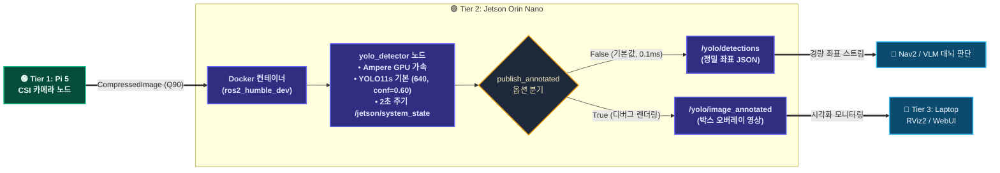
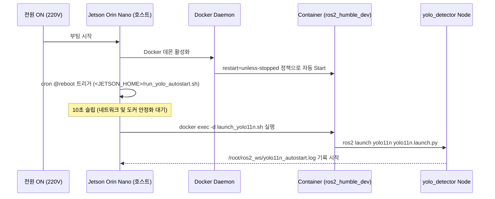

# 🚀 Jetson Orin Nano: YOLO11n ROS 2 패키지화 및 부팅 자동 실행 기술 명세서

> **문서 버전**: v1.4.12  
> **점검일**: 2026-11-24  
> **대상 기기**: Jetson Orin Nano (`<JETSON_IP>:2222`, 계정: `<JETSON_USER>`, 컨테이너: `ros2_humble_dev` / `my_ros2_robot:humble`)  
> **작성자**: `ROS2_JW`

### 📋 문서 버전 관리 (Document Version Control)
| 문서&nbsp;버전 | 개정&nbsp;일자 | 작성자 | 문서&nbsp;상태 | 변경 및 개정 내역 |
| :---: | :---: | :---: | :---: | :--- |
| `v1.0.0` | 26.11.04 | ROS2_JW | Approved | • `yolo11n` ROS 2 패키지화, 0.1ms JSON 경량 발행 및 부팅 자동 실행 명세 최초 제정 |
| `v1.4.0` | 26.11.16 | ROS2_JW | Approved | • `rmw_cyclonedds_cpp` / `CYCLONEDDS_URI` 전환 및 `v1.4.0` 환경 현행화 |
| `v1.4.9` | 26.11.23 | ROS2_JW | Approved | • `launch_yolo11n.sh` 통합 런처 내 `vlm_service_node.py` · `floor_obstacle_node.py` · `gesture_node.py` 3종 병렬 자동 기동 반영 |
| `v1.4.10` | 26.11.24 | ROS2_JW | Approved | • `launch_yolo11n.sh` `! pgrep -f` 중복 방지 가드 · `"$@"` 인자 · `cyclonedds.xml` 폴백 버전을 `scripts/sync_to_robot.sh`로 Jetson 실기 배포 동기화 |
| **`v1.4.12`** | 26.11.24 | **ROS2_JW** | **Approved** | • `detector_node.py`·`yolo11n.launch.py` 기본값을 실기 표준(`yolo11s.pt`, `imgsz=640`, `conf=0.60`)으로 정렬(`yolo11n.pt` 경량 인자 옵션)<br>• 2초 주기 `/jetson/system_state` 실측 텔레메트리(RAM/Swap/온도) 발행, `network_failover.py` 무선 전환 시 유선 IP 삭제 및 `sync_to_robot.sh` Docker `install/` 동기화 반영 |

---

## 1. 개요 및 목적

본 문서는 Jetson Orin Nano에서 단독 파이썬 스크립트(`jetson_yolo_node.py`)로 구동되던 YOLO11 초경량 객체 인식 파이프라인을 **ROS 2 표준 패키지(`yolo11n`)로 모듈화/패키징**하고, **젯슨 전원 인가 시 100% 무인 자동 실행(Docker 기동 ➔ ROS 2 Launch)**되도록 구축한 전체 아키텍처와 소스 코드를 분석 및 정리한 기술 명세서입니다.

---

## 2. 시스템 아키텍처 및 데이터 흐름



---

## 3. `yolo11n` ROS 2 패키지 구조 및 상세 코드 분석

### 3.1 디렉토리 구조
패키지 경로: `<JETSON_HOME>/ros2_ws/src/yolo11n` (컨테이너 내부: `/root/ros2_ws/src/yolo11n`)

```text
yolo11n/
├── package.xml                 # 패키지 메타데이터 및 의존성 정의
├── setup.cfg                   # libexec 설치 디렉토리 매핑 ($base/lib/yolo11n)
├── setup.py                    # setuptools 빌드 및 entry_points 등록
├── resource/
│   └── yolo11n                 # ament 리소스 인덱스 마커
├── yolo11n/
│   ├── __init__.py
│   └── detector_node.py        # YOLO11 Orin GPU 초경량 실시간 인식 노드
└── launch/
    └── yolo11n.launch.py       # ROS 2 Launch 런처 파일
```

---

### 3.2 핵심 소스 코드 분석

#### (1) `setup.cfg` (ROS 2 패키지 실행 핵심)
ament_python 빌드 시 `ros2 run` 및 `ros2 launch`가 실행 파일을 찾을 수 있도록 libexec 경로를 정확히 바인딩합니다.
```ini
[develop]
script_dir=$base/lib/yolo11n
[install]
install_scripts=$base/lib/yolo11n
```

#### (2) `setup.py`
`yolo_detector`를 `console_scripts` 엔트리포인트로 등록하고, `launch/*.launch.py` 파일을 `share/yolo11n/launch` 경로에 복사하도록 정의했습니다.
```python
import os
from glob import glob
from setuptools import find_packages, setup

package_name = 'yolo11n'

setup(
    name=package_name,
    version='0.1.0',
    packages=find_packages(exclude=['test']),
    data_files=[
        ('share/ament_index/resource_index/packages', ['resource/' + package_name]),
        ('share/' + package_name, ['package.xml']),
        (os.path.join('share', package_name, 'launch'), glob('launch/*.launch.py')),
    ],
    install_requires=['setuptools'],
    zip_safe=True,
    maintainer='<JETSON_USER>',
    maintainer_email='<JETSON_USER>@local.host',
    description='Ultra-lightweight YOLO11 real-time detection ROS 2 package for Jetson Orin Nano',
    license='Apache-2.0',
    entry_points={
        'console_scripts': [
            'yolo_detector = yolo11n.detector_node:main',
        ],
    },
)
```

#### (3) `detector_node.py` (인식 엔진 & 시스템 텔레메트리)
* **GPU 가속 자동 감지**: `torch.cuda.is_available()`를 통해 Jetson Orin Nano Ampere GPU(`0`) 자동 할당.
* **대역폭/지연 절감**: Pi 5로부터 `CompressedImage`를 직접 수신하여 압축 해제 후 추론 (`self.processing` 프레임 드롭 가드).
* **0.1ms JSON 바운딩박스 발행**: OpenCV의 `plot()` 및 `imencode()`를 기본 비활성화하여 **CPU 피크 전류 및 20ms 렌더링 지연을 원천 제거**, 구조화된 JSON 문자열(`/yolo/detections`)만 초고속 발행.
* **실측 시스템 텔레메트리 (`/jetson/system_state`, `v1.4.12`)**: 2초 타이머로 `/proc/meminfo`(RAM/Swap)와 thermal zone(온도)을 읽어 JSON 발행해 WebUI에 실측 상태를 전달합니다(실측 예: `4.6 GB / 7.3 GB (63.2%)`, Swap `25 MB / 16.0 GB`, `67.9°C`).

```python
# JSON 발행 구조 예시
{
    "timestamp": 1793776556.28,
    "frame_id": "camera_frame",
    "image_size": [640, 480],
    "count": 1,
    "objects": [
        {
            "class_id": 0,
            "class_name": "person",
            "conf": 0.884,
            "box": [120.5, 80.2, 340.1, 410.6],
            "center": [230.3, 245.4],
            "size": [219.6, 330.4],
            "rel_box": [0.1883, 0.1671, 0.5314, 0.8554]
        }
    ]
}
```

#### (4) `yolo11n.launch.py` (런처)
파라미터 변경을 터미널에서 즉시 주입 가능 (`v1.4.12`에서 실기 표준 `yolo11s.pt` 정렬, 경량 `yolo11n.pt` 인자 전환 지원):
```python
# 지원 Launch Arguments
# - model: 가중치 파일 경로 (기본값: /root/ros2_ws/yolo11s.pt, 경량 옵션: /root/ros2_ws/yolo11n.pt)
# - imgsz: 추론 해상도 (기본값: 640, 경량 옵션: 480)
# - conf: 검출 신뢰도 임계값 (기본값: 0.60, 경량 옵션: 0.35)
# - use_compressed: 압축 영상 수신 여부 (기본값: true)
# - publish_annotated: 시각화 토픽 발행 여부 (기본값: false)
```

---

## 4. 부팅 시 자동 실행(Autostart) 아키텍처

젯슨에 220V 전원이 공급되면 사람의 개입 없이 스스로 서비스를 띄우는 2단계 자동 기동 파이프라인입니다.



### 4.1 적용된 핵심 설정

1. **Docker 자동 재기동 정책**:
   ```bash
   docker update --restart unless-stopped ros2_humble_dev
   ```

2. **호스트 부팅 트리거 스크립트 (`<JETSON_HOME>/run_yolo_autostart.sh`)**:
   ```bash
   #!/bin/bash
   # 시스템 부팅 및 Docker 데몬 안정화 대기
   sleep 10

   # 1. ros2_humble_dev 컨테이너 구동 확인
   if [ "$(docker inspect -f '{{.State.Running}}' ros2_humble_dev 2>/dev/null)" != "true" ]; then
       docker start ros2_humble_dev
       sleep 3
   fi

   # 2. 컨테이너 내부에서 launch_yolo11n.sh 백그라운드 구동 (중복 실행 방지)
   RUNNING=$(docker exec ros2_humble_dev pgrep -f "yolo_detector" 2>/dev/null)
   if [ -z "$RUNNING" ]; then
       docker exec -d ros2_humble_dev bash -c '/root/ros2_ws/launch_yolo11n.sh > /root/ros2_ws/yolo11n_autostart.log 2>&1'
   fi
   ```

3. **crontab 등록**:
   ```bash
   @reboot <JETSON_HOME>/run_yolo_autostart.sh
   ```

4. **통합 실행 래퍼 스크립트 (`<JETSON_HOME>/ros2_ws/launch_yolo11n.sh`, 레포: [`src/jetson/scripts/launch_yolo11n.sh`](../../../src/jetson/scripts/launch_yolo11n.sh))**:
   ```bash
   #!/bin/bash
   source /opt/ros/humble/install/setup.bash
   source /root/ros2_ws/install/setup.bash

   export ROS_DOMAIN_ID=30
   export RMW_IMPLEMENTATION=rmw_cyclonedds_cpp
   if [ -f /root/ros2_ws/cyclonedds.xml ]; then
       export CYCLONEDDS_URI=file:///root/ros2_ws/cyclonedds.xml
   elif [ -f "$HOME/cyclonedds.xml" ]; then
       export CYCLONEDDS_URI="file://$HOME/cyclonedds.xml"
   fi

   # 1. Qwen2-VL 4-bit VLM 상주 노드 (VRAM 1.42GB)
   if [ -f /root/ros2_ws/vlm_service_node.py ] && ! pgrep -f "/root/ros2_ws/vlm_service_node.py" >/dev/null 2>&1; then
       nohup python3 /root/ros2_ws/vlm_service_node.py > /root/ros2_ws/vlm_service.log 2>&1 &
   fi

   # 2. 전 구간 상시 바닥 장애물 감지 노드 (/vision/scan, /vision/floor_obstacles)
   if [ -f /root/ros2_ws/floor_obstacle_node.py ] && ! pgrep -f "/root/ros2_ws/floor_obstacle_node.py" >/dev/null 2>&1; then
       nohup python3 /root/ros2_ws/floor_obstacle_node.py > /root/ros2_ws/floor_obstacle.log 2>&1 &
   fi

   # 3. ArUco 숫자 카드 + 한 손 Nav2/순찰 제어 노드 (/gesture/cmd, /gesture/state)
   if [ -f /root/ros2_ws/gesture_node.py ] && ! pgrep -f "/root/ros2_ws/gesture_node.py" >/dev/null 2>&1; then
       nohup python3 /root/ros2_ws/gesture_node.py > /root/ros2_ws/gesture_node.log 2>&1 &
   fi

   # 4. YOLO11n 메인 런치 실행 (실시간 JSON 추론)
   ros2 launch yolo11n yolo11n.launch.py "$@"
   ```

---

## 5. 운영 및 유지보수 가이드

### 5.1 실시간 로그 확인
```bash
# 호스트(<JETSON_USER>)에서 바로 로그 테일링
tail -f <JETSON_HOME>/ros2_ws/yolo11n_autostart.log

# 정상 로그 예시:
# [yolo_detector-1] >>> [YOLO11] 모델 로딩 중: /root/ros2_ws/yolo11s.pt (디바이스: 0, 해상도: 640, 임계값: 0.60, 시각화발행: False)
# [yolo_detector-1] >>> [YOLO11] /root/ros2_ws/yolo11s.pt 로드 완료!
# [yolo_detector-1] >>> [YOLO11] /camera/image_raw/compressed 수신 대기 중...
```

### 5.2 수동 재시작 · 원격 동기화 및 네트워크 페일오버
```bash
# 실행 중인 노드 정지
docker exec ros2_humble_dev pkill -f yolo_detector

# 수동으로 백그라운드 재실행
<JETSON_HOME>/run_yolo_autostart.sh

# 시각화 영상(RViz2 디버깅)을 켜고 실행하고 싶을 때
docker exec -it ros2_humble_dev bash -c 'source /root/ros2_ws/install/setup.bash && ros2 launch yolo11n yolo11n.launch.py publish_annotated:=true'

# 노트북에서 Jetson 원격 코드 동기화 (root 소유 Docker install/ 내부까지 자동 복사)
bash scripts/sync_to_robot.sh jetson
```
* **유무선 네트워크 페일오버 (`network-failover.service`, `src/jetson/scripts/network_failover.py`)**: 호스트 OS에서 `enP8p1s0`(유선) ↔ `wlP1p1s0`(무선) 링크를 감시해 고정 IP `<JETSON_IP>/24`를 자동 전환합니다. `v1.4.12`부터 Wi-Fi 전환 시 유선 인터페이스의 잔류 IP를 삭제하고 `time.monotonic()` 디바운스·정확한 프리픽스 체크(`f"{ip}/"`)를 적용해 라우팅 충돌을 차단했습니다.
