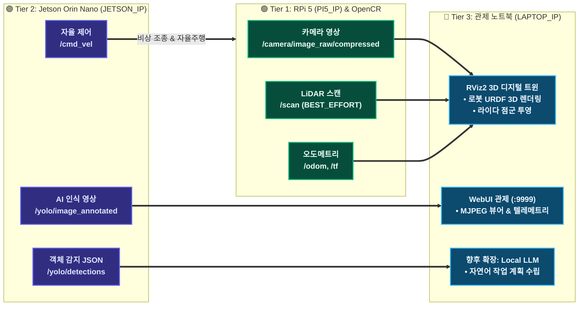

# 🧠 관제 노트북(Host PC) 기능별·역할별 기술 분석 보고서
### (3D Digital Twin, Docker GUI Offloading, Time-Sync Architecture & Future LLM Integration)

- **점검일**: 2026-11-24
- **문서 위치**: `docs/2_tiers/tier3_control_laptop/web_services.md`
- **대상 기기**: 관제 노트북 (Local Host PC @ `<LAPTOP_IP>`)
- **목적**: 3-Tier 로봇 분산 시스템의 HMI(인간-기계 인터페이스), 3D 디지털 트윈 관제기, 시뮬레이터로서의 엔지니어링 설계 및 문제 해결 명세를 체계화.

### 📋 문서 버전 관리 (Document Version Control)
| 문서&nbsp;버전 | 개정&nbsp;일자 | 작성자 | 문서&nbsp;상태 | 변경 및 개정 내역 |
| :---: | :---: | :---: | :---: | :--- |
| `v1.0.0` | 26.10.27 | ROS2_JW | Approved | • Docker GPU 패스스루, Gazebo 시간 충돌 해결 및 LLM 확장 분석서 제정 |
| `v1.2.0` | 26.11.04 | ROS2_JW | Approved | • `yolo_monitor_viewer.py` HUD 뷰어, 하이브리드 도커 런처 및 Zero-Dependency 원칙 수립 |
| `v1.3.0` | 26.11.05 | ROS2_JW | Approved | • `:9999` WebUI 관제 서버(`ThreadingHTTPServer`) 및 비동기 MJPEG·텔레메트리 분리 |
| `v1.3.1` | 26.11.05 | ROS2_JW | Approved | • 상주 웹 서비스(`:5555`, `:7777`, `:9999`, `:9418`) `systemd --user` 자동 부팅 명세 |
| `v1.4.0` | 26.11.09 | ROS2_JW | Approved | • WebUI 실시간 모터 토크 제어(`POST /api/motor/torque`) 및 Pi 5 로컬 Nav2/SLAM 연동 |
| `v1.4.1` | 26.11.16 | ROS2_JW | Approved | • WebUI PIN 인증 Nav2/SLAM 전환, 즉시 정지·`relocalize`·`full_reset` 및 대시보드 UX 개편 |
| `v1.4.2` | 26.11.17 | ROS2_JW | Approved | • `/map` 3열 가두리·순찰/Teleop API, `10.8V/11.0V` 상단 전압바 및 `foxglove-bridge.service` 자동 기동 |
| `v1.4.5` | 26.11.18 | ROS2_JW | Approved | • `/map` `/api/map/hazard_zones` 위험구간 저장, `/api/nav_goal` 단일 WP 이동, `/api/nav_cancel` 브레이크<br>• E-STOP/모터 ON 복구, 주행 가능 배지 및 태블릿 UX 개선 |
| `v1.4.6` | 26.11.18 | ROS2_JW | Approved | • `/` 기본 실시간 맵(`map.html`) 전환(`/dashboard` 분리), `WP`/`위험구간` 2-Tab<br>• 대시보드 3단 VLM 채팅창(`/api/vlm/ask` + TTS 연동) |
| `v1.4.7` | 26.11.19 | ROS2_JW | Approved | • `/api/patrol` 선택 WP(`selected_indices`), `LOCALIZING`(`위치 찾기 중...`) 배지, `FOLLOWING`·순찰 목표 배지 우선순위 교정 |
| `v1.4.8` | 26.11.20 | ROS2_JW | Approved | • 원본 JPEG 패스스루(`/video_feed`) + 브라우저 `<canvas>` YOLO 오버레이(`/api/yolo`, `yolo_overlay.js`)<br>• `IS_PI5_LOCAL` Pi 5(`<PI5_IP>:9999`) 듀얼 모드<br>• 지정순찰모드(`custom_order`) 및 `/map` 모바일 세로 스크롤 교정 |
| `v1.4.9` | 26.11.23 | ROS2_JW | Approved | • `<canvas>` 바닥장애물(`/vision/floor_obstacles`)·제스처/ArUco 진행 배지 오버레이<br>• 👍 Nav2+자동순찰/✋ Nav2 종료 비동기 핸들러<br>• `🔌 현재 위치 충전소 지정`(`set_dock`) 및 OpenCR `NO_CONNECT` 시 상단 `🔴 OpenCR OFF` 교정 반영 |
| `v1.4.10` | 26.11.24 | ROS2_JW | Approved | • Pi 5 `:9999` `jta-web-monitor.service` & `inner_webui_launch.sh` 레포 1:1 백업 경로 링크 동기화 |
| **`v1.4.12`** | 26.11.24 | **ROS2_JW** | **Approved** | • 원자적 비상정지(`POST /api/estop`), 로컬 `/tailwind.js`(398KB) 100% 오프라인화, `Condition` 이벤트 기반 MJPEG, `mtime` 캐싱, SLAM `tf2_ros` 폴백, `IS_WEB_MASTER` 게이트<br>• `/api/yolo` 사람 카운트다운 HUD(`3s/30s/50s`), 실측 `/pi5/system_state`·`/jetson/system_state` 텔레메트리, Keepout `0.15m`·`turn_seq` 경합 방지 반영 |
| `v2.0.0` | (예정) | ROS2_JW | 계획&nbsp;(Planned) | • 의자 다리 학습용 합성 이미지 생성 및 RTX 4070 VLM 오토 라벨링 수록 |

---

## 1. 🏗️ 3-Tier 분산 시스템에서의 역할 분담 (Tier 3 Architecture)

노트북은 **Tier 3 (통합 모니터링, HMI, 3D 디지털 트윈 및 고수준 의사결정 허브)**로서 로봇의 물리적인 주행 부담 없이 대용량 시각화와 사용자 입력을 전담합니다.



---

## 2. 🖥️ 하드웨어 컴포넌트별 상세 기능 및 역할 분석

| 하드웨어 항목 | 장착 스펙 | 시스템 내 기능 및 엔지니어링 역할 (Functional Role) |
| :--- | :--- | :--- |
| **CPU** | **12th Gen Intel Core i7-12700H** (14코어 20스레드, 최대 4.7GHz) | • **P-코어(성능) + E-코어(효율) 하이브리드 구조**<br>• 백그라운드 CycloneDDS 통신 I/O 스레드와 Lichtblick/RViz2 그래픽 렌더링 스레드를 분산 배치하여 0% CPU 렉 보장 |
| **RAM (메모리)** | **48 GB DDR5** (가용 **43 GiB**) | • 대규모 SLAM 지도 데이터 및 장시간 ROS 2 Bag 로깅 시 메모리 부족 원천 방지<br>• 향후 로봇 자연어 제어를 위한 온디바이스 LLM(7B~14B 모델)을 여유롭게 적재할 수 있는 풍부한 용량 확보 |
| **GPU** | **NVIDIA GeForce RTX 4070 Laptop (8GB GDDR6)** | • RViz2의 수천 개 3D 포인트 클라우드, 메시 모델, 고주기 카메라 텍스처를 60 FPS 이상으로 하드웨어 렌더링<br>• 도커 컨테이너 내부로 GPU를 오프로딩하여 부드러운 HMI 사용자 경험 제공 |
| **스토리지** | Micron 512GB NVMe SSD (여유 **233 GB**) | • 초당 수백 MB에 달하는 센서 로깅(Bag) 시 스토리지 쓰기 버퍼 병목 없는 초고속 I/O 보장 |
| **네트워크** | Wi-Fi 6 / 6E 무선 어댑터 | • 5GHz 저간섭 대역을 활용하여 RPi5(`<PI5_IP>`) 및 Jetson(`<JETSON_IP>`)과 2ms 미만의 핑 레이턴시로 1:1 유니캐스트 연결 유지 |

---

## 3. 🐳 Docker 가상화 및 GPU GUI 오프로딩 아키텍처

호스트 OS인 **Linux Mint 22.3 (Zena)**는 Ubuntu 24.04 LTS 기반이므로, 표준 ROS 2 Humble(Ubuntu 22.04 기반)을 완전한 격리 환경에서 구동하기 위해 Docker 가상화를 적용했습니다.

### ⚙️ 관제 전용 런처 (`ros2basic.sh`) 설계 분석
```bash
docker run -it --rm \
  --name ros2_humble_basic \
  --net=host \
  --ipc=host \
  --privileged \
  --gpus all \
  -e DISPLAY=$DISPLAY \
  -e __NV_PRIME_RENDER_OFFLOAD=1 \
  -e __GLX_VENDOR_LIBRARY_NAME=nvidia \
  -e QT_X11_NO_MITSHM=1 \
  -e ROS_DOMAIN_ID=30 \
  -e RMW_IMPLEMENTATION=rmw_cyclonedds_cpp \
  -e CYCLONEDDS_URI=file:///tmp/cyclonedds.xml \
  -v "$XML_PATH:/tmp/cyclonedds.xml:ro" \
  -v /tmp/.X11-unix:/tmp/.X11-unix:rw \
  -v $HOME/.Xauthority:/root/.Xauthority:rw \
  -v <REPO_ROOT>:/root/ros2_JTA:rw \
  ros2-humble-gazebo:latest bash
```

1. **하드웨어 3D 가속 패스스루**:
   - `--gpus all` 및 `-e __NV_PRIME_RENDER_OFFLOAD=1 -e __GLX_VENDOR_LIBRARY_NAME=nvidia`를 통해 내장 그래픽(Intel Iris Xe) 대신 **외장 NVIDIA RTX 4070 GPU를 강제 지정**하여 RViz2 3D 렌더링 부하를 전담시킵니다.
2. **X11 GUI 포워딩 최적화**:
   - `-v /tmp/.X11-unix:/tmp/.X11-unix`와 `QT_X11_NO_MITSHM=1`을 지정하여 공유 메모리 MIT-SHM 충돌을 방지하고 호스트 데스크톱 창에 RViz2 화면을 직접 표출합니다.
3. **호스트 네트워크 모드 (`--net=host`)**:
   - 가상 브리지 네트워크의 오버헤드를 없애고 RPi5 및 Jetson과의 1:1 UDP CycloneDDS 통신을 호스트 물리 카드(`wlo1`)와 100% 동일한 성능으로 연결합니다.

---

## 4. ⏱️ Gazebo 가상 시간 vs 실로봇 현실 시간(Wall-clock) 충돌 해결

### 🚨 트러블슈팅: RViz2 10초 주기 프리징 및 화면 깜빡임 현상
- **원인 규명**:
  - 초기 시뮬레이션 환경(`rros2gaz.sh`)에서 Gazebo가 실행되면서 `/clock` 토픽으로 가상 시간(Simulation Time)을 발행하고 있었습니다.
  - 이 상태에서 실로봇(라즈베리파이 5)의 센서 패킷(LiDAR, 카메라, 오도메트리)은 **현실 세계 시간(Wall-clock Time)** 타임스탬프를 찍고 전송되었습니다.
  - ROS 2의 TF2 변환 엔진이 **"미래 시간의 데이터(Extrapolation into the future)"**로 인식하여 TF 변환에 실패하고, RViz2에서 10초 주기로 화면이 멈추거나 깜빡이는 치명적인 시간 비동기화가 발생했습니다.
- **엔지니어링 해결**:
  - 시뮬레이션용 스크립트(`rros2gaz.sh`)와 실로봇 전용 관제 스크립트(`ros2basic.sh`)를 완전히 분리.
  - `ros2basic.sh`에서는 **Gazebo 가상 시뮬레이터를 전면 제거**하고 순수 현실 시간(`use_sim_time:=false`)만 사용하도록 격리하여 TF 비동기화 및 화면 깜빡임을 100% 해결했습니다.

---

## 5. 📡 수신/모니터링 토픽 파이프라인

| 토픽명 | 송신원 (Source) | 노트북에서의 처리 및 시각화 (Visualization) |
| :--- | :--- | :--- |
| **`/camera/image_raw/compressed`** | 라즈베리파이 5 (`<PI5_IP>`) | WebUI / Lichtblick / RViz2: 640x480 JPEG(Q90) 15 FPS 실시간 전방 카메라 스트림 (`/camera/image_raw` On-Demand) |
| **`/yolo/image_annotated`** | Jetson Orin Nano (`<JETSON_IP>`) | RViz2 `Image` 디스플레이: GPU 가속 바운딩 박스가 그려진 AI 인식 결과 영상 |
| **`/yolo/detections`** | Jetson Orin Nano (`<JETSON_IP>`) | WebUI `<canvas>` 오버레이(`/api/yolo`, 사람 카운트다운 HUD) 및 텍스트 모니터링 |
| **`/vision/floor_obstacles`, `/gesture/state`** | Jetson Orin Nano (`<JETSON_IP>`) | WebUI `<canvas>` 바닥장애물 마커 및 ArUco/한손 제스처 진행 배지 표출 |
| **`/pi5/system_state`, `/jetson/system_state`** | Pi 5 (`<PI5_IP>`) / Jetson (`<JETSON_IP>`) | WebUI 대시보드 실측 `vcgencmd get_throttled`(Pi 5) · RAM/Swap/온도(Jetson) 실시간 표출 |
| **`/scan`** | 라즈베리파이 5 (`<PI5_IP>`) | RViz2 / WebUI 2D 맵(`tf2` SLAM 폴백): 360도 2D 레이저 점군 뷰 |
| **`/odom`, `/tf`** | 라즈베리파이 5 (`<PI5_IP>`) | RViz2 `RobotModel` & `TF`: 로봇의 실시간 3D 자세 및 주행 궤적 표출 |
| **`/cmd_vel`** | 관제 노트북 (노트북 직접 발행) | `teleop_twist_keyboard`를 통한 비상 원격 수동 주행 제어 |

---

## 6. 🚀 향후 확장: 온디바이스 LLM / SLM 로봇 태스크 플래닝

관제 노트북은 **48GB 고용량 RAM과 RTX 4070 (8GB VRAM)**을 보유하고 있어, 단순 3D 시각화를 넘어 **자율주행 상위 의사결정 브레인(VLM/LLM)**으로 확장이 가능하도록 인프라가 준비되어 있습니다:

- **데이터 파이프라인**:
  1. Jetson Orin Nano가 발행하는 **`/yolo/detections`** (예: `"cup(0.89), chair(0.75)"`)를 노트북의 Ollama(Llama-3 / Mistral 7B)가 실시간 구독.
  2. 사용자가 자연어로 `"책상 위에 있는 컵 쪽으로 이동해"`라고 명령하면, LLM이 검출된 사물 좌표와 `/odom` 위치를 매핑하여 Nav2 Goal 좌표를 생성하고 로봇에게 자율 주행 명령을 하달하는 시스템으로 즉시 확장이 가능합니다.

---

## 7. 🌐 노트북(Tier 3) 상주 웹 서비스 및 무인 자동화 인프라

관제 노트북은 단일 RViz2 뷰어에 국한되지 않고, 개발 현장과 원격 관제를 동시에 지원하는 **3대 핵심 웹 서비스 및 Git 네트워크 데몬**을 호스트 `systemd --user` 데몬(`Linger=yes`)을 통해 24시간 무인 가동합니다:

| 포트 | 서비스명 | systemd 유닛 / 실행 파일 | 엔지니어링 역할 및 주요 기능 |
| :---: | :---: | :--- | :--- |
| **`:5555`** | **Git&nbsp;Web&nbsp;Viewer** | `git-web-viewer.service`<br>[`~/.local/bin/git_web_viewer.py`](file://~/.local/bin/git_web_viewer.py) | • **깃 커밋 & 브랜치 시각화**: `ros2_JTA` 전체 커밋 히스토리 및 브랜치 분기점 웹 뷰어<br>• **코드 Diff 및 파일 트리**: 브라우저에서 작업 변경점 및 소스 코드 실시간 열람 |
| **`:7777`** | **Markdown&nbsp;Docs&nbsp;Viewer** | `md-viewer.service`<br>[`~/.local/bin/md_viewer.py`](file://~/.local/bin/md_viewer.py) | • **프로젝트 문서화 포털**: `docs/1_master/` · `docs/2_tiers/` 전체 명세서 렌더링<br>• **작업 일지 뷰어**: `docs/3_daily_review/` 일일 개발 일지 목차 및 내용 탐색 |
| **`:9999`** | **JTA&nbsp;WebUI** | Pi 5 [`src/pi5/scripts/jta-web-monitor.service`](../../../src/pi5/scripts/jta-web-monitor.service) (`User=<PI_USER>`, `Restart=always`, `RestartSec=5`, `ExecStartPre`/`ExecStopPost` 포트 정리 ➔ [`src/pi5/scripts/inner_webui_launch.sh`](../../../src/pi5/scripts/inner_webui_launch.sh) Distrobox `humble` + CycloneDDS ➔ `~/jta_web/web_monitor_server.py`)<br>[`src/laptop/web/web_monitor_server.py`](../../../src/laptop/web/web_monitor_server.py) | • **Pi 5(`:9999`) 독립 호스팅 & 100% 오프라인 동작 (`v1.4.12`)**: 외부 CDN 제거 후 로컬 `/tailwind.js`(398KB) 서빙, `IS_WEB_MASTER` 게이트로 Pi 5/노트북 듀얼 WebUI 제스처 중복 충돌 차단<br>• **고성능 스트리밍 & `<canvas>` HUD**: `threading.Condition` 이벤트 기반 원본 JPEG 패스스루(`/video_feed`) + `mtime` 파일 캐싱 + `/api/yolo` (`yolo_overlay.js`: YOLO 박스 + 바닥장애물 + ArUco/제스처 진행 배지 + **사람 감지 카운트다운 HUD `3s/30s/50s`**)<br>• **원자적 안전 제어 & SLAM/맵 정합**: `POST /api/estop` 원자적 비상정지(순찰·Nav2 취소 + `/cmd_vel=0` ×5 + 토크 OFF), `nav2_start`/`slam_start` 사전 정지, `tf2_ros`(`map->base_footprint`) SLAM 실시간 위치/라이다 폴백, Keepout 선분 폭 `0.15m` 정합, `turn_seq` 선회-주행 경합 방지<br>• **3.0초 Watchdog & 실측 텔레메트리**: OpenCR `NO_CONNECT` 전환 시 즉시 `🔴 OpenCR OFF` 초기화, `/pi5/system_state`(실측 `vcgencmd get_throttled` hex·한국어 라벨) 및 `/jetson/system_state`(실측 RAM/Swap/온도) 표출 |
| **`:9418`** | **Git&nbsp;Network&nbsp;Daemon** | `git-daemon.service`<br>`/usr/lib/git-core/git-daemon` | • **로봇 기기 간 무인 Git 동기화**: Pi 5(`<PI5_IP>`)와 Jetson(`<JETSON_IP>`)에서 계정 비밀번호 없이 초고속 `git clone / pull` 지원 |

