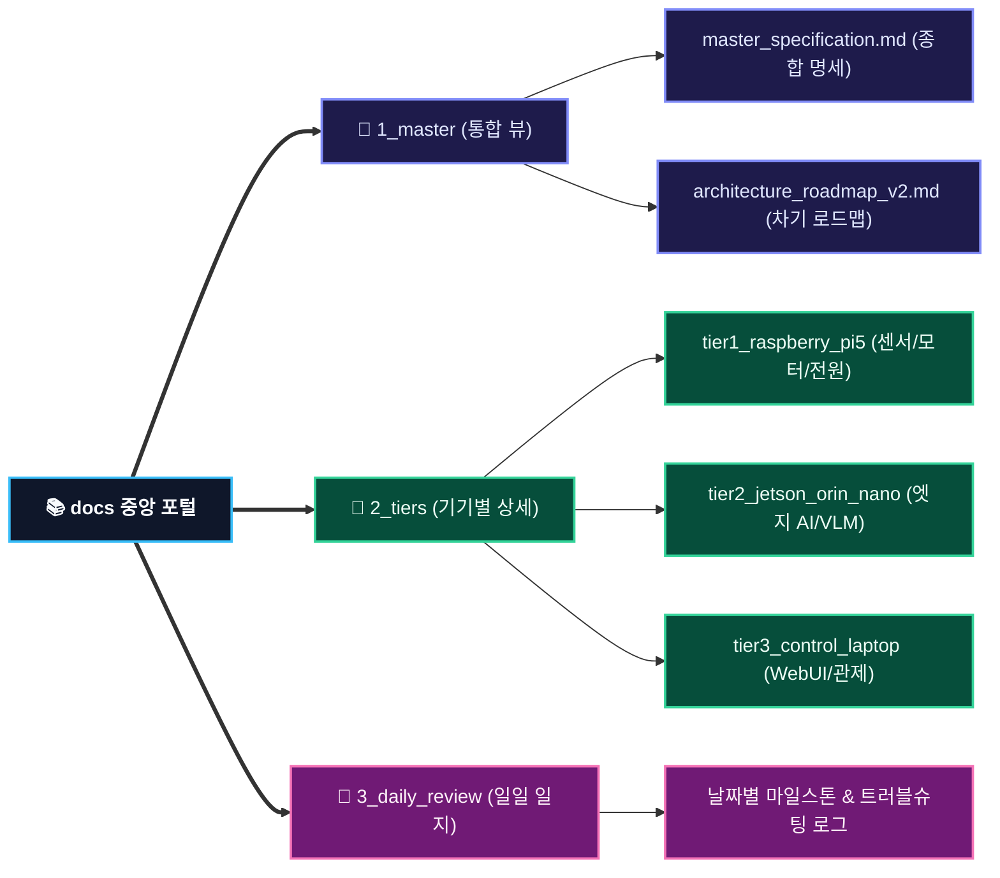

# 📚 ros2_JTA 중앙 기술 문서 포털 (Documentation Hub)

> **환영합니다!** 이 문서는 `ros2_JTA` 3-Tier 분산 자율주행 로봇 시스템의 모든 아키텍처 명세서, 기기별 하드웨어/소프트웨어 분석서 및 일일 개발 일지를 한눈에 탐색할 수 있는 **중앙 내비게이션 포털**입니다.  
> **엔지니어**: `ROS2_JW` | **점검일**: 2026-11-24

### 📋 문서 버전 관리 (Document Version Control)
| 문서&nbsp;버전 | 개정&nbsp;일자 | 작성자 | 문서&nbsp;상태 | 변경 및 개정 내역 |
| :---: | :---: | :---: | :---: | :--- |
| `v1.0.0` | 26.11.05 | ROS2_JW | Approved | • `docs/` 4대 티어(1_master, 2_tiers, 3_daily_review, 4_career) 중앙 포털 최초 신설 |
| `v1.4.1` | 26.11.16 | ROS2_JW | Approved | • CycloneDDS Unicast Peer, Lichtblick 관제, WebUI Nav2/SLAM 통합 일지 및 점검일 전수 동기화 |
| `v1.4.2` | 26.11.17 | ROS2_JW | Approved | • `patrol_node` 다중 웨이포인트 순찰, WebUI `/map` 3열 가두리·전압바, `foxglove-bridge.service` 자동 기동 및 AMCL 복구 반영 |
| `v1.4.3` | 26.11.17 | ROS2_JW | Approved | • `vlm_service_node.py` Option A(이벤트 우선 + 경량 추론) 튜닝 및 전체 문서 체계 전수 정합성 동기화 |
| `v1.4.4` | 26.11.17 | ROS2_JW | Approved | • Nav2 로컬 컨트롤러 `MPPIController` 전환 (`nav2_params.yaml` Pi 5 경량 튜닝) 반영 |
| `v1.4.5` | 26.11.18 | ROS2_JW | Approved | • MPPI 실주행 검증, Costmap 좁은 틈 우회 완화 튜닝, Keepout/Speed 마스크, WebUI `/map` 태블릿 관제 고도화 반영 |
| `v1.4.6` | 26.11.18 | ROS2_JW | Approved | • WebUI `/` 기본 실시간 맵 전환·`WP`/`위험구간` 2-Tab·대시보드 3단 VLM 채팅창(TTS 연동) 및 Jetson VLM `640×480` 순수 시각 우선 반영 |
| `v1.4.7` | 26.11.19 | ROS2_JW | Approved | • Nav2 `behavior_server` 정정·좁은공간 탈출 튜닝, AMCL 맵 정리·확장 • 최단거리/선택 WP/3초확정 음성·20초 추종(40초 쿨다운, IDLE 포함), WebUI `LOCALIZING`·배지 교정 • 전 문서 `Approved`/`26-xx-xx` 표준화 |
| `v1.4.8` | 26.11.20 | ROS2_JW | Approved | • WebUI 원본 JPEG 패스스루 + `<canvas>` YOLO 오버레이, `IS_PI5_LOCAL` Pi 5(`:9999`) 이전 • 지정순찰(`custom_order`)·부팅 볼륨(`80%→95%`)·`1.7m` 통일 반영 |
| `v1.4.9` | 26.11.23 | ROS2_JW | Approved | • 상시 바닥장애물(`/vision/scan`), ArUco 카드(`0~10`)+한손(✋/👍) Nav2·자동순찰 제어, `10.5V` 저전압 `dock` 복귀 • `OpenCR OFF` UI 교정 및 `1.2m/30s/50s` 통일 |
| **`v1.4.10`** | 26.11.24 | **ROS2_JW** | **Approved** | • Pi 5·Jetson 실기 스크립트/설정/마스크 1:1 백업 & `launch_yolo11n.sh` 배포 동기화 • `speaker_node.py` 랜덤 부팅곡(`~/music/song`)+인트로 TTS 및 `dobingda.mp3` Edge-TTS 안내 음성 대체 |

---

## 🗺️ 전체 문서 디렉토리 맵

---

## 1. 🌟 전체 시스템 통합 뷰 (`docs/1_master/`)

전체 로봇 시스템의 거시적 구조와 향후 고도화 목표를 확인할 때 가장 먼저 열람하는 문서입니다:

* **[master_specification.md](1_master/master_specification.md)**  
  3-Tier 시스템(Pi 5 + Jetson + Laptop)의 통신 토폴로지, 토픽 계약, 하드웨어 스펙, 시리얼 포트 및 트러블슈팅을 총망라한 **단일 진실 공급원(Single Source of Truth) 통합 명세서**. (작성자: `ROS2_JW`, 인쇄/PDF 지원)
* **[architecture_roadmap_v2.md](1_master/architecture_roadmap_v2.md)**  
  Pi 5 전원 완전 분리, Pi 5 로컬 폐쇄 루프(Nav2 + SLAM), 경사로 단차 낙상 방지(Keep-out Zone), 20평 컴퓨터실 3cm 의자 다리 회피 등 **순수 차기 고도화 계획 및 연구 과제**. (작성자: `ROS2_JW`)

---

## 2. 🤖 3-Tier 기기별 심층 기술 분석서 (`docs/2_tiers/`)

현재 100% 구현되어 실전 가동 중인 기기별 하드웨어·소프트웨어 전문 명세서입니다:

### 🍓 Tier 1: 센서 & 구동계 ([`docs/2_tiers/tier1_raspberry_pi5/`](2_tiers/tier1_raspberry_pi5/))
* **[hardware_and_power.md](2_tiers/tier1_raspberry_pi5/hardware_and_power.md)**: Pi 5 스펙, CSI 카메라 저지연 파이프라인(640x480 Q90 15 FPS), 5.2V 5A 전원 구성 및 `10.5V` 저전압 `dock` 복귀.
* **[opencr_and_motor.md](2_tiers/tier1_raspberry_pi5/opencr_and_motor.md)**: OpenCR 1.0 펌웨어, 모터 PID 제어, 1Mbps 시리얼 CDC ACM 통신, `10.5V` 복귀 & `OpenCR OFF` 단절 감시.
* **[jta_bringup_package.md](2_tiers/tier1_raspberry_pi5/jta_bringup_package.md)**: `jta_bringup` 통합 패키지, `MPPI` + `vision_scan` 바닥 회피, `patrol_node`(지정순찰·`1.2m/30s/50s` 추종·ArUco·`10.5V` `dock`) 및 무인 부팅(`Linger`).

### ⚡ Tier 2: 엣지 AI 브레인 ([`docs/2_tiers/tier2_jetson_orin_nano/`](2_tiers/tier2_jetson_orin_nano/))
* **[hardware_and_docker.md](2_tiers/tier2_jetson_orin_nano/hardware_and_docker.md)**: Jetson Orin Nano 스펙, TUI 모드, 16GB NVMe Swap, `mediapipe==0.10.18` 격리 설치 및 Docker 환경.
* **[yolo11n_package.md](2_tiers/tier2_jetson_orin_nano/yolo11n_package.md)**: `yolo11n` ROS 2 패키지, 0.1ms JSON 경량 발행 및 `launch_yolo11n.sh` 통합 자동 기동.
* **[vlm_tts_service.md](2_tiers/tier2_jetson_orin_nano/vlm_tts_service.md)**: Qwen2-VL 4-bit 상주(`640×480`·`40 tokens`), `1.2m` 근접 트리거, 상시 바닥장애물(`floor_obstacle_node`) & ArUco/한손 제어(`gesture_node`).

### 💻 Tier 3: 통합 관제 & HMI ([`docs/2_tiers/tier3_control_laptop/`](2_tiers/tier3_control_laptop/))
* **[host_and_rviz2.md](2_tiers/tier3_control_laptop/host_and_rviz2.md)**: i7-12700H 노트북 스펙, 무소음 iGPU 관제(`ros2basic_nonNV.sh`), Lichtblick(`:8765`) & Pi 5 WebUI 호스팅 전환.
* **[web_services.md](2_tiers/tier3_control_laptop/web_services.md)**: Pi 5 WebUI(`:9999`, 패스스루+`<canvas>`·`set_dock`·`OpenCR OFF`·👍/✋), Git 뷰어(`:5555`), 문서 뷰어(`:7777`), Git 데몬(`:9418`).
* **[hud_monitor_viewer.md](2_tiers/tier3_control_laptop/hud_monitor_viewer.md)**: 초경량 OpenCV 네이티브 HUD 뷰어(`yolo_monitor_viewer.py`), 18650 배터리 전압/게이지 및 라이다 실시간 오버레이.

---

## 3. 📝 일일 개발 일지 (`docs/3_daily_review/`)

매일 수행한 실제 작업 내역, 트러블슈팅 과정 및 검증 결과가 일자별로 투명하게 기록된 일지 모음입니다:

* **[2026-11-24 일지](3_daily_review/2026-11-24_실기스크립트백업_랜덤부팅세레머니_음원개선.md)**: Pi 5(13종)·Jetson(5종) 실기 스크립트/설정/마스크 1:1 백업, `launch_yolo11n.sh` 배포 동기화, `speaker_node.py` `~/music/song` 랜덤 부팅곡 + 인트로 TTS 및 `dobingda.mp3` Edge-TTS 안내 음성 대체 (`v1.4.10`).
* **[2026-11-23 일지](3_daily_review/2026-11-23_바닥장애물_ArUco제스처_저전압복귀.md)**: 상시 바닥 장애물 감지(`/vision/scan`) 튜닝, ArUco 숫자 카드(`ID 0~10`) + 한 손(✋/👍) Nav2·자동순찰 제어, OpenCR `10.5V` 저전압 `dock` 복귀, 단절 UI 교정 및 `1.2m/30s/50s` 통일 (`v1.4.9`).
* **[2026-11-20 일지](3_daily_review/2026-11-20_WebUI패스스루Pi5이전및순찰추종고도화.md)**: WebUI 원본 JPEG 패스스루 + `<canvas>` YOLO 오버레이, Pi 5(`:9999`) 로컬 이전, 지정순찰(`custom_order`)·부팅 볼륨(`80%→95%`)·`1.7m` 통일 (`v1.4.8`).
* **[2026-11-19 일지](3_daily_review/2026-11-19_Nav2타이트튜닝및순찰고도화.md)**: Nav2 `behavior_server` 정정·좁은공간 탈출 튜닝(`robot_radius 0.145`), `my_map_261113.pgm` 정리·우측 확장, 최단거리/선택 WP/3초확정 음성·20초 사람추종(40초 쿨다운, IDLE 포함), WebUI `LOCALIZING`·배지 교정 및 전 문서 `Approved`/`26-xx-xx` 표준화.
* **[2026-11-18 일지](3_daily_review/2026-11-18_MPPI실주행검증.md)**: `MPPIController` Pi 5 실주행 부하 검증(CPU 37.1%), `sync_to_robot.sh` 보강, Nav2 Costmap 우회 완화·`KeepoutFilter`/`SpeedFilter`, WebUI `/` 기본맵·2-Tab·`/api/map/hazard_zones`·`/api/nav_goal`·`/api/nav_cancel`·대시보드 3단 VLM 채팅창(TTS) 및 Jetson VLM `640×480` 고도화.
* **[2026-11-17 일지](3_daily_review/2026-11-17_다중웨이포인트순찰및AMCL복구.md)**: 다중 웨이포인트 순찰(`patrol_node`), `speaker_node` `dmix`/`stop`, WebUI `/map` 3열 가두리·전압바, `foxglove-bridge.service` 자동 기동, AMCL 복구, VLM Option A 및 Nav2 `MPPIController` 전환.
* **[2026-11-16 일지 (2차)](3_daily_review/2026-11-16_CycloneDDS전환및Nav2WebUI통합.md)**: CycloneDDS Unicast Peer 3-Tier 전면 전환(`config/cyclonedds.xml`), `jta_bringup` Nav2 & `auto_localizer` 통합, `:9999` WebUI PIN 인증 기반 Nav2/SLAM 상호 인터락 제어 및 Lichtblick `map` 고정.
* **[2026-11-16 일지 (1차)](3_daily_review/2026-11-16_Lichtblick관제및라이다복구.md)**: RViz2 대체 `Lichtblick v1.30.0 + foxglove_bridge` 구축(`config/lichtblick_nav2_slam.json`), `/tf_static` 재구독 해결 및 LDS-01 `1.617m` 하드웨어 락업 USB 리셋 복구(`unique_cnt: 266`).
* **[2026-11-13 일지 (오후)](3_daily_review/2026-11-13_SLAM맵핑및Nav2자율주행실증.md)**: 신규 SLAM 지도(`my_map_261113`) 생성, FastDDS Discovery Server(`<PI5_IP>:11811`) 3-Tier 영구 전환, Nav2 자율주행 실증 및 안전 마진(`robot_radius: 0.24`) 튜닝.
* **[2026-11-13 일지 (오전)](3_daily_review/2026-11-13_카메라FPS최적화및젯슨MAXN.md)**: Pi 5 카메라 15 FPS 최적화 및 열 쓰로틀링 해제, Jetson Orin Nano Super MAXN_SUPER 풀파워 승격.
* **[2026-11-12 일지](3_daily_review/2026-11-12_라이다VLM센서퓨전.md)**: 라이다-YOLO-VLM 3대 센서 퓨전(1.5m 사람 접근 실측 경보), VLM 상시 연속 가동 루프(4~6초), 0초 즉답 캐싱(2ms), 20초 쿨다운 디바운스 및 2분 인터벌 브리핑 구축.
* **[2026-11-11 일지](3_daily_review/2026-11-11_VLM단문브리핑실증.md)**: 3-Tier 무인 브리핑 풀 루프 실증, 간결한 단문 요약(사물+개수) 프롬프트 개편, 2-Tier 비전 그라운딩 좌표 노이즈 방탄 필터 구축.
* **[2026-11-10 일지](3_daily_review/2026-11-10_FastDDS_SHM및원클릭SLAM계획.md)**: FastDDS SHM 하이브리드 트랜스포트 선언, Jetson Orin Nano VLM 4-bit NF4 경량화(VRAM 1.42GB) 실증, Pi 5 선희 성우(Edge-TTS) 탑재, AGENTS.md 제0조(Hard Brake Rule) 신설.
* **[2026-11-09 일지](3_daily_review/2026-11-09_전원검증및SLAM지도생성.md)**: Pi 5 벅 컨버터(5.2V 5A) 실측(0x0), OpenCR 모터 부팅 폭주 방지 가드레일, 2D SLAM 실측 점유 지도 획득 및 정중앙 대칭 정렬, 오프라인 RViz2 맵 뷰어 구축, Pi 5 로컬 Nav2 풀 스택 구축.
* **[2026-11-06 일지](3_daily_review/2026-11-06_WebUI개선및VLM양자화규약.md)**: WebUI 4:3 뷰포트 & YOLO 바운딩박스 정밀 오버레이, Jetson Orin Nano VLM 4-bit 양자화 VRAM 다이어트 규약 수립.
* **[2026-11-05 일지](3_daily_review/2026-11-05_관제웹UI구축.md)**: WebUI 반응형 관제 고도화, 바운딩박스 복원, 다이어그램 테마 리팩토링 및 시스템 통합 리네이밍.
* **[2026-11-04 일지](3_daily_review/2026-11-04_VLM음성및전원.md)**: VLM-TTS 음성 브리핑 실증, 오토스타트 복구 및 하드웨어 전원 진단.
* **[2026-11-03 일지](3_daily_review/2026-11-03_비전VLM구축.md)**: 비전 파이프라인 초경량화 및 젯슨 엣지 AI/VLM 환경 구축.

---

> 💡 **웹 뷰어 지원**: 본 문서들은 브라우저(`http://<LAPTOP_IP>:7777`)에서 아름다운 마크다운 테마와 다이어그램(Mermaid)으로 실시간 렌더링되어 열람할 수 있습니다.
